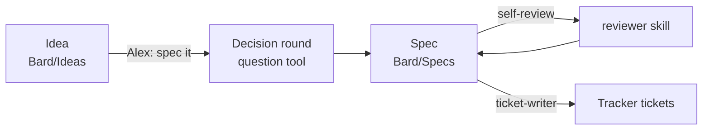

# Specs (`Bard/Specs/`)

A spec is an idea that Alex chose to build, written as a contract someone can cut tickets from.
It sits between an idea and the tracker. Why a separate folder: an idea says what could be, a
spec says what will be built and how we know it is done. Mixed with ideas, the decided work
and the proposals blur.



## When to write a spec

Only when Alex asks: `/bard spec <idea>`, "build this idea as a spec", "spec it". Never in a
sweep, and never on bard's own judgment. A spec commits work, and that is Alex's call.

A spec usually starts from an idea note. It can start from a conversation when Alex asks for it
directly. Then write the idea note too, so every spec has an idea with the problem and the
"why".

## Before writing: ask, do not guess

1. Read the idea note and every note it links.
2. List every open choice the spec depends on: the idea's `## Open questions`, plus any fork
   you find while drafting.
3. **Facts are your job.** Look them up first (vault notes, the repo, the `search` skill).
4. **Decisions go to Alex** through the `question` tool, in rounds. Recommended option first,
   with the why in its description. A choice with one plausible answer is not a question:
   decide it and record why.
5. Write the spec only after every choice the spec depends on is answered. A choice left open
   on purpose goes in `## Still open` with who must answer it.

## Format

The OKF envelope (SKILL.md STEP 3) plus `status` and `idea`:

```yaml
type: spec
status: draft             # draft | ready | ticketed | shipped | superseded
title: "[SERVICE-NAME] <outcome, not activity>"
description: <one line: what it delivers and the key decisions>
up: "[[Topic Hub]]"
idea: "[[<Idea note title>]]"
tags: [spec, topic/x, bard/new]
timestamp: <ISO 8601: now>
source: <session_id>
repo: <repo>              # when known
resource: ""              # a real verified URL, or omit
```

- `draft`: written, not yet reviewed or not yet re-checked against the repo.
- `ready`: reviewed, repo facts re-checked, someone could cut tickets tomorrow.
- `ticketed`: tickets exist. Link each in `## 6. Resources`.
- `shipped`: the work is done. Link the PR or the impact note.
- `superseded`: a later spec or decision replaced it. Link the replacement. Keep the note.

Body, in this order:

1. A one-line banner when any "today" fact came from vault notes and not from the repo:
   `> Draft written from vault notes ... Re-check them before tickets are cut.`
2. `## Decisions (<date>)`: a table of `# | Decision | Why`. Every answer from the question
   rounds goes here, with its reason.
3. The six sections of the ticket-writer template, as `## 1.` to `## 6.`: Intent and success
   criteria (objective plus Given/When/Then ACs), Constraints and guardrails, Technical
   interface, Logic and implementation flow, Validation steps, Resources and team context.
   Template: [ticket-writer template](../../ticket-writer/references/template.md).
4. `## Still open`: facts still to find, and who must answer.

Mermaid for every flow, sequence, or state machine. Each AC must be testable without knowing
the implementation, and must not depend on a spike result: write "passes without X; record the
spike result here" instead of "if X exists".

## Provenance

The same rules as every note. Every fact about today (a path, a setting, a count, a limit) is
cited, or carries the date it was last seen and the note it came from. Every external claim
(a service limit, an API, a status) links its primary source. The design itself is the only
part that is not a fact.

## Self-review before handing over

Run the `reviewer` skill on the spec (docs layer) before you hand it over. Fix every Blocker
and Should-fix you can fix yourself, and list what you fixed. A fix that needs Alex's choice
becomes the next question round. Why: on 2026-11-22 the first draft of the dependency-agent spec
said a GitHub App permission blocked merges when it did not; the review caught it.

## Linking idea and spec

- The spec has `idea: "[[<idea>]]"`.
- The idea gets `spec: "[[<spec>]]"` and `status: specced`. This is the one status change bard
  makes on an idea, and only because Alex asked for the spec.
- Related specs link each other in `## 6. Resources`, with the reason ("depends on", "first
  agent that uses it").

## Editing a spec

Specs change in place, only when Alex asks ("add this", "D1 changed", "mark it ready").

- A changed decision: update the row and add the date and the new reason. Mark it
  `Under review` while a spike runs. Do not delete the old reason: write "replaces ...".
- Never change `status` on bard's own judgment.
- When a later idea or decision changes a spec, edit the spec in the same turn and say so, so
  the two never disagree.

## Where specs show up

`Bard.base` has a **Specs** view (`type == "spec"`, grouped by `status`), next to the Ideas
view. See [Obsidian setup](obsidian-setup.md).

## Filename

`Bard/Specs/<SERVICE-NAME> <outcome>.md`, sanitized with the same rules as every note
(SKILL.md, Filename convention). The frontmatter `title` keeps the `[SERVICE-NAME]` form; the
filename drops the brackets.

## Not this skill

- Cutting tracker tickets from a spec: `ticket-writer`.
- A spec that lives in a repo (`docs/`, `.canon/`): write it there with `coding`, not here.
