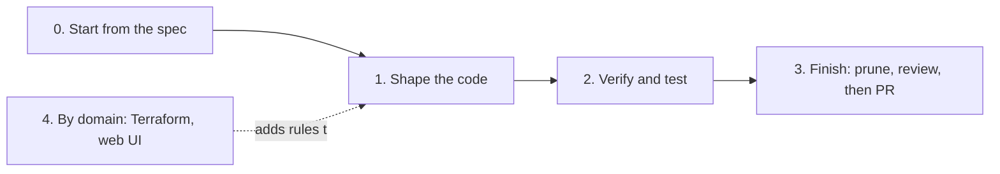
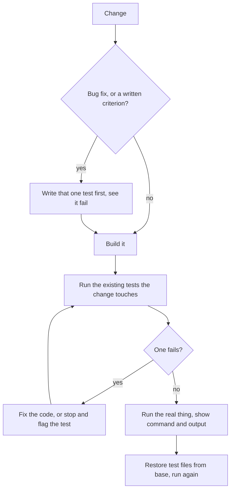

# Coding

## Asking

When you need a decision from Alex, ask through the `question` tool, not prose. One call
carries the whole round. The recommended option goes first, and its description carries the
why. Do not add a "type your own answer" option: the tool adds it. A decision with one
plausible answer is not a question, so decide it and say why. Where this skill defines its
own review or answer format, that format wins. If the host has no question tool, use
`❓ **Q1 - <title>**: ...` and `➡️ <answer and why>` in the same place.

How I code, from the first line to the PR. `AGENTS.md` and `CLAUDE.md` make every coding session load this file before it changes code or opens a PR. Follow the repo's own rules too. If they conflict with this file, stop and ask instead of guessing.

The rules in parts 0 to 3 apply to every language. A domain reference adds to them; it never overrides them.

## 0. Start from the spec

### Read before you build

- **Start a build from a spec or tickets only when I say so.** Planning and questions are fine before that; code is not.
- **Read the input first: the spec, the tickets, or both.** If the work is more than a small change and has no spec, say so and offer to write a short one first.
- **Read the repo before you touch it:** `CONTEXT.md` if it exists, the ADRs in the area you change, and the repo's own `AGENTS.md` or `CLAUDE.md`.

**Why:** a spec is the only place the why survives the session. A build that starts from memory of the chat builds what you remember, not what I asked for.

### Stay inside the slice

- **Do not fix problems outside the slice.** Report them and let me decide.
- **If a slice is too big for one session, stop and say so.** Cut it again instead of pushing through a full context window.

**Why:** scope creep in a slice is how a slice stops being demoable, and a half-done slice at the end of a context window is worse than a small finished one.

The start and review steps come from mattpocock/skills `implement`, rewritten.

## 1. Shape the code

### Make the smallest complete change

- **Before you write, list everything the change must reach:** every caller, test, fixture, config entry and export. For a bug fix, grep every caller of the function and fix the root cause once, in the shared code. This reach list is also how you find the existing tests to run in part 2.
- **Take the first option that fully works:**
  1. Does it need to exist? Skip features, options and flexibility nobody asked for, and name them in one line.
  2. Is it already in this codebase? Use the helper, component or pattern the way the code around it does.
  3. Does the standard library or the platform have it? Use it, unless the project has its own.
  4. Does a dependency already installed do it? Use it. Never add a dependency for a few lines.
  5. Otherwise, write the minimum code that works. One line, if a reader gets it at a glance.
- **Be lazy about the solution, never about the change.** Finish every part the reach list names. Code you move or merge keeps its error handling and validation.
- **Between options of the same size, take the one that is correct on edge cases.** Deletion beats addition. Keep the layers, interfaces and conventions the codebase already has.
- **Mark a shortcut with a known limit:** `shortcut: <the limit>, <when to upgrade>`.
- **Never cut:** validation at trust boundaries, error handling that prevents data loss, security, accessibility, or anything I asked for.
- **End the report with one or two lines:** what you skipped or did not check, and the risk I must know.

**Why:** every line we add is a line we maintain. Ponytail measured these rules on 39 agentic tasks: 53% less code, 26% less cost, and the same hidden checks passed (96% to 97%). That benchmark is the author's own. Its rule "leave one small test for new logic" is not here: part 2 decides which tests to write.

Adapted from [DietrichGebert/ponytail](https://github.com/DietrichGebert/ponytail/blob/ebd8654/skills/ponytail/SKILL.md) (MIT, `ebd8654`).

### Design for testability. Do not inject everything

- **Testable means controllable and observable.** Controllable: a test can cheaply reproduce the situations the code runs in. Observable: a test can see what the code did. If you can't do both, the design is the problem, not the test.
- **Put a seam only where the real dependency is non-deterministic or outside the process.** That list is short and predictable: clock, randomness, network, filesystem, database, environment variables, subprocesses, message queues. Everything else gets constructed directly.
- **Inject a dependency when one of these is true, not by default:** you genuinely need a second implementation, or you need to test how this code *interacts* with that collaborator. If neither holds, injecting it only complicates every caller.
- **Split newables from injectables.** Value objects and entities are newables: tests just build them. Services (things that *do* something: parsers, clients, repositories) are injectables. Never inject a service into a value object or entity; it makes the value object impossible to build without a mock.
- **Own the interface at the boundary.** Define the interface your code actually needs (`Clock`, `ArticleStore`), not a thin wrapper around the vendor's API. Unit-test the callers against a test double; write one integration test that exercises the real implementation, because that's the only place the vendor's real behaviour gets checked.
- **When something genuinely can't be tested, make it humble.** UI glue, framework entry points, async plumbing: move logic out until what remains is so small it's obviously correct by reading it. Test the logic you moved out; leave the humble part untested on purpose.
- **Never build a seam speculatively.** An interface with one implementation and no test double behind it is not flexibility, it's a maintenance cost. Add the seam when the second implementation or the test that needs it actually shows up. (How much testing a change warrants at all is the tests-and-docs rule in `AGENTS.md`; this section is only about how to shape the code so testing is possible.)
- **Say "seam" for where an interface lives, and "boundary" for a real external edge.** A seam is a place where behaviour can change without editing in that place. A boundary is where the system meets something you do not own, such as a vendor API or a database. Keep both words, but do not use "boundary" to mean the first thing: in domain-driven design it already means a bounded context.

**Why:** testability is a side effect of good design, not a goal you bolt on. Code that's easy to test usually has fewer dependencies and clearer contracts. But "inject everything" is the overengineering I hate: an interface per collaborator, almost all with exactly one implementation forever, and object graphs so big you need a framework to assemble them. Seams at real boundaries buy fast, deterministic tests. Seams everywhere else are pure cost.

Sources for the framing above: Feathers on seams, Beck on controllability, Hevery on newables vs injectables, Meszaros/Martin on the humble object, Fowler on non-determinism, Noback on owning your boundary interfaces.

### Be short on comments

- **Only comment when the why isn't obvious from the code.** No narrating what the code already says.

**Why:** models tend to over-comment, and I don't like it. Noisy comments bury the few that matter, and good names plus small functions already tell the what.

## 2. Verify and test

The evidence behind every rule here is in [verify-and-test evidence](references/verify-and-test-evidence.md).

### Verify by running the real thing

- **Prove every change by running it.** Run the real code path: the CLI, the service, the page in a browser, the script against real input. You pick how. Show the command and its real output. "It should work" is not proof.
- **Run the existing tests the change touches, and leave none of them failing.** Use the reach list from part 1 to find them. If a test already failed on the base branch, say so.
- **Locally, run only targeted tests. Never the full suite.** This holds for unit tests in every language, Playwright and other browser tests, and `tofu test` or `terraform test`. Name the test files, or filter by test name, with the runner's own flag (`pytest tests/test_cart.py`, `npx playwright test tests/login.spec.ts`). If no test covers the change, say so and ask before you run more.
- **The full suite runs in CI.** On a PR, read the CI result and report it. If no CI runs the full suite on this change (no workflow, or a push that skips it), say so and ask.
- **If you cannot run it, say so.** Mark it "not run", give the reason, and give the exact command that runs the real code path on sample input, with the output you expect. Running only the existing tests is not this command. Never claim a run you did not see.

**Why:** an agent stops when the work looks done. A run is a signal the agent did not write itself, and old tests left failing are where regressions cost the most. A full local run costs minutes and tokens on every change. Picking the tests the change touches is what cut regressions in one study (TDAD, in the evidence file). CI runs the full suite on a clean machine, so a local full run buys little.

### Do not write tests nobody asked for

- **Do not write a test that only the code suggests.** No unit test for a helper, no test "for coverage", and no characterization or snapshot test that records what the code does now.
- **Write a new test only in these cases:**
  - **A bug fix.** Write the repro test from the bug report, before the fix. See it fail for the right reason, then fix the code.
  - **A written acceptance criterion.** A spec or a ticket states the rule before the code exists. A chat request does not count, unless I ask for a test in it. Take each case and expected value from the criterion, not from the code. The test name says which criterion it guards.
- **Keep the existing behaviour tests as the guard.** Keep them green, fix them when they are wrong, and add a case when the change extends a rule they already guard.
- **Do not apply any of this to a throwaway script, a spike, a config value, or a pure rename.** Run it and show the output.
- **In delegated work, the orchestrator writes the allowed test and agrees its seam with me.** The worker gets both in its contract and writes no other test.

**Why:** a test the agent derives from its own code holds the same reading of the task as the code, so it confirms the error. Banning these tests cut cost with no loss in success, and generated regression tests locked in bugs for months.

### When an existing test fails

- **The code is wrong until you show otherwise.** Fix the code.
- **Change a test only when you can name the rule that changed, and I agreed.** If a test looks wrong, stop and flag it: name the test and say why. Do not edit it. In delegated work, return `blocked`.
- **Never delete, skip, or weaken a test to get green.** Never special-case a test's input in the code.
- **Before you trust a green run, restore the test files from base and run again:** `git checkout <base> -- <existing test paths>`. In delegated work the orchestrator does this. New test files are not on the base branch, so review them in the diff.

**Why:** agents edit tests to get green. Restoring from base works like read-only tests, which stopped most of that cheating. It does not catch special-casing, so the self-review looks for it.

### Write an allowed test first, at a seam

- **Agree the seam before you write the test,** unless your contract already gives it. A seam is the place where you observe behaviour without reaching inside the implementation.
- **Red before green.** Run the test and see it fail for the right reason. Then write only enough code to pass it.
- **Test observable behaviour against a rule someone owns.** Enter through a public entry point, assert an outcome outside the implementation, and take the expected value from the rule, not from the code. Do not stub the boundary the change crosses. The test shapes and the tests to reject are in [test shapes](references/test-shapes.md).
- **Refactor after green, as its own step.** Then run the tests and the real thing again.

**Why:** a test written after the code passes on its first run, so nothing shows it can fail. A test shaped like the implementation passes while the real workflow is broken, then fails on a safe refactor.

## 3. Finish

### Prune tests before you call it done

- **Before you report a change as done, run [the prune](references/prune-tests.md) on the tests the change added or changed.** Include the other tests in the same test files. Delete or rewrite what it flags, and delete production code that only existed for those tests. Then run the targeted tests again and show them green.
- **Scope it to the change, not the whole repo.** A repo-wide prune on every task fills the diff with deletions nobody asked for. Prune the whole suite only when I ask.
- **Report the result in one line:** how many tests were deleted, how many were rewritten, or "nothing to prune".

**Why:** a test that guards no behaviour still costs a run, a read, and a fix on every refactor, and it makes the suite look stronger than it is. Part 2 says which tests to write. The prune catches the ones that slipped through, while the change is still fresh.

### Review your own diff

- **For a big or risky behaviour change, have a fresh context review the diff before you report done.** Big or risky means more than one file, more than about 20 changed lines, or code that touches auth, money, data, infrastructure, or security. Give a subagent the spec and the diff, not this conversation, and have it load `reviewer` and use its code layer: the spec, the repo standards, and production risk, as three separate axes. If the host has no subagents, load `reviewer` yourself.
- **For a smaller behaviour change, review it yourself without loading `reviewer`.** Write one line for each of the three axes, by name: spec, standards, production risk.
- **Check the diff for test cheating:** an edited or deleted existing test, a new skip, a new test outside the allowed cases, or code that special-cases a test's input.
- **Fix every Blocker and Should-fix you can fix yourself.** Bring the rest to me as decisions, through the `question` tool.
- **Say that the review ran and what it found**, in one line per axis.
- **Skip it for a throwaway script, a config value, or a pure rename.** Showing it working is the proof there.

**Why:** a finding I make after you report done costs a whole extra round. A verifier that got only the spec caught 95.4% of seeded faults, against 85.1% for the builder's own check ([arXiv 2610.28667](https://arxiv.org/abs/2610.28667)), so a big diff is worth the extra tokens. A small diff is not: loading `reviewer` raised the cost of a small eval change by about half.

### Every PR gets a change description

- **When you open a pull request or change one, write its body with [the PR description standards](references/pr-description.md).** Do this every time, with no ask needed. This covers `gh pr create`, a PR body update after new commits, and a request to rewrite a description.
- **Do not write a free-form body first and fix it later.** Gather the facts, write the body to a file, then post it with `--body-file`, and run the render check the reference gives.

**Why:** a reviewer must understand the change before reading the diff. The reference fixes the shape: why, before and after diagrams, what changed, and proof. Every number in it comes from the code. A body written from memory gets a line count or a module name wrong, and then the reader trusts nothing in it.

## 4. By domain

Read the reference that matches the task. Tasks outside these need only parts 1 to 3.

| When the task touches | Read |
| --- | --- |
| Terraform or OpenTofu code, its tooling, or its CI | [Terraform and OpenTofu standards](references/terraform-opentofu.md): module choices, version pins, ordering and state safety, hooks, CI, targeted tests only, and the checks before a new root's PR |
| Web UI code: HTML, CSS, components, pages, forms | [Web interface standards](references/web-interface.md): fetch the current Web Interface Guidelines and use their review format |
| Opening a PR, or changing its body | [PR description standards](references/pr-description.md), with its [template](references/pr-description-template.md) and [diagram patterns](references/pr-description-diagrams.md) |
| Finishing any change that added or changed tests | [The prune](references/prune-tests.md) |
| Writing an allowed test, or fixing an existing one | [Test shapes](references/test-shapes.md) |
| Defending or changing a rule in part 2 | [Verify and test evidence](references/verify-and-test-evidence.md) |
| Checking whether part 2 works on real work | [Real-work tracking](references/real-work-tracking.md) |
