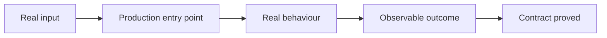

# Test shapes

Read this when you write an allowed test under `coding` part 2, or fix an existing one.

A test earns its place when it can fail because the system's observable behaviour is wrong. It should not fail only because code moved, a private name changed, or the implementation now reaches the same result by a different path.

Use the closest proof to production that stays deterministic, safe, and cheap:

- **Behaviour tests prove outcomes that matter to a user or operator.** Start through a public entry point. Assert returned data, persisted state, emitted events, logs, metrics, files, process exit status, or another result outside the implementation. Do not substitute assertions about private methods or collaborator calls unless that interaction is itself the contract.
- **Contract tests prove each boundary.** Cover accepted and rejected inputs, outputs, failure semantics, and side effects. Include protocol details such as status codes, schemas, serialization, idempotency, and error shape when callers depend on them.
- **Integration tests prove real boundaries where practical.** Exercise the real database engine, filesystem, network client, subprocess, queue, or vendor adapter in a safe test environment. A test double can isolate caller logic. It cannot prove that the real dependency accepts the request or produces the response your code expects. Do not stub the boundary the change crosses.
- **End-to-end tests prove critical production flows.** Start at the real external entry point and follow the flow to its durable or user-visible result. Keep this set small because these tests cost more and fail for more environmental reasons.
- **Failure-path tests prove safe failure.** Show what happens with invalid input, timeouts, unavailable dependencies, partial work, retries, and cleanup when they apply. Assert the relevant safety contract: no corrupted data, bounded retries, a useful error, and no false success after incomplete work.
- **Expected values come from the rule, not the code.** If calculating the expected result requires rebuilding the production algorithm inside the test, use a higher-level test or real execution instead.
- **Refactor-safe tests preserve freedom to change the code.** A correct internal rewrite should keep passing when the public contract stays unchanged. Exact call order, object layout, helper names, and file structure are assertions only when consumers truly depend on them.

Reject tests that create the appearance of proof. [The prune](prune-tests.md) lists the common ones: tests tied to the past, to nothing, or to the implementation. Two more it does not name:

- **Fake upstream programs:** a mock that accepts the string the test expects proves string assembly against the mock. It does not prove that the real program parses the command, honours its flags, or produces the required side effect.
- **Volume as quality:** a large test count can repeat one weak assertion many times. Confidence comes from distinct contracts and realistic failure paths, not volume.

**Rule:** Test observable behaviour against a rule someone owns. Use real execution as proof when a test would only mirror the implementation.

**Why:** implementation-shaped tests give false confidence. They can pass while the real workflow is broken, then fail during a safe refactor.
