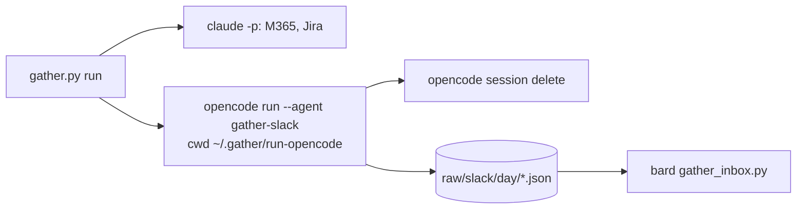

# Spec: Slack moves from bard into gather

Status: plan, 2026-11-20. Owner: Alex.

## Why

bard fetches Slack itself in every sweep, so Slack is the one comms source with no raw,
verbatim store, no cursor, and no ledger line. gather already does this for M365, Jira and
GitHub. Moving Slack in gives Slack the same contract.

## Facts (verified live 2026-11-20)

- `claude -p` cannot reach Slack: `claude mcp list` shows `claude.ai Slack ... Needs
  authentication`, and the MyQ admin blocks Claude's Slack app (archeologist/references/slack.md).
- OpenCode reaches Slack with Cursor's approved client id. `opencode run --agent <a> --archived
  --format json -m <model> "<prompt>"` runs headless. Each tool call is one stdout line
  `{"type":"tool_use","sessionID":"ses_...","part":{"type":"tool","tool":"slack_slack_read_channel",
  "state":{"status":"completed","input":{...},"output":"<text>","metadata":{"truncated":false,
  "content":[{"type":"text","text":"<text>"}]}}}}`. `state.output` equals the MCP text byte for byte.
- No OpenCode API endpoint calls an MCP tool without a model.
- Project config in the run cwd (`opencode.jsonc`) is honored. An agent with
  `{"action":"*","resource":"*","effect":"deny"}` then `allow` per Slack read tool blocked
  `glob`: no tool event came back for it.
- OpenCode cuts tool output at `tool_output.max_bytes` (default 51200). The run cwd config
  must raise it (`max_bytes: 20000000`, `max_lines: 1000000`). `metadata.truncated` reports a cut.
- Results are JSON: search → `{"results": "<markdown>", "pagination_info": "<text>"}`;
  `slack_read_channel` → `{"messages": "<markdown>", "pagination_info": "<text>"}`;
  `slack_read_user_profile` → `{"result": "User ID: U...\n..."}`.
  `pagination_info` is either `For the next page of results use cursor \`<c>\`` or
  `There are no more messages available.`
- Search hit markdown: `### Result i of n`, then lines `Channel: <name> (ID: C...)`,
  `Participants: ...`, `From: ...`, `Time: 2026-11-20 10:54:00 CST`, `Permalink: <url>`, `Text: ...`.
- Every `opencode run` saves a session in `~/.local/share/opencode/opencode.db` (directory = run
  cwd), even with `--archived`. `opencode session delete <id>` removes the session, its messages
  and parts; a content search of the db found no text left after it.
- The runner model reads every result. Model order (Alex, 2026-11-20):
  `claude-agent/haiku`, then `opencode-go/deepseek-v4.1-flash#high`. Changed the same day: Cursor
  models cannot use MCP tools through OpenCode (no `tool_use` event, the model says "Tool not found").
- Rewriting `opencode.jsonc` before each run raced OpenCode's config reload: `Agent not found:
  "gather-slack"` on every call. The same run without the rewrite worked.
- `claude-agent/haiku` completed `slack_read_user_profile` with `{"response_format": "concise"}`; with
  `{}` it added `user_id: ""` and the call failed. It saves Claude Code sessions (tool results
  included) under `~/.claude/projects/<cwd, every non-alphanumeric character as ->/`.

## Shape

## Slack source contract

Source `slack`, window kind (has a cursor and `covered_from`), one span (Slack `after:` is a
date), no day chunks. Window start = cursor, else `--since`, else 7 days back.

1. `slack_slack_read_user_profile {"response_format": "detailed"}` → Alex's user id from `User ID: (U\w+)`. None →
   `error: no slack user id`. Stored as a record.
2. Three searches with `slack_slack_search_public_and_private`, each paged by cursor:
   - DMs: `{"keywords": [], "filters": "after:<D>", "channel_types": "im,mpim", "limit": 20,
     "include_context": false, "natural_language_query": "", "sort": "timestamp"}`
   - mentions: same without `channel_types`, `keywords: ["<@U...>"]`
   - own posts: same without `channel_types`, `filters: "from:<@U...> after:<D>"`
   `D` = the day before the window start (UTC date): `after:` leaves out the date typed.
3. Reads, up to 10 calls per runner round, each paged by cursor:
   - every DM channel id from the DM search: `slack_slack_read_channel {"channel_id": C,
     "oldest": "<window start epoch seconds>", "limit": 100}`
   - every thread: `slack_slack_read_thread {"channel_id": C, "message_ts": T, "limit": 100}`.
     Threads come from hits of all three searches: `T` = the permalink's `thread_ts` query value
     when present; otherwise, for a hit outside the DM channels, `T` = the `p<digits>` path part
     as `<first 10>.<rest>`. Dedupe by `(C, T)`.
4. Paging: cursor regex `` cursor `([^`]+)` `` in `pagination_info` → next call adds `"cursor"`;
   `no more` → stop; neither, with a full page → `capped at N pages` (same rule as today).
   `--max-pages` counts per chain.
5. Items = total search hits. Ledger line: `fetched N calls, M items`.

## Runner contract

- `opencode_runner(root)`: cwd `<root>/run-opencode` (0700). Writes one static `opencode.jsonc` there
  only when it is missing or different, never per round: agent `gather-slack` (V2 keys `agents` and
  `system`; mode primary, system prompt = the exact-calls instruction plus "Pass each args object
  exactly as given. Add no keys.", permissions deny `*` then allow the four Slack read tools), plus
  `tool_output` limits above and `"snapshots": false`. The per-round `allowed` guard stays in the parser.
- Parse: a tool part whose `tool` is not allowed → `GuardError`; `status` `completed` → content
  `state.output`; `error` → is_error with `state.error`; `metadata.truncated` true → `SpillError`.
- Model fallback: a runner failure (non-zero exit, timeout, an error event, or calls asked but no tool
  part in the output) on `claude-agent/haiku` retries that round once on the opencode-go model and keeps it for the rest
  of the run. The run log gets `slack: fell back to opencode-go: <reason>`.
- Cleanup: every `sessionID` seen in stdout is deleted with `opencode session delete` in a
  `finally`. A failed delete writes the id to `<root>/run-opencode/orphans` (0600); the next run
  deletes orphans first. Never touch a session that gather did not create.
- Sweep: a run killed before its first stdout line leaves a session with no id. The first call and
  `runner.close()` (from `cmd_run`, in a `finally`) run `opencode session list --format json` in the
  run cwd and delete every session whose `directory` equals `str(cwd.resolve())` exactly, never by the
  list alone. A list failure is a note in `runner.notes`, never an error.
- Claude project folder: after every attempt, remove `~/.claude/projects/<run-opencode cwd>` whole
  (`_project_dir(cwd)`; `shutil.rmtree`; skip a symlink; no other path), because `claude-agent` saves
  sessions there. It is gather's own cwd folder.
- New ledger reasons: `opencode failed`, `no slack user id`.

## Not in scope

Slack canvases and files, channel history without Alex in it, the `with:` search.

## Acceptance

- `uv run --with pytest python -m pytest gather/tests bard/tests -q` passes.
- `uv run --with pyyaml python -m skillcheck` → PASS.
- Live: `python3 gather/scripts/gather.py run --sources slack --since 1d --root <tmp>` →
  `slack: fetched ...`, raw files whose `content` equals the tool output, and no session left in
  opencode.db with directory `<tmp>/run-opencode`.
