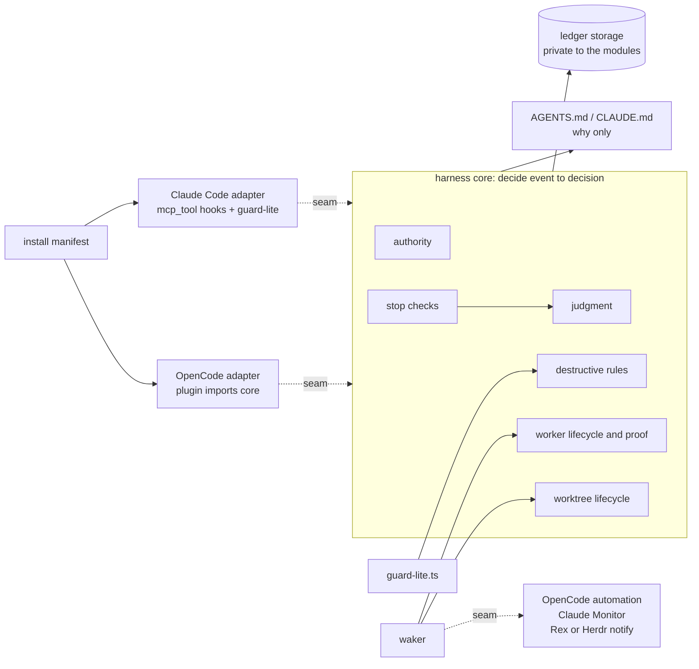
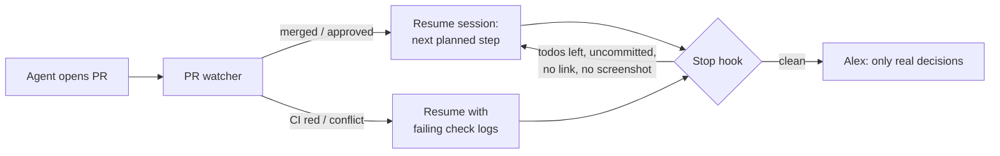
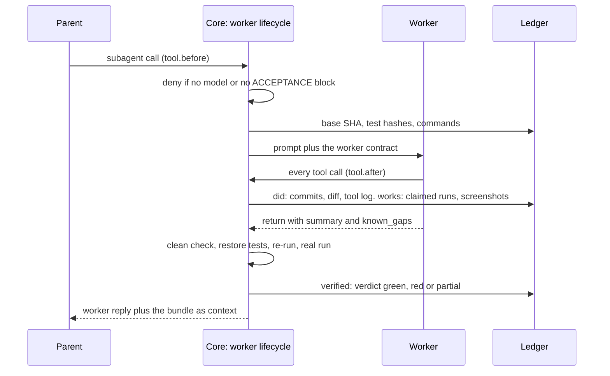
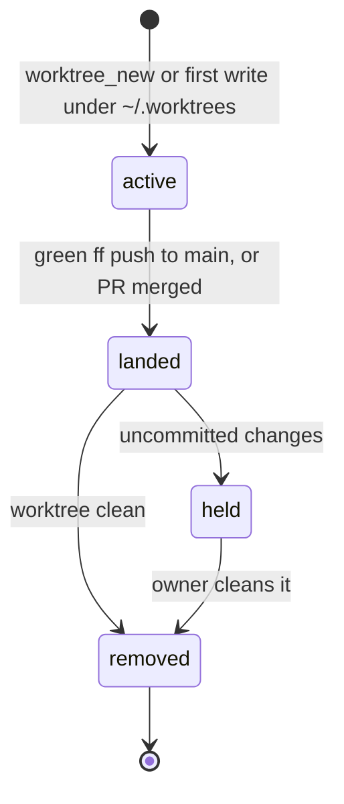
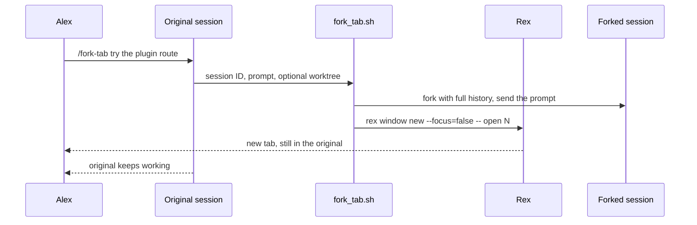
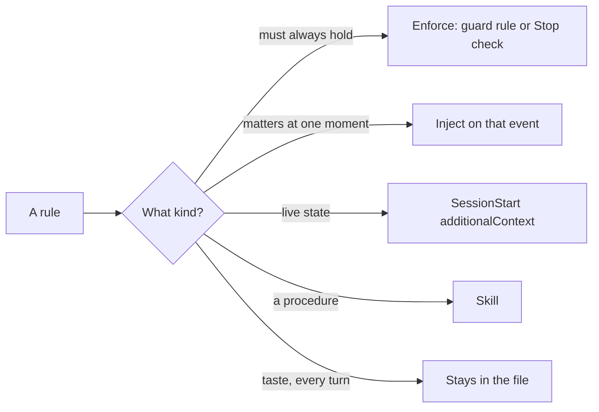
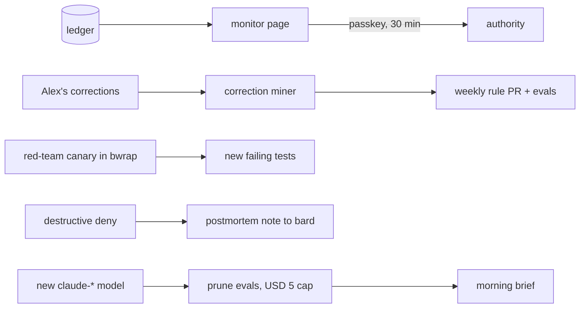

# Harness evolution: rules in code, not prose

Status: plan only, ready to build. Written and grilled with Alex on 2026-11-25 (D1 to D82, in the appendix).

**Ask:** approve Phase 0. Then the phases run in order as one plan (D73), each ending with its Done-when.

**Threat model (D72).** The harness guards against agent mistakes, such as the 11-21 delete. It is not a wall against a hostile agent: everything runs locally as Alex's user, who has passwordless `sudo`. Grants are exact and bound to what Alex saw, and the journal makes tampering visible. Security work stops there.

## Start here

| Phase | Builds | Depends on | Done-when command |
| --- | --- | --- | --- |
| 0 | Bun pin, 18 fact probes | nothing | each probe row records its result in this spec |
| 1 | Core, adapters, manifest, registry, journal, authority, destructive rules, `guard-lite` | 0 | `bun test harness/` exits 0, plus the live probes in Phase 1 |
| 1b | `harness_request`, `harness_apply`, rollback | 1 | `bun test harness/apply` exits 0, plus the throwaway apply |
| 2 | Waker (PR watch), 7 Stop checks, routing hints | 1, 1b | test PR resumes the session with no prompt |
| 3 | Worker lifecycle, `verify`, proof bundles, `push-gate`, Proof check | 2 | seeded red, partial and green workers |
| 4 | acastro2 credential helper, `ub-mode` links | 0 | `git push` works with no helper flag |
| 5 | Worktree lifecycle, `main-checkout-write`, live handoff, conflict watch and autofix, Handoff, Processes, Cleanup checks | 3 | two sessions see each other in `.harness/HANDOFF.live.md` |
| 6 | `/fork-tab` | 5 | fork opens in a new Rex tab and worktree |
| 7 | Route the prose | 2, 5 | both files under 70 lines, evals show no loss |
| 8 | Prune by eval | 7 | each remaining rule has an eval that changes output |
| 9 | Page, jobs, miner, canary, recorder, compaction, new-model evals | 1b, 3 | the Phase 9 Done-when list |

Each rule and Stop check ships in the phase named in its "Ships in" column. Before that phase it does not exist, so nothing is live early (D24 means live from the day it ships).

Evidence (scratch, not durable):
- Archeologist briefing, session `ses_dec5cba8bffeG7XseU2P5tAuyM`. It covers 2026-11-19 to 2026-11-25 only: this Linux box has 6 days of history and no Mac stores.
- OpenCode features: `ses_dec5c94cdffe1v7zVO7K45B0Q3`. Checked on OpenCode v2.4.1.
- Claude Code features: `ses_dec5c74ffffeXTLt2kV33YEDxE`. Checked on Claude Code 2.1.332.
- Practice: `ses_dec5c5a5affeXDt64DMht0sGg7`, plus Anthropic's [3 patterns for harnessing Claude's intelligence](https://claude.com/resources/articles/harnessing-claudes-intelligence) (April 2026), added after Alex asked.

## Why

Every rule in `~/.config/opencode/AGENTS.md` and `~/.claude/CLAUDE.md` is prose. The model can decide a prose rule does not apply, and it did:

- On 2026-11-21 a worker ran `rm -r ~/Developer/ChamberlainGroup-myQ-Shared`, and about 54 repos had to be cloned again. The fix was another prose rule.
- "Load `coding`" and "no git writes" were pasted by hand into 69 of 158 worker prompts in 6 days.
- The post-worker check (restore the tests from base, hash them, re-run) was done by hand in 74 sessions.
- The acastro2 push trick was typed 250 times in 48 sessions.

Two facts make prose rules weaker than they look:

- OpenCode `cli.json` sets `session.permissions: "autoaccept"`. Every `ask` rule is approved automatically, so only `deny` is a fence.
- In both tools, a deny rule matches the command text only. `git -C . push`, `/usr/bin/git push` and `bash -c '...'` get past a `git push` rule. The Claude Code docs say deny rules are not a security boundary. A hook that parses the full command is the real fence.

Alex also spends his time steering, not building. In the same 6 days, 334 of his 1,202 top-level prompts (28%) only told the agent to take an obvious next step, and 584 (49%) were 6 words or fewer. The top kinds, from keyword matches on the OpenCode store and Claude Code `history.jsonl` (approximate counts):

| Prompt | Count | What it means |
| --- | --- | --- |
| "merged", "both merged", "approved", "sent" | 82 short ones, 102 in all | Alex acts as the agent's GitHub webhook |
| `/mcp`, `/model`, `/resume`, `/reload-skills` | 55 | Harness upkeep |
| A screenshot pasted as feedback | 41 | Alex does the UI check by hand |
| "link?", "links" | 36 | The links rule leaks |
| "commit and push" | 32 | The agent stops before the obvious step |
| "continue", "do it", "yes", "ok" | 31, plus 35 automatic "Continue." | The agent stops with todos open |
| "so what now?", "did it return?" | 17 | No view of the state |
| "CI failing", "merge conflict", "same error" | 17 | Alex relays CI to the agent |
| "nudge it, faster" | 12 | Alex watches the workers |
| "it's already merged", "already sent" | 9 | The agent reports old state as current |
| "you can, use browser control" | 1 here, likely more on the Mac | The agent gives up a task it can do in the browser |

"Use the question tool" appears once in these 6 days. Either it happens on the Mac, or that rule already mostly works.

The practice behind this is harness engineering: when an agent makes a mistake, add a fix in code so it cannot happen again ([Hashimoto](https://mitchellh.com/writing/my-ai-adoption-journey), [Böckeler](https://martinfowler.com/articles/exploring-gen-ai/harness-engineering.html), [OpenAI](https://openai.com/index/harness-engineering/)). A rule with no exceptions goes in a hook. A preference stays in prose.

## Shape

One core holds every policy behind one interface, `decide(event) → decision`. Inside it, six modules each own one concern and their own ledger tables. Each tool gets one thin adapter, and one manifest says how each adapter is wired. The prose files keep only the why.

| Module | Interface | Owns |
| --- | --- | --- |
| Authority (D50, D70) | `command(channel, proof, text)`, `holds(session, grant)`, `protects(toolCall)` | merge and other grants, the kill switch, `harness wrong`, and every rule that stops an agent acting as Alex |
| Destructive rules (D51) | `classify(command, cwd) → deny reason or none` | the shell parser, the D5 allowlist, recursive delete, merge in shell, destructive git. No ledger, no network |
| Stop checks | `check(turn) → send back or pass` | the Stop check table |
| Worker lifecycle and proof | `onSpawn(call)`, `onReturn(call)` | `workers`, `bundles`, the failure ladder |
| Worktree lifecycle | `onEvent(worktree event)` | `worktrees`, `workstreams`, landing and cleanup |
| Judgment (D52) | `judge(questions, summary) → answers with source` | the Jev call, its 3-second timeout and the keyword fallback |
| Rule registry (D67) | `mode(ruleId) → enforce, advise, inject or off`, `mark(ruleId, event)` | every rule's id, event, owning module and current mode |
| Event journal (D68) | `append(event or decision)`, `read(session or kind, window)` | every event in and every decision out, hash-chained |
| Jobs (D69) | `schedule(job)`, `status()`, `runNow(job)` | host jobs in `harness serve`, run by in-process `Bun.cron` |

Why this shape (from two architecture reviews):
- **Core, not 8 scripts.** In the first draft, each policy read its tool's raw hook JSON, so a hook format change leaked into 8 modules. Only the 2 adapters know the tool formats now. Two adapters make the seam real.
- **Ledger storage, not 9 stores.** One SQLite file holds all state, so the OpenCode server restart loses nothing.
- **Worker lifecycle, not a command to remember.** The core verifies on every worker return.
- **One waker.** The PR watcher, the done signal and the watchdog share one poll-and-wake module.
- **Authority in one module.** Everything only Alex can do was checked in 9 places, and the forged-prompt hole (D35) came from that spread. One module means one test suite for "an agent cannot act as Alex".
- **Destructive rules shared.** `guard-lite.ts` would otherwise be a second copy of the shell parser and the allowlist, and the fallback would drift from the main path.
- **Install manifest.** The Claude Code adapter uses 4 transports, and D36 must know which config entries are the harness's. One manifest feeds the installer, the adapters and D36.
- **Judgment in one module.** One Jev call per stop instead of 4, and the fallback is written once.
- **Domain interfaces on the ledger.** A generic `record` and `query` would make every caller know each table's columns and expiry. Each module owns its tables instead.

### Interface

`decide(event) → decision`. The tests use the same interface: JSON event in, decision out.

| Event | Claude Code hook | OpenCode hook |
| --- | --- | --- |
| `tool.before` | `PreToolUse` | `permission.hook("evaluate")`, `tool.hook("execute.before")` |
| `tool.after` | `PostToolUse` | `tool.hook("execute.after")` |
| `prompt` | `UserPromptSubmit` (command hook, D35) | `session.hook("prompt")` |
| `stop` | `Stop` | session idle event (name to confirm in Phase 0) |
| `session.start` | `SessionStart` (command hook) | session created event (Phase 0) |
| `session.end` | `SessionEnd` | equivalent to confirm in Phase 0 |

| Decision | Claude Code | OpenCode |
| --- | --- | --- |
| `allow` | `permissionDecision: allow` | no change |
| `deny` + message | `permissionDecision: deny`; on `stop`, exit 2 sends the agent back | `effect = "deny"`; on `stop`, a prompt into the session |
| `modify` + new input or context | `updatedInput`, `additionalContext` | input change in `execute.before`, output change in `execute.after` (Phase 0) |
| `ask` + message | `permissionDecision: ask` | `deny` with "ask Alex with the question tool, then retry", because `autoaccept` passes every ask |

**Failure mode.** If the core crashes or times out, the adapter denies calls that match a destructive rule (recursive delete, merge, destructive git) and allows everything else. Why: a timed-out Claude Code `PreToolUse` hook lets the call through, so the adapter must enforce this itself.

**Runtime.** TypeScript on Bun. mac-bootstrap installs a pinned Bun on the Mac and the VM. In Claude Code, the `harness-hooks` MCP server hosts the core, and `mcp_tool` hooks call its `decide` tool (D32). `SessionStart` and `UserPromptSubmit` are command hooks, and `guard-lite.ts` backs up the destructive rules (D33). The OpenCode plugin imports the core in-process, because OpenCode runs plugins on Bun, so each call costs nothing extra. Tests run with `bun test harness/`, and `scripts/check.sh` runs them in CI.

### Ledger

The proposed columns and keys are in `docs/specs/harness-ledger.erd.json` (an Archify ERD: 20 tables, one domain per module). Phase 1 turns it into the first migration.

One SQLite file per host at `~/.local/state/harness/ledger.db`, opened with `bun:sqlite` in WAL mode, so several sessions can write at once. It is private storage, not an interface: each module in the Shape table owns its tables and offers domain operations (D53). Only those modules import the storage. The guard denies agent writes to it. It is per host: a merge token on the Mac does not work on the VM.

| Table | Holds | Kept |
| --- | --- | --- |
| `journal` | every event in and decision out: session, event, rule id, outcome, reason, prompt text, tool args and output as hashes. Each row holds the hash of the row before it (D68) | 90 days |
| `rules` | rule id, event, owning module, mode, `harness wrong` count today (D67) | permanent |
| `jobs` | job name, schedule, last run, last result (D69) | permanent |
| `bundles` | proof bundles: did, works, verified (D41) | 30 days, and the PR body and git note keep the summary |
| `tokens` | grants from Alex: `MERGE-OK <pr>` and `HARNESS-OK <sha8> <digest8>`, each with its request, journal row and expiry | until used or 30 minutes |
| `watches` | PRs and workers the waker polls, with the last state seen | until done or 24 hours |
| `workers` | each spawn: base SHA, test file hashes, acceptance commands, last activity | 30 days |
| `sessions` | live sessions per repo | until `session.end` |
| `worktrees` | session, repo, path, branch, workstream, state (`active`, `landed`, `held`, `removed`), sync state (`current`, `behind`, `conflict`) with the conflicting files (D79) | until removed |
| `workstreams` | owner, worktrees in order, state, next steps, running processes, updated (D38) | until the workstream ends |
| `processes` | processes a session started, with a `keep` flag | until killed, or reported at the next `session.start` |
| `corrections` | prompts tagged as corrections, with session and the rule they point at (D57) | 90 days |
| `egress` | advisory egress warnings (D62) | 30 days |
| `page_auth` | passkey credential and the current 30-minute grant (D61) | until revoked |
| `snapshots` | session state saved at `PreCompact` (D65) | 7 days |
| `sendbacks` | stop send-backs per turn, for the cap | 30 days |
| `nudges` | drift, wrap-up and stall nudges per turn, for the cap (D78) | 30 days |
| `requests` | `harness_request` rows: SHA, digest, rendered review (Phase 1b) | 90 days |
| `applies` | each apply: SHA, tree hash, schema version, rollback time (Phase 1b) | permanent |
| `schema_meta` | the ledger schema version | permanent |

## Phase 0. Prove the unverified facts

Do this first. Step 0: install the pinned Bun on both hosts (D11), and add a `setup-bun` step to `.github/workflows/checks.yml` and a Bun lane to `scripts/check.sh`. Then the probes below. The design depends on these facts, and the docs do not answer them. Each test becomes an adapter test in Phase 1.

| Fact | Test | Done when |
| --- | --- | --- |
| OpenCode `permission.hook("evaluate")` with `effect = "deny"` stops a `shell` call under `autoaccept` | A scratch plugin denies `echo HARNESS-PROBE`, and a session runs it | The command does not run, and the agent sees the reason |
| `bun:sqlite` loads inside OpenCode's plugin runtime | A scratch plugin opens a database and writes one row | The row is in the file |
| OpenCode `tool.hook("execute.before")` can change a tool's input, and `execute.after` can change its output | A scratch plugin adds a line to a `subagent` prompt and to a shell result | Both changes show in the session |
| A per-call subagent `model` overrides the agent's frontmatter `model` | Call `general` with a `model` that differs from its frontmatter, then read `session_v2.model` | The row shows the per-call model |
| An automation or a background wait can wake an idle session (OpenCode `automation` `send`, Claude Code `Monitor` or a background shell) | Start a 1-minute watch that sends `HARNESS-WAKE`, then let the session go idle | The session resumes and answers with no prompt from Alex |
| The OpenCode V2 events for idle, session created and session end | Log every `session.hook` event name in a scratch plugin across one session | The names are in the Interface table |
| Each tool's todo list can be read by the core at `stop` | Log the todo items a scratch adapter sees in one turn, in both tools | The pending items show in the log |
| What counts as `session.end` in OpenCode when the TUI closes but the session stays on the server | Close a TUI on a session with a test server running, and log the events | The event name is in the Interface table, and its timing is recorded |
| Jev answers inside 3 seconds from a hook, and the fallback runs when it does not | Call Jev from a scratch Stop adapter, then once with the network blocked | A typed answer, then a `jev-unavailable` row |
| A permission deny on `mcp__harness-hooks__*` blocks the model, while `mcp_tool` hooks can still call `decide` | Deny the tool, then call it from the model and from a hook | The model call is denied and the hook call returns a decision. If not, `decide` moves to command hooks |
| `guard-lite.ts` with `onFailure: "block"` blocks a destructive call when the MCP server is down | Stop the `harness-hooks` server, then run `rm -r` on a path outside the allowlist | The call is blocked, and a plain `ls` still runs |
| OpenCode `session.hook("context")` can add text at the end of the conversation, not only to the system prompt | Add a marker from a scratch plugin and read the outgoing request | The marker sits after the last message. If it can only change `event.system`, event injection in OpenCode uses only static text there, and dynamic text goes through tool results |
| A WebAuthn passkey works for a page on `http://127.0.0.1` (a secure context) from Edge on the Mac, also when the page is the VM's port | Register and sign once from the Mac | The page accepts the assertion. If the VM port fails, the page is reached through an SSH tunnel to `localhost` |
| `Bun.cron` jobs in `harness serve` survive a page restart and fire once each | Schedule a 1-minute test job, restart the service, and count runs | One run per minute, none missed after the restart |
| `bwrap` plus a local allowlist proxy limits the network to the model API | Run the canary with `--unshare-net` and a socket to a proxy that allows only the model host; try `curl example.com` and a model call | The model call works and `curl` fails. On the Mac, the canary runs on the VM only |
| Only a prompt Alex typed reaches the grant parser | Send `MERGE-OK 1` as the first line through `opencode run`, an automation `send`, a subagent prompt, `claude -p`, `/fork-tab` and a typed prompt | Only the typed prompt is marked interactive in the hook input. If no tool marks it, grants are read only from the page (D72) |
| Settings overrides cannot switch the hooks off | Try `disableAllHooks`, a project `.claude/settings.json`, a repo `opencode.jsonc` with an allow rule, and an env var | Each is denied by `harness-config-write` or has no effect with managed settings (D74) |
| A Claude Code command can read its own session ID | A `SessionStart` hook writes `session_id` to an env file, and a command reads it | The command prints the ID |

If the deny test fails, the OpenCode adapter uses `execute.before` to replace the command with one that fails with the reason. If `bun:sqlite` does not load, the OpenCode adapter spawns `bun core.ts` like Claude Code. If the wake test fails, the waker uses the Rex or Herdr notification only. If more than one of these fails, stop and bring it to Alex.

## Phase 1. Core, ledger, adapters, guard

Build the core, both adapters, the install manifest (D49), the rule registry (D67), the event journal (D68), the authority module (D50) and the destructive rules module (D51). Together they close the worst risks and prove the seam with both adapters.

Phase 1 files:

| Path | Holds |
| --- | --- |
| `harness/core.ts` | `decide(event) → decision` and policy routing |
| `harness/adapters/claude.ts`, `harness/adapters/opencode.ts` | tool formats in and out |
| `harness/guard-lite.ts` | about 20 lines that call `destructive.ts` |
| `harness/modules/{authority,destructive,registry,journal}.ts` | the Phase 1 modules |
| `harness/manifest.ts` | each entry: `id`, `tool`, `event`, `transport`, `matcher`, `onFailure` |
| `harness/install.ts` | writes config from the manifest; `--dry-run` prints the diff |
| `harness/cli.ts` | read-only `status` (D70) |
| `bin/harness-rollback` | restores the previous applied SHA from a terminal (Phase 1b) |
| `harness/mcp/{hooks,agent}.ts` | the two MCP servers (D34) |
| `harness/tests/` | `bun test` suites |

Event shape: `{ v: 1, event, tool, session, cwd, repo, input, interactive, time }`. Decision shape: `{ outcome: allow | deny | modify | ask, message?, input?, context?, ruleId }`.

Before the live probe, Alex runs mac-bootstrap, or `bun harness/install.ts --dev` once. `--dev` installs from the working tree for that host only.

Guard rules (each has a rule id, so Phase 8 can switch it off). `recursive-delete`, `merge-in-shell` and `destructive-git` live in the destructive rules module. `harness-self`, `harness-config-write` and `ledger-write` live in the authority module:

| Rule id | Denies | Message to the agent | Ships in |
| --- | --- | --- | --- |
| `recursive-delete` | `rm -r`, `rm -rf`, `find -delete`, `rsync --delete` outside the D5 allowlist | "Recursive delete outside the allowlist. Name the exact files, or ask Alex." | 1 |
| `merge-in-shell` | Every `gh pr merge`, `gh api .../merge`, `git merge` into `main` or `master`, `git push` of a merge to `main` that has no PR | "Use the `merge_pr` tool." | 1 |
| `destructive-git` | `git reset --hard`, `git clean`, `git push --force` and `-f`, `git checkout -- .` | Same rules as today's `opencode.jsonc` deny list, now in both tools | 1 |
| `push-gate` | A `git push` of a head commit with no bundle, or a red or partial bundle pushed to `main` (D44). A push that changes only `*.md` files is exempt. Log-only until the Phase 3 `verify` Done-when passes | "Verify first: call `verify`; the harness needs a green bundle for this exact commit to land on main." | 3 |
| `ledger-write` | Any write to `~/.local/state/harness/` by any tool or shell form it can parse | "Only the harness writes its state." | 1 |
| `harness-self` | An agent shell call to `harness off`, `on`, `wrong`, `rollback`, `harness/install.ts` or `harness-rollback`; and agent `sudo`, `su`, `pkexec` or `docker run -v` (D31, D37, D72) | "Only Alex runs harness commands." | 1 |
| `harness-config-write` | Any agent write to `~/.claude/settings*.json`, a project `.claude/settings*.json`, any `opencode.jsonc`, or the harness plugin files (D36, D74) | "Change the harness source in a worktree, get a green bundle, show Alex the diff, and ask for HARNESS-OK. `harness_apply` installs it." | 1 |
| `main-checkout-write` | An edit or write tool on a path in a repo's main checkout, and `git commit`, `git checkout`, `git merge` or `git rebase` run there (D7) | "Work in a worktree: call `worktree_new`. It records the pointer for other agents." | 5 |

The guard parses the full command and walks `bash -c`, `sh -c`, `env`, `xargs`, `git -C` and absolute paths before it matches. Why: deny rules in both tools match only the command text.

**Control commands.** Alex types `harness off`, `harness on`, `harness on <rule>`, `harness wrong`, `HARNESS-OK` or `harness rollback` in a prompt, and the `prompt` event applies it. `bun harness/cli.ts status` is read-only: it shows the flag, the rule modes, today's send-backs and the job results (D70). Changes come only from the prompt or the page's passkey. If the core breaks every session, Alex runs mac-bootstrap to remove the hooks.

**Landing (D26).** After an agent pushes, the core's `tool.after` policy checks that the push was fast-forward, then runs `git merge --ff-only origin/main` in the main checkout itself. The `main-checkout-write` rule does not apply to the harness, only to agents.

**Merge.** `merge_pr` is one stdio MCP server in `harness/` (D29), with `repo` and `pr` fields. It merges by rebase or fast-forward only. Why: Anthropic recommends a dedicated tool for hard-to-reverse actions, because the harness then sees typed arguments it can gate, log and replay ([article](https://claude.com/resources/articles/harnessing-claudes-intelligence)). The token flow:
1. A typed prompt whose first line is exactly `MERGE-OK <pr>` writes a row to `tokens` for that PR (D4). A substring never counts.
2. `merge_pr` reads the row, merges one PR and deletes the row.
3. With no valid row, `merge_pr` returns "Merge needs Alex's token."

Why the ledger holds the token: `ledger-write` stops the common ways an agent writes there, and the journal records each grant with the prompt that made it. A token with no matching journal row shows in `harness status`. That is tamper-evident, not tamper-proof (D72).

Done when:
- `bun test harness/` passes. The authority suite tries the forgery paths the guard can see: a non-interactive prompt with `MERGE-OK`, a substring `MERGE-OK`, a shell write to the ledger, `harness off` or `install.ts` from a shell, an edit to `settings.json`, and agent `sudo`; each one is denied. A token row written behind the guard's back shows as unmatched in `harness status`. The registry suite flips a rule's mode and checks each policy obeys it. The journal suite checks the hash chain. The destructive rules suite runs once and covers the core, `guard-lite.ts` and the OpenCode failure path. The suites also have one case per rule, the bypass forms (`git -C . push --force`, `bash -c "rm -rf ~/x"`, `/usr/bin/gh pr merge 1`), the token expiry, the failure mode, the kill switch, and an agent call to `harness off` that is denied.
- A live probe in each tool shows a denied `rm -rf <path outside allowlist>` with the message, and a merge on a throwaway repo under `~/.agents/skill-workspace/` that works only after `MERGE-OK`.

## Phase 1b. Approved harness changes

This is the deploy path for every later phase (D71), so it comes right after Phase 1.

1. `harness_request(sha)` takes a full SHA. The harness records it and renders the review itself: `git diff <main>..<sha> -- harness/`, `install.ts --dry-run` as a config-entry diff, a flagged list of changed or deleted test cases, manifest changes and rule-mode changes, and an 8-character digest of the whole text. It returns this as the tool result and journals it.
2. Alex types `HARNESS-OK <sha8> <digest8>` as the first line of a prompt, or taps the passkey for that request on the page. The grant is bound to that SHA and request, lives 30 minutes, and is used once.
3. `harness serve` runs the apply: `git archive <sha>` into `~/.local/state/harness/applied/<sha>/`, a tree-hash check, then `install.ts` from there with `bun install --frozen-lockfile --ignore-scripts`. A different SHA, digest or an expired grant means no apply.
4. The check before a request: the base authority and destructive suites run unchanged, plus the new tests, and `bun test harness/` must exit 0. The rendered review shows any changed or deleted case.
5. Rollback: `harness rollback` (prompt or page) restores the previous applied SHA from `applied/`, after a tree-hash check. `bin/harness-rollback`, outside the install, does the same from Alex's terminal when the hooks are broken. The ledger has a schema version, and an apply that changes it first copies the ledger file.

Done when:
- A throwaway harness commit applies only with its own `HARNESS-OK <sha8> <digest8>`.
- A commit pushed after the request is refused, a replayed grant is refused, and a substring `HARNESS-OK` grants nothing.
- `bin/harness-rollback` restores the previous install with the hooks switched off.
- The journal shows request, grant, apply and rollback.

## Phase 2. Steering: PR watcher and Stop hook

This phase gives Alex his time back. The PR watcher and the Stop checks target about 230 of the 334 steering prompts: "merged" (82), link (36), commit (32), continue (31), "what now" (17), CI relayed (17), already merged (9), and part of the screenshots.

**PR watcher (the waker).** It also keeps state fresh: the stale-state check reads PR state from the watcher's last poll in the ledger, not from the agent's memory. When an agent runs `gh pr create` or pushes to a PR branch, the core's `tool.after` policy adds a row to `watches` with the session ID. The waker polls `gh pr view <n> --json state,reviewDecision,mergeable,statusCheckRollup` every 2 minutes (D19) and wakes the session on a change:

| Change | What the session gets |
| --- | --- |
| Merged (D9) | "PR #n merged. Run the next planned step." The step comes from the todo list, then the HANDOFF Next list. With neither, Alex gets a notification instead. |
| Approved | "PR #n approved. Merge needs Alex's token." The agent never merges by itself. |
| A check failed | The failed job name and the last 80 log lines (`gh run view --log-failed`) |
| Conflict | "PR #n has a conflict with its base. Rebase and re-run the acceptance commands." |

- OpenCode: one `automation` with an `every` trigger and a `code` action. It returns `send: { prompt }` to the session that opened the PR, and `done: true` once the PR is closed or merged and the next step has started.
- Claude Code: a background `Monitor` or a `gh pr checks --watch` background shell that ends the wait. Check in Phase 0 which one wakes an idle session. If neither can, use a Rex or Herdr notification, and Alex types one word.

**Stop checks.** On the `stop` event, the core reads the turn and returns `deny` with a message, which sends the agent back. Each check has a rule id:

| Check | Sends back when | Prompts it removes | Ships in |
| --- | --- | --- | --- |
| Commit | The repo has verified changes that this session made, and they are not committed and pushed. Never other sessions' files. | 32 "commit and push" | 2 |
| Links | The turn ran `git push`, `gh pr create`, a ticket or comment create, or a page publish, and the reply has no URL for it | 36 "link?" | 2 |
| Continue | The todo list has a pending item and the reply does not ask Alex anything | 31 "continue", 35 automatic "Continue." | 2 |
| UI proof | The turn changed UI files and has no `browse` screenshot after the last change | most of the 41 screenshots | 2 |
| State | The reply does not end with what is done, what is running, and the next step | 17 "what now?" | 2 |
| Handoff | This session's `workstreams` entry was not updated since its last commit (D6, D38) | the handoff reminders | 5 |
| Proof | The reply says "done", "fixed" or "works" with no green bundle in this turn for that change (D47) | claims that are not shown | 3 |
| Processes | A process this session started is still running and is not named in the reply | the server scavenger hunt | 5 |
| Cleanup | Scratch files for this session are over 500 MB, or a merged worktree of this session is still on disk (D22) | disk filling on the VM | 5 |
| Handoff protocol | The committed `HANDOFF.md` is over 150 lines, or holds live workstream state that belongs in the ledger (D23) | handoffs that only grow | 5 |
| Stale state | The reply says a PR is open, a review is waiting, or something waits for Alex, and the turn did not check it live (`gh pr view`, the ticket, the inbox) after the last time Alex spoke | 9 "it's already merged", "already sent" | 2 |
| False "can't" | The reply says the agent cannot do something, or asks Alex to do it by hand, and the task is in a browser while `browse` is connected. Only login, 2FA, a passkey, a captcha or a payment confirmation go to Alex, through `handoff`. | "you can, use browser control" | 2 |

The four judgment checks (ask Alex something, false "can't", stale state, state footer) go through the judgment module (D52): one Jev call per stop with a short turn summary, and a send-back at 0.80 or above (D27). The summary holds no transcript, no secrets and no file contents. When Jev is blocked or slow, strict keyword rules decide.

The cap (D10) stops a loop: after 5 send-backs in one turn, the core lets the agent stop and say which check failed. The `sendbacks` table counts them.

**Upkeep.** Pin model and effort in each agent's frontmatter and in `settings.json`, so `/model` and `/effort` stop being needed at session start. Reload skills when a file in `~/.agents/skills` changes. Claude Code has a `FileChanged` hook event, and the existing `sync-agents-skills.sh` is the start.

Done when:
- A test PR on a throwaway repo goes from opened to merged, and the session resumes with no prompt from Alex.
- A failed check comes back as logs in the session.
- `bun test harness/` has one case per Stop check that ships in Phase 2, plus the cap.
- After one week of use, a re-run of the prompt count shows the steering share down from 28%.

## Phase 3. Worker lifecycle and proof of work

One policy covers a worker from spawn to return, and every change ends in a proof bundle the agent cannot fake. The research behind this comes from the [Claude Code team on verification](https://claude.dev/blog/how-the-claude-code-team-thinks-about-verification/), [Anthropic on long-running harnesses](https://www.anthropic.com/engineering/effective-harnesses-for-long-running-agents) and [agent receipts](https://github.com/danielmeppiel/agent-contracts/blob/main/spec/receipt.md).

**`verify` tool.** The main session or any worker calls the `verify` MCP tool with its acceptance commands. The harness runs them in the worktree, adds the repo's committed `verify` command, and writes the bundle. A change that touches only `*.md` files needs no bundle. `push-gate` ships in this phase and stays log-only until the `verify` Done-when passes.

**Spawn** (`tool.before` on `subagent`, `Agent` or `Task`):
- Deny when `model` is missing, or a `general` spawn has no `ACCEPTANCE:` block (D17). The harness always adds the repo's committed `verify` command, restored from base, to the list, so `ACCEPTANCE: true` cannot give a green. Read-only agents are exempt.
- Record the base SHA, test file hashes and acceptance commands in `workers`.
- Add the worker contract to the prompt (`modify`): load `coding` first, no git writes outside its worktree, flag a wrong test and do not edit it, end with `summary` and `known_gaps`.

**Proof bundle (D41).** Each field has one owner, so the agent writes only what it cannot fake:

| Level | Field | Captured by |
| --- | --- | --- |
| Did | `session`, `model`, `effort`, `base_sha`, `head_sha`, `commits[]`, `diff_stat`, `outside_allowlist[]` | hooks |
| Did | `tool_calls[]`: tool, args hash, exit code, output hash, time | hooks |
| Did | test file hashes before and after | hooks |
| Works | `runs[]` the agent ran, tagged "claimed" | hooks |
| Works | `ui_proof[]`: `browse` screenshots taken after the last edit | hooks |
| Verified | `clean`: the worktree had no uncommitted changes (D42) | harness |
| Verified | `rerun[]`: each acceptance command with test files restored from base | harness |
| Verified | `real_run`: the command that runs the real thing, from the contract | harness |
| Verified | `verdict`: green, red or partial, set by code (D43) | harness |
| Verified | `advisory`: Jev's score on the raw evidence, never the claim | harness |
| Agent | `summary`, `known_gaps` | agent |

**Verify on return** (`tool.after`):
1. If the worktree is not clean, stop: verdict `partial: uncommitted changes`.
2. Compare the test file hashes with the record, then restore the test files from the base SHA.
3. Run each acceptance command and the real run. Keep each exit code and the last 40 lines.
4. Set the verdict by code, ask Jev for its advisory score, and write the bundle to `bundles`.
5. Add the bundle to the worker's reply as context (D18), so the parent sees the claim and the proof side by side.

**Where the proof goes:**
- The full bundle stays in the ledger as a projection of the hash-chained journal (D46, D68).
- The verdict goes in git notes (`refs/notes/harness`) on the head commit, and the 6-line summary in the PR body (D48).
- The `push-gate` rule denies a push with no bundle, and keeps red or partial off `main` (D44).
- The workstream entry links the bundle ID, so `HANDOFF.live.md` shows it.

**Failure ladder (D45).** After a red verdict, round 1 goes back to the worker, round 2 runs on the strong model, round 3 is done inline by the orchestrator. After 3 reds in a row on one branch, the work stops and Alex is asked. No skipped flaky tests and no retries along the way.

**The main session too (D47).** The Stop check sends the orchestrator back when it says "done", "fixed" or "works" with no green bundle in that turn.

**Nudges (D75 to D78).** Agents and subagents get three kinds of nudge, so they finish the work instead of following tangents:

| Nudge | When | Delivered by |
| --- | --- | --- |
| Drift | Every 20 tool calls or 10 minutes of a turn, the judgment module compares a summary of the recent calls with the session's goal (the worker contract's objective, else the current todo, else the workstream's next step). Off-task at 0.80 or above. No goal on record: no check | the core on `tool.after`, as context, in the same turn |
| Wrap-up | A worker passes its time budget: 30 minutes, or the contract's `BUDGET:` line | the core on `tool.after` |
| Stall | 10 minutes with no tool call. For a worker, always. For a main session, only when a todo is pending and the last reply did not ask Alex anything | the waker, which wakes the session |

The drift nudge says: "You are drifting from <goal>. Wrap up: finish <next step>, run the acceptance commands, report." After 5 nudges in one turn with no progress, the harness stops nudging, marks the session `stuck` on the page, and sends Alex one notification. When a worker finishes, Alex gets one Rex or Herdr notification.

Done when:
- On a seeded repo, a worker that edited a test comes back red, a worker with uncommitted changes comes back partial, and a clean worker comes back green.
- A push with no bundle is denied, a docs-only push passes, a `verify` call from the main session gives a bundle, and a red bundle cannot fast-forward to `main`.
- `harness status` recomputes each bundle from journal rows and flags a hand-edited `bundles` row.
- A stalled worker gets one nudge, and a finished worker shows one notification, with no prompt from Alex.

## Phase 4. Small fixes, no hook needed

- **acastro2 pushes:** set `credential.https://github.com/acastro2.helper` in the global git config, so pushes to acastro2 repos use that account's token. This removes the 250 hand-typed helpers. The command goes in mac-bootstrap.
- **Broken symlinks:** `~/.claude/commands/ub-mode.md` and `~/.config/opencode/commands/ub-mode.md` point at `/Users/acastro/...`. Make them relative, or create them from mac-bootstrap per host.

Done when: `git push` in `alex-skills` works with no `-c credential.helper`, and both `ub-mode` links resolve on Linux and on the Mac.

## Phase 5. Worktree lifecycle, cleanup, live handoff

One worktree lifecycle module owns every worktree from creation to removal, so landing steps are code, not prose.

**Rule files.** This phase's PR also changes the "never select worktree/isolation options" line in `~/.config/opencode/AGENTS.md` and `~/.claude/CLAUDE.md` to "Work in the session's worktree; the harness creates it." `worktree_new` adds `.harness/` to the worktree's `info/exclude`, so the live file never makes it dirty.

**Worktrees (D7, D21, D39).** One worktree per branch, at `~/.worktrees/<repo>/<name>`. The `worktree_new` MCP tool creates it, records it, and moves the session there (OpenCode `session.move`; Claude Code `--worktree` or `isolation: worktree` for subagents). A worktree made by hand under `~/.worktrees/` is registered on its first write (D37). The `main-checkout-write` rule denies agent writes in the main checkout.

**Transitions (D40).** The lifecycle module does each step itself:

| Transition | What the module does |
| --- | --- |
| `active` to `landed` | Runs `git merge --ff-only origin/main` in the main checkout (D26), links the bundle, and marks the workstream step done |
| `landed` to `removed` | `git worktree remove` (never `--force`), deletes the local branch, updates `HANDOFF.live.md` |
| `landed` to `held` | Messages the owner session. After 24 hours with no live owner, notifies Alex once |

If the main checkout has uncommitted changes of its own (Alex editing by hand), the fast-forward is skipped and Alex gets a notice.

**Live handoff (D23, D38).**
- The `workstreams` table holds each live workstream: owner, worktrees in order, state, next steps, running processes, updated.
- The harness renders it into a read-only `.harness/HANDOFF.live.md` in every worktree at `session.start` and after each change. Agents read it to see who does what, and where.
- Agents change their own entry with the `workstream_update` MCP tool, never by editing the file.
- The committed `HANDOFF.md` keeps only lasting context: repo gotchas and long-running items, 150 lines at most. The `handoff` skill changes to match, and the repo's own `docs/HANDOFF.md` is the first one to clean up.

**Conflict watch (D79 to D82).** Agents in many worktrees keep hitting merge conflicts, so the waker watches for them and fixes them:

| Check | Every 5 minutes, per `active` worktree | Then |
| --- | --- | --- |
| Behind, no conflict | `git fetch`, then `git merge-tree --write-tree origin/main HEAD` exits 0 | If the worktree is clean and its owner is not mid-turn, the harness rebases it, runs `verify` so the bundle matches the new head, and tells the owner |
| Conflict with main | `merge-tree` reports conflicts | The owner session wakes with the conflicting files and the main commits behind them, and is told to rebase, resolve and run `verify`. With no live owner, a resolver worker on the strong model gets the same task under a normal contract |
| Overlap with another worktree | `merge-tree` between two live branches in one repo reports conflicts | Both owners are told which files overlap, so they can agree on order or split the work |

`merge-tree` tests the merge with no checkout, so the watch never touches a worktree. A resolved branch still needs a green bundle to land (D44). After 3 failed resolve attempts on one branch, the failure ladder (D45) sends it to Alex. Git 2.56 is on the VM, and `git merge-tree --write-tree` ran there on 2026-11-25.

**Cleanup (D20, D22).**
- On `session.end`, the core kills each process in `processes` for that session, unless it has the `keep` flag. An agent sets `keep` with the `keep_process` tool only for a server Alex asked to keep up, and the Stop check makes it name the process in the reply.
- The Stop check sends the agent back when its scratch files are over 500 MB or a removed worktree is still on disk.

Done when:
- Two sessions in one repo each get a worktree, and each sees the other in `.harness/HANDOFF.live.md` at start.
- A write in the main checkout is denied with the worktree message.
- A green ff landing fast-forwards the main checkout, removes the clean worktree and its branch, and updates the live file.
- A landing with uncommitted changes goes to `held`, and the owner gets the message.
- `session.end` kills an unkept test server and keeps a server flagged `keep`.
- A seeded conflict on a worktree wakes its owner with the file list, a behind-but-clean worktree is rebased and re-verified on its own, and an ownerless conflict gets a resolver worker.

## Phase 6. Fork to a new tab

Alex often wants to explore two paths from one conversation. Today `/fork` replaces the session he is in. The goal: one command opens the fork in a new Rex tab, already running, and the original session does not stop or change.

Verified on 2026-11-25:
- **OpenCode:** `opencode run -s <session> --fork --title <t> --format json "<prompt>"` made a new session with the full history. It answered a question about this conversation, while the original session kept running. The JSON events carry the new `sessionID`. `--worktree <name>` also exists on `opencode run`.
- **Claude Code:** `claude --resume <id> --fork-session` exists in `claude --help` (2.1.332). Not run yet.
- **Rex:** `rex window new -s SESSION LABEL --focus=false -- COMMAND` opens a tab and keeps Alex's current tab active.

`harness/fork_tab.sh` does the following:
1. OpenCode: run `opencode run -s "$OPENCODE_SESSION_ID" --fork --title "<t>" --format json "<prompt>"`, read the new session ID from the events, then `rex window new -s "$REX_SESSION" "<t>" --focus=false -- opencode -s <new id>`.
2. Claude Code: `rex window new -s "$REX_SESSION" "<t>" --focus=false -- claude --resume <id> --fork-session "<prompt>"`.
3. The fork always gets its own worktree through the `worktree_new` tool (D7), so the two paths never edit the same files.
4. Under Herdr (`HERDR_ENV=1`), open a Herdr tab instead of a Rex tab.

Entry points: an OpenCode command `/fork-tab <prompt>` and a Claude Code command or skill `/fork-tab <prompt>`. Each calls the script with its own session ID.

Open questions for Phase 0:
- How does a Claude Code command read its own session ID? Hooks get `session_id` on stdin. A `SessionStart` hook can write it to an env file. Not verified.
- Does `claude --resume <id> --fork-session "<prompt>"` start the fork with the prompt in the interactive TUI? Not run yet.

Done when: `/fork-tab` from a running session opens a new tab that already answers the prompt with the full history, Alex's tab stays focused, and the original turn goes on with no change.

## Phase 7. Route the prose

Every rule in `AGENTS.md` and `CLAUDE.md` gets exactly one route (D54). The test for each rule: when must the model know it, and can code enforce it?

| Route | Channel | Cache and cost |
| --- | --- | --- |
| Enforce | Guard rules, Stop checks, spawn rules | No context cost. Only a deny message enters the context |
| Inject on event | `PreToolUse` / `PostToolUse` `additionalContext` (Claude Code); `execute.before` / `execute.after` (OpenCode) | Sent only when that event fires |
| Session state | `SessionStart` `additionalContext`, also on matcher `compact` | Cached for the session. Subagents do not get it. 10,000-character cap |
| Skill | the skill's `SKILL.md` | Only the description loads until the skill runs |
| Stays in the file | `AGENTS.md`, `CLAUDE.md` | Cached prefix, but every subagent pays it again |

Examples:

| Rule today | Route |
| --- | --- |
| Links on every outward change | Inject on `git push`, `gh pr create` and ticket or page writes, plus the Links Stop check |
| Set a model on every subagent call | Enforce: the spawn deny |
| Load `coding` before code work | Inject at worker spawn (the contract) and on the first edit in a session |
| Web UI and accessibility rules | Inject when a UI file is edited |
| Handoff, running processes, worktrees | Session state, from the ledger |
| "Find something" goes to archeologist | Routing hint (D56) |
| STE100, why-first, "call me out", diagrams | Stays in the file |

Rules for the routes:
- Static rules never go into `UserPromptSubmit` (D55). Only the routing hint does (D56).
- Every injected text has a rule id, so Phase 8 can switch it off, and the journal shows when it fired.
- In OpenCode, dynamic text goes at the end of the conversation, never into the system prompt, so the cache holds (Phase 0).

Target: both files under 70 lines, holding only taste plus one line of why per routed rule.

Done when: the line counts drop, and a short eval shows no rule loss. Run the `coding` worker eval, one merge-attempt eval, and one links eval before and after.

## Phase 8. Prune by eval

Anthropic's point: every harness part encodes a limit of the model, and a newer model can make it dead weight ([article](https://claude.com/resources/articles/harnessing-claudes-intelligence)). So the harness gets the same test as a skill.

- For each rule left in the files and each injected text after Phase 7, run one eval with it and one without it, on the current model.
- Switch a harness rule off by its id for one eval run with `HARNESS_DISABLE=<rule-id>`. The journal shows which rule fired.
- Remove each rule that changes nothing. Keep the eval, so the next model change re-runs it.
- Count the MCP tools loaded in a session. Tools sit in the cached prefix, so a long or changing list costs cache hits and attention. Move rarely used servers behind Code Mode search.
- Test Claude Code auto mode (a second model judges each shell command) as a backstop behind the guard rules. It does not replace the guard: it is a judgment, and the guard rules have no exceptions.

Done when: every remaining prose rule has an eval that shows it changes the output.

## Phase 9. Operate and improve

Once the harness runs, it watches and improves itself. Alex reviews; he does not have to steer.

- **Monitor page (D58 to D61).** Build it first in this phase: the decision inbox, the egress warnings and the steering metric all show there.
- **Correction miner (D57)**, **red-team canary (D63)** and **new-model evals (D66)** are jobs (D69) in `harness serve`, run by in-process `Bun.cron`. Each starts `opencode run --format json` on the pinned cheap model, Cursor first; the canary runs it inside `bwrap`. The `jobs_status` and `job_run_now` MCP tools show and trigger them.
- **Canary bypasses are tests**, so the next `bun test harness/` run fails until the guard is fixed.
- **Flight recorder (D64)** replays from the journal (D68). **Compaction safety (D65)** reads and writes the ledger only.
- **Egress guard (D62)** is a `tool.before` policy that only adds context and logs. It has a rule id, so Phase 8 can measure whether it changes behaviour.

Done when:
- The page shows a live session from each tool, and a `harness wrong` from the page marks the send-back after one passkey.
- An agent's `curl` to the page's port is denied, and `browse` cannot open it.
- A seeded week of corrections produces one PR with one eval per proposed change.
- The canary finds a seeded bypass and leaves a failing test.
- A compaction in a long session keeps its todos and workstream.

## Later, end to end

Not in this plan. Each needs its own spec.

- Automations: `gather` and `bard` sweeps, the morning brief, and a weekly `upstream_audit.py` run that opens a PR.
- `anthropics/claude-code-action` for PR review on `alex-skills`.
- A doc-gardening job that checks `HANDOFF.md` and the README tables against the repo.
- Package the adapters as a Claude Code plugin (`.claude-plugin/plugin.json`), so the Mac and this box install the same thing.

## Appendix: decisions

All taken by Alex on 2026-11-25.

| # | Decision | Answer | Why |
| --- | --- | --- | --- |
| D1 | Scope of this change | Plan doc only | Build comes after the plan |
| D2 | `gh pr merge` | Deny in shell. Merges go through the typed `merge_pr` tool, which needs Alex's token | Alex keeps the merge in chat, and a typed tool is easier to gate than a parsed command |
| D3 | Where the code lives | `alex-skills/harness/` | One fewer repo. skillcheck only reads folders with a `SKILL.md` (`skillcheck/core.py:63`), so it ignores `harness/` |
| D4 | Merge token | A typed prompt whose first line is exactly `MERGE-OK <pr>`: one merge of that named PR, within 30 minutes | Short to type, never a substring, and an old prompt cannot authorize a merge hours later |
| D5 | Recursive delete allowlist | The session scratchpad, `~/.agents/skill-workspace`, `/tmp`, and tracked or ignored paths inside the current repo. Never the repo root, never `.git` | Would have blocked the 11-21 delete |
| D6 | Stale handoff | The Stop check sends the agent back when its workstream entry is stale (D38) | Alex wants the handoff current at every milestone, and the cap stops a loop |
| D7 | Worktrees | An agent never writes in a repo's main checkout. Every writing session works in its own worktree, and the ledger keeps a pointer to it. This replaced a warn-only lock | Agents stop stepping on each other and on Alex |
| D8 | Steering fixes | In this spec, as Phase 2 | Alex picked it |
| D9 | When a watched PR merges | Resume the session and run the next step: the todo list first, then the HANDOFF Next list. If neither has a step, notify Alex | It never invents work |
| D10 | Stop cap | 5 send-backs per turn, then stop and say which check failed | Alex picked 5 over 3 |
| D11 | Core runtime | TypeScript on Bun, pinned, installed on both hosts | Native to OpenCode plugins |
| D12 | Adapters | OpenCode imports the core in-process; Claude Code per D32 | One runtime and one code path |
| D13 | Events | The 6 in the Interface table | `session.end` gives a point to record leftovers |
| D14 | Decisions | `allow`, `deny`, `modify`, `ask`, plus an optional message | `ask` maps to a question-tool deny in OpenCode |
| D15 | Failure mode | Closed for destructive rules, open for the rest | A broken core never deletes repos and never blocks ordinary work |
| D16 | Ledger | SQLite per host; the journal keeps 90 days (D68) | Several writers, queryable, in Bun |
| D17 | Worker acceptance | A `general` spawn with no `ACCEPTANCE:` block is denied. Read-only agents are exempt | The core needs the commands to re-run them |
| D18 | Verify result | Added as context next to the worker's reply | The parent sees the claim and the check side by side |
| D19 | Waker | One watch per session, every 2 minutes, expires after 24 hours | An OpenCode automation can only wake the session that created it |
| D20 | `session.end` | Kill the processes the session started, except the ones it registered with `keep` and named in its reply. Report the kept ones at the next start | The VM has little room for leftovers, and a server Alex asked for stays up only when it is named |
| D21 | Worktree home | `~/.worktrees/<repo>/<name>` | Outside every repo, so OpenCode does not load a second copy of a skill, and one folder is easy to measure on the VM |
| D22 | Cleanup | When a watched PR merges, the waker removes its worktree and local branch, only if the worktree is clean. The Stop check sends the agent back for unnamed running servers or scratch files over 500 MB | Disk on the VM stays bounded, and nothing with unsaved work is deleted |
| D23 | HANDOFF protocol | Agents coordinate through the `workstreams` table and the rendered `HANDOFF.live.md` (D38). The committed `HANDOFF.md` keeps only lasting context, 150 lines at most | Agents read who does what and where, and done work is removed, so the file stays current |
| D24 | Rollout | Each rule is live from the day its phase ships it (Ships in). No shadow week. Exception: `push-gate` starts log-only until `verify` works (D44) | Alex wants the time savings at once. `harness wrong` (D28) is the safety valve |
| D25 | Kill switch | `harness off` and `harness on`: one global flag in the ledger that only Alex can set | One command recovers every session if the core has a bug |
| D26 | Landing | Fast-forward only. The agent rebases its worktree branch on `origin/main`. In personal repos (remote owner `acastro2`) it pushes to `main`. In work repos it opens a PR, merged by rebase or ff, never a merge commit. After each landing the harness, not the agent, runs `git merge --ff-only` in the main checkout | A straight history, and the local `main` never drifts |
| D27 | Semantic Stop checks | Jev judges 4 checks (asks Alex something, false "can't", stale state, state footer) from a short turn summary, and sends back at 0.80 or above. If Jev is blocked or takes over 3 seconds, strict keyword rules decide and the ledger logs `jev-unavailable` | Jev can be blocked, so it never runs without a fallback |
| D28 | Tuning | `harness wrong` marks the last send-back false, and the agent continues. A rule marked wrong 3 times in a day goes log-only until `harness on <rule>` | A bad rule cannot cost turns all day |
| D29 | Harness MCP server | One stdio MCP server in `harness/`, loaded by both tools, for every action an agent takes on purpose: `merge_pr`, `worktree_new`, `workstream_update`, `keep_process`, `verify`, `harness_status`, `harness_request`, `harness_apply`, `jobs_status`, `job_run_now`. It calls the same core and ledger. Enforcement stays in hooks, and the kill switch stays the ledger flag | An MCP server only offers tools the model may call, so it cannot enforce. Typed tools are easier to gate and log than parsed shell commands |
| D30 | Scope | Every git repo on both hosts, except the Obsidian vault and `~/.agents/skill-workspace` | The 11-21 wipe hit a work repo, so opt-in would have missed it |
| D31 | Who runs `harness` commands | Only Alex: typed in a prompt, or through the page passkey (D70). The guard denies agent shell calls to `harness off`, `on`, `wrong`, `rollback` and the installer | An agent must never switch the harness off |
| D32 | Claude Code adapter | `tool.before`, `tool.after` and `stop` are `mcp_tool` hooks that call `decide` on the `harness-hooks` MCP server, with `onFailure: "continue"`. `SessionStart` and `UserPromptSubmit` are command hooks. This replaces the Claude half of D12 | A warm process and no spawn cost per call. `mcp_tool` hooks are skipped at launch `SessionStart` ([hooks](https://code.claude.com/docs/en/hooks)) |
| D33 | Fail closed with MCP | Next to the main hook, a command hook `bun guard-lite.ts` checks only the destructive patterns, with `onFailure: "block"` (Claude Code 2.1.328 or later) | If the MCP server dies, deletes, merges and destructive git are still blocked, and other work goes on (D15) |
| D34 | Two MCP servers | `harness-hooks` serves only `decide`, and the model is denied it (`mcp__harness-hooks__*`). `harness` serves the agent tools listed in D29, with `codemode: false` in OpenCode. OpenCode keeps the in-process core and does not load `harness-hooks` | If the model could call `decide`, it could fake a prompt with `MERGE-OK` |
| D35 | Grants channel | `MERGE-OK <pr>`, `HARNESS-OK <sha8> <digest8>`, `harness off`, `on`, `wrong` and `rollback` count only as the first line of a prompt the hook marks as typed by Alex (Phase 0), or from the page passkey. Never through MCP, never a substring | The narrowest channel available. On this host it is tamper-evident, not a wall (D72) |
| D36 | Config protection | `harness-config-write` denies any agent write to `~/.claude/settings*.json`, a project `.claude/settings*.json`, any `opencode.jsonc`, and the harness plugin files. Config changes go through `harness_apply` (D71) | A partial rule left `disableAllHooks` and later allow rules open. Alex approves real changes in conversation |
| D37 | Installing the harness | Fresh host and recovery: mac-bootstrap. Running host: `harness_apply` only (D71). Nothing else writes the entries. `harness-self` denies agent calls to `install.ts`. The core registers any worktree under `~/.worktrees/` on its first write, so `worktree_new` is a shortcut, not a gate | One reviewed path changes the harness, and a dead MCP server cannot block all writes |
| D38 | Live handoff | Live coordination lives in the ledger `workstreams` table. The harness renders it into a read-only `.harness/HANDOFF.live.md` in every worktree at `session.start` and after each change. Agents update it with the `workstream_update` MCP tool | With one worktree per session, a committed file is invisible to other agents until it lands, and parallel edits conflict |
| D39 | Worktree per branch | One worktree per branch (one PR or one ff landing). A workstream owns several worktrees in order | Removing a worktree on landing (D22) never kills ongoing work |
| D40 | Worktree states | `active`, `landed`, `held`, `removed`. The lifecycle module does each transition's work: fast-forward `main`, remove the worktree and branch, close the workstream entry. A `held` worktree messages its owner; after 24 hours with no live owner, Alex gets one notification | Landing steps stop being prose, and uncommitted work is never deleted |
| D41 | Proof bundle | Hooks record "did" (commits, diff, tool-call log with hashes, test file hashes) and "works" (claimed runs, screenshots taken after the last edit). The agent writes only `summary` and `known_gaps`. "Verified" is the harness's own re-run | Vendors let the agent make its own evidence; the harness must not |
| D42 | Where the re-run happens | In the worker's own worktree, with test files restored from base. The worktree must be clean first; if not, the verdict is `partial: uncommitted changes` | Alex picked the worker's worktree. The clean check stops a pass that depends on files that never land |
| D43 | Verdict | Code sets green, red or partial from exit codes. Jev scores the raw evidence as advice only and never sees the agent's pass claim | Verifiers shown the pass signal accept more hacks ([arXiv 2511.21654](https://arxiv.org/html/2511.21654)) |
| D44 | Push gate | No bundle for the head commit: push denied, except a push that changes only `*.md` files. The rule starts log-only and enforces once the Phase 3 `verify` Done-when passes. Red or partial: only to a PR branch, labelled in the PR body. Green: may land anywhere. The verdict goes in git notes (`refs/notes/harness`) and the PR body, not a commit trailer | Nothing reaches `main` without the harness's own green. A trailer would change the SHA it proves |
| D45 | Failure ladder | 3 red verdicts in a row on one branch: round 1 back to the worker, round 2 on the strong model, round 3 inline, then stop and ask Alex. No skipped flaky tests, no retries | Matches the existing escalation rule, now enforced from the ledger |
| D46 | Ledger integrity | Hash-chain the event journal (D68); bundles are projections of it. `harness status` checks the chain. No signing | Every agent runs as Alex's user, so it could read any signing key. The `ledger-write` rule is the real control |
| D47 | Proof for the main session | A Stop check sends the orchestrator back when it says "done", "fixed" or "works" with no green bundle in that turn for the change it means | Done means shown, not claimed, for every session |
| D48 | Bundle in the PR | The PR body gets 6 lines: head SHA, verdict, acceptance table, screenshot links, bundle ID, and `known_gaps` | A reviewer sees the harness's proof, not the agent's story |
| D49 | Install manifest | One manifest lists each event, its transport, matcher, `onFailure` and an entry id. `install.ts` writes both tools' config from it, the adapters route by it, and the rendered review (Phase 1b) flags every manifest change | Folded from review 2. D36 gets a precise target, and the installed config cannot drift from the source |
| D50 | Authority module | `command`, `holds` and `protects` own every grant, switch and anti-forgery rule (`ledger-write`, `harness-self`, `harness-config-write`, the `decide` deny). The prompt hook in both tools, `cli.ts` and `merge_pr` all call it | Folded from review 2. The security story is one module and one test suite |
| D51 | Destructive rules module | `classify(command, cwd)` holds the shell parser and the D5 allowlist. The core, `guard-lite.ts` and the OpenCode failure path all call it. `guard-lite.ts` is about 20 lines | Folded from review 2. The fallback can never protect less than the main path |
| D52 | Judgment module | `judge(questions, summary)` sends all of a stop's semantic questions to Jev in one call, applies the 3-second timeout and the keyword fallback, and logs `jev-unavailable` | Folded from review 2. One Jev round trip per stop, and the fallback is written once |
| D53 | Ledger interface | The ledger is private storage. Each module owns its tables and offers domain operations, such as `grant` and `consume` in authority, and `register` and `land` in the worktree lifecycle | Folded from review 2. Schema and expiry stay with their owner |
| D54 | Route the prose | Every rule in `AGENTS.md` and `CLAUDE.md` gets exactly one route: enforce, inject on its event, `SessionStart` state, skill, or stays in the file | Each rule loads only when it matters. Anthropic's guidance puts "never" and "always" rules in hooks, not instruction files ([steering Claude Code](https://claude.com/resources/articles/steering-claude-code-skills-hooks-rules-subagents-and-more)) |
| D55 | No static rules per prompt | `UserPromptSubmit` never carries static rules. Its `additionalContext` is resent uncached on every turn and grows the history | Static text belongs in the cached prefix or on its event |
| D56 | Routing hints | The `UserPromptSubmit` hook adds one hint of at most 200 characters when the prompt shows a clear intent: a history question gets "use archeologist", writing as Alex gets "load alex-voice", a library question gets "use Context7". The judgment module decides (Jev, then keywords). No match, no hint | Targets the routing rules that leak today, at almost no token cost |
| D57 | Correction miner | The judgment module tags each prompt where Alex corrects an agent ("no", "I told you", "already merged"). The text stays in the local ledger. Each week the miner opens one PR in the repo that owns each rule, with the corrections as evidence (session IDs) and one eval per proposed change. Merge still needs `MERGE-OK` | Harness engineering on its own: Alex reviews a diff instead of spending a session on each fix |
| D58 | Decision inbox | Notify only. Every waiting `question` from every session shows on the monitor page with a link to its session | The question tool waits in its own tab, so an outside answer cannot fill it |
| D59 | Monitor page | `harness serve`: a Bun server on 127.0.0.1, run as a user service (systemd on the VM, launchd on the Mac), installed by mac-bootstrap. One page per host, updated live from that host's ledger. It shows waiting questions, live sessions, workstreams and worktree states, proof bundles and verdicts, denies and send-backs with their `harness wrong` count, egress warnings, and the steering share over time. The guards never depend on it | One screen for everything the harness knows. If the page dies, only the page is lost |
| D60 | Page actions | `harness wrong` on a send-back, `harness off` and `on`, `MERGE-OK` for one named PR, approving a harness request and `harness rollback`, and answering a waiting question (sent as the session's next prompt when its turn ends). Each action goes through the authority module (D50) | Alex acts where he sees the state |
| D61 | Page auth | A WebAuthn passkey. Merge, harness apply, `harness off` and `on`, and rollback each need a fresh tap. A 30-minute session covers read views, `harness wrong` and question answers. Guard rules deny agent shell calls to the page's port, and deny `browse` from opening the page | A replayed browser session cannot merge or install (Alex, 2026-11-25) |
| D62 | Egress guard | Advisory only. On outside tools (Exa, Context7, Jev, webfetch, websearch, image and video generation, and any MCP tool not on the internal list: Atlassian, Slack, Datadog, myq-tools, GitHub, OpenCode artifacts) it warns on emails, API keys and tokens, and any argument over 2,000 characters. The warning goes to the agent as context, to the ledger and to the page. It never blocks | Alex picked advisory. The privacy rule gets a sensor, not a fence |
| D63 | Red-team canary | A weekly automation runs the cheap model under `bwrap` (0.9.0 is installed), with only `~/.agents/skill-workspace/canary/` writable with `--unshare-net` and only a local allowlist proxy to the model API. It runs on the VM only; the Mac has no `bwrap`. It tries to delete, merge and forge on purpose. Each bypass becomes a failing test in `harness/tests` and a note on the page | The guard must keep up with models that get smarter |
| D64 | Flight recorder | `harness replay <session>` rebuilds a session from the ledger. Each destructive deny writes a postmortem note to the bard inbox in the vault: session, command, rule, and what the agent did next | Nobody could say exactly what happened on 11-21. The note also feeds the correction miner |
| D65 | Compaction safety | A `PreCompact` hook writes the session state (todos, workstream, worktree, decisions this session) to the ledger. The `SessionStart` hook on matcher `compact` injects it again. OpenCode uses `session.hook("compaction")` | Long sessions stop losing state on compaction |
| D66 | New-model evals | When a session reports a new Claude family or version (`claude-*`, any provider, including `cursor/claude-*`), the Phase 8 prune evals run by themselves, capped at USD 5, and the results go into the morning brief. Effort variants and other model families never trigger it | Alex: OpenCode Zen gets a new model every day, so only Claude counts |
| D67 | Rule registry | One registry owns each rule's id, event, owning module and mode (enforce, advise, inject, off). Every policy asks it before acting. Auto log-only (D28), `HARNESS_DISABLE`, advisory rules (D62) and `harness on <rule>` all change the mode there | Folded from review 3. A mode could change in 4 places with no owner |
| D68 | Event journal | The core appends every event it receives and every decision it returns to one hash-chained journal. Tool args and outputs are stored as hashes; prompt text is kept locally for 90 days. Replay, the page, the miner, the steering metric and the bundles are projections of it | Folded from review 3. Replay needed every session's events, and the spec stored tool calls only for workers |
| D69 | Jobs | Host jobs run in `harness serve` with in-process `Bun.cron`, so each runs exactly once with no session open. A model job starts `opencode run --format json` on the pinned cheap model, Cursor first. The `harness` MCP server adds `jobs_status` and `job_run_now` | Folded from review 3. The waker's adapters only wake an existing session, and a stdio MCP server lives per session, so jobs would skip or run twice |
| D70 | Alex's channels | Authority takes `command(channel, proof, text)` from two writing channels: the prompt hook and the page's passkey grant. `cli.ts` is read-only. Recovery is mac-bootstrap removing the hooks | Folded from review 3. A TTY is no proof: an agent can fake one with `script` |
| D71 | Approved harness changes | Agents evolve the harness in conversation through `harness_request` and `harness_apply`, built in Phase 1b. The grant is `HARNESS-OK <sha8> <digest8>` or one passkey tap, bound to the SHA and the harness-rendered review, used once within 30 minutes. The apply runs from `git archive` of that SHA with no install scripts. `harness rollback` and `bin/harness-rollback` restore the previous applied SHA | Alex wants to evolve the harness by talking to the agent, and approve each change. The applied change is exactly the reviewed commit |
| D72 | Threat model | Guard against agent mistakes, not a hostile agent. Grants are exact and bound to what Alex saw. The journal makes tampering visible. Agent `sudo`, `su`, `pkexec` and `docker run -v` are denied as mistakes, not as a wall. No separate OS user | Everything runs locally as Alex's user, who has passwordless `sudo`. Alex: "don't overdo the security" |
| D73 | Plan shape | One plan, all phases in order, each with its Done-when. No MVP slices | Alex picked one plan over M1 to M3 slices |
| D74 | Claude managed settings | mac-bootstrap writes the Claude Code harness hook and MCP entries to `/etc/claude-code/managed-settings.json` (Linux) or `/Library/Application Support/ClaudeCode/managed-settings.json` (Mac). OpenCode has no managed layer, so `harness-config-write` covers its config | `disableAllHooks` or a project settings file in user space cannot switch the harness off |
| D75 | Drift nudge | Every 20 tool calls or 10 minutes of a turn, for main sessions and subagents, the judgment module checks the recent calls against the session's goal and nudges at 0.80 or above. No goal on record, no check | Alex: agents must keep doing the work and wrap it up, not go on tangents |
| D76 | Wrap-up budget | Workers only: 30 minutes, or the contract's `BUDGET:` line. Past it, the worker is told to finish the step, commit and report | Alex picked workers only; main sessions run as long as he drives them |
| D77 | Stall nudge | Workers after 10 minutes with no tool call. Main sessions too, but only with a todo pending and no question waiting for Alex | A session waiting on Alex is never poked |
| D78 | Nudge cap | 5 nudges in one turn with no progress: stop, mark `stuck` on the page, notify Alex once. Counted in `nudges` | Alex picked 5 over 3 |
| D79 | Conflict watch | Every 5 minutes, for every `active` worktree, the waker runs `git fetch` and `git merge-tree --write-tree origin/main HEAD`, and records `current`, `behind` or `conflict` with the files | Alex keeps hitting merge conflicts across many worktrees. `merge-tree` checks with no checkout |
| D80 | Auto-rebase | Behind with no conflict: if the worktree is clean and its owner is not mid-turn, the harness rebases it, runs `verify`, and tells the owner | Branches stay current with no agent effort, never mid-edit |
| D81 | Conflict autofix | The owner session wakes with the files and the main commits behind them, and resolves, then runs `verify`. With no live owner, a resolver worker on the strong model does it. A green bundle is still needed to land, and 3 failures go to Alex | The agent that wrote the code fixes it, orphans still get fixed, and nothing lands without proof |
| D82 | Cross-worktree overlap | `merge-tree` between live branches in one repo; both owners are told which files overlap | Parallel agents learn they collide while it is cheap |

## Risks

- **The `harness-hooks` server is down.** The main hooks continue, and `guard-lite.ts` still blocks the destructive calls (D33). The Stop checks and the worker lifecycle do not run until it is back, and `harness status` shows it.
- **Same-user tampering.** An agent with `sudo` or a script the guard cannot parse can still change state. The journal and `harness status` make that visible; nothing stops it (D72).
- **A hook timeout lets the call through.** In Claude Code, a timed-out `PreToolUse` hook does not block. The adapter applies the failure mode (D15) itself, and the core has no network calls on `tool.before`.
- **An in-process core can crash the OpenCode plugin.** The adapter wraps each call and applies the failure mode on any exception.
- **`--bare` skips hooks.** `claude -p --bare` runs with no hooks, so the eval harnesses run without the guard. That is fine for evals, but never use `--bare` for real work.
- **Plugin subagents ignore `hooks`.** Put the Claude Code hooks in `settings.json`, not in a plugin's agent frontmatter.
- **Another session edits the same files.** Commit each phase with a pathspec.
