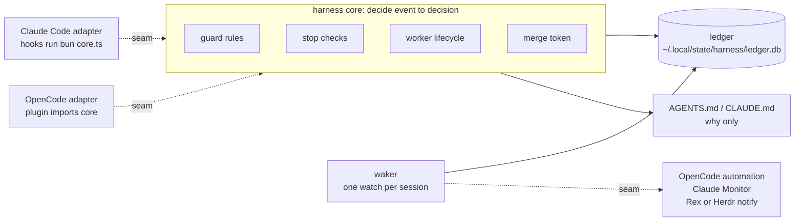
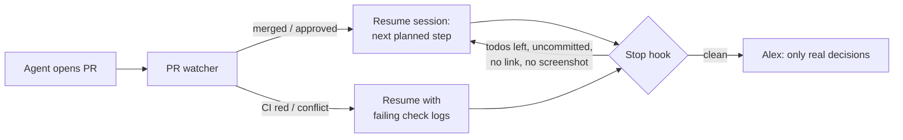
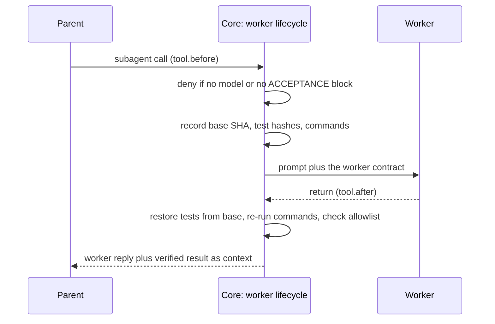
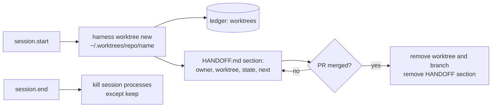
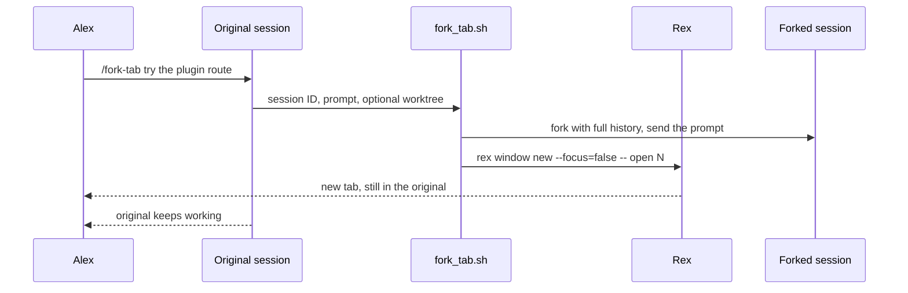

# Harness evolution: rules in code, not prose

Status: plan only. Nothing is built. Written 2026-11-25. Grilled with Alex twice; the frontier is empty. Every decision is taken (see Decisions), including Alex's later additions on worktrees, cleanup and the HANDOFF protocol (D7, D20 to D23). The design was reviewed with `improve-codebase-architecture` and grilled with Alex on 2026-11-25: the policies now sit behind one core module with one ledger, not in separate scripts.

Evidence (scratch, not durable):
- Archeologist briefing, session `ses_dec5cba8bffeG7XseU2P5tAuyM`. It covers 2026-11-19 to 2026-11-25 only: this Linux box has 6 days of history and no Mac stores.
- OpenCode features: `ses_dec5c94cdffe1v7zVO7K45B0Q3`. Checked on OpenCode v2.4.1.
- Claude Code features: `ses_dec5c74ffffeXTLt2kV33YEDxE`. Checked on Claude Code 2.1.332.
- Practice: `ses_dec5c5a5affeXDt64DMht0sGg7`, plus Anthropic's [3 patterns for harnessing Claude's intelligence](https://claude.com/resources/articles/harnessing-claudes-intelligence) (April 2026), added after Alex asked.

## Why

Every rule in `~/.config/opencode/AGENTS.md` and `~/.claude/CLAUDE.md` is prose. The model can decide a prose rule does not apply, and it did:

- On 2026-11-21 a worker ran `rm -r ~/Developer/ChamberlainGroup-myQ-Shared`, and about 54 repos had to be cloned again. The fix was another prose rule.
- "Load `coding`" and "no git writes" were pasted by hand into 69 of 158 worker prompts in 6 days.
- The post-worker check (restore the tests from base, hash them, re-run) was done by hand in 74 sessions.
- The acastro2 push trick was typed 250 times in 48 sessions.

Two facts make prose rules weaker than they look:

- OpenCode `cli.json` sets `session.permissions: "autoaccept"`. Every `ask` rule is approved automatically, so only `deny` is a fence.
- In both tools, a deny rule matches the command text only. `git -C . push`, `/usr/bin/git push` and `bash -c '...'` get past a `git push` rule. The Claude Code docs say deny rules are not a security boundary. A hook that parses the full command is the real fence.

Alex also spends his time steering, not building. In the same 6 days, 334 of his 1,202 top-level prompts (28%) only told the agent to take an obvious next step, and 584 (49%) were 6 words or fewer. The top kinds, from keyword matches on the OpenCode store and Claude Code `history.jsonl` (approximate counts):

| Prompt | Count | What it means |
| --- | --- | --- |
| "merged", "both merged", "approved", "sent" | 82 short ones, 102 in all | Alex acts as the agent's GitHub webhook |
| `/mcp`, `/model`, `/resume`, `/reload-skills` | 55 | Harness upkeep |
| A screenshot pasted as feedback | 41 | Alex does the UI check by hand |
| "link?", "links" | 36 | The links rule leaks |
| "commit and push" | 32 | The agent stops before the obvious step |
| "continue", "do it", "yes", "ok" | 31, plus 35 automatic "Continue." | The agent stops with todos open |
| "so what now?", "did it return?" | 17 | No view of the state |
| "CI failing", "merge conflict", "same error" | 17 | Alex relays CI to the agent |
| "nudge it, faster" | 12 | Alex watches the workers |
| "it's already merged", "already sent" | 9 | The agent reports old state as current |
| "you can, use browser control" | 1 here, likely more on the Mac | The agent gives up a task it can do in the browser |

"Use the question tool" appears once in these 6 days. Either it happens on the Mac, or that rule already mostly works.

The practice behind this is harness engineering: when an agent makes a mistake, add a fix in code so it cannot happen again ([Hashimoto](https://mitchellh.com/writing/my-ai-adoption-journey), [Böckeler](https://martinfowler.com/articles/exploring-gen-ai/harness-engineering.html), [OpenAI](https://openai.com/index/harness-engineering/)). A rule with no exceptions goes in a hook. A preference stays in prose.

## Shape

One core module holds every policy behind one interface. One ledger module holds every piece of state. Each tool gets one thin adapter. The prose files keep only the why.



Why this shape (from the architecture review):
- **Core, not 8 scripts.** In the first draft, each policy read its tool's raw hook JSON. A change in a tool's hook format then leaked into 8 modules, and OpenCode V2 already renamed every hook once. Now only the 2 adapters know the tool formats. Two adapters make the seam real.
- **Ledger, not 9 stores.** The first draft kept state in token files, plugin memory, `.git` lock files, automation state and more. The merge token alone had two designs, and plugin memory is lost when the OpenCode server restarts.
- **Worker lifecycle, not a command to remember.** A `verify_worker.py` that the parent must call is the same prose-rule failure this spec removes. The core now verifies on every worker return.
- **One waker.** The PR watcher, the done signal and the watchdog all poll something and wake a session. One module writes the fallback once.

### Interface

`decide(event) → decision`. The tests use the same interface: JSON event in, decision out.

| Event | Claude Code hook | OpenCode hook |
| --- | --- | --- |
| `tool.before` | `PreToolUse` | `permission.hook("evaluate")`, `tool.hook("execute.before")` |
| `tool.after` | `PostToolUse` | `tool.hook("execute.after")` |
| `prompt` | `UserPromptSubmit` | `session.hook("prompt")` |
| `stop` | `Stop` | session idle event (name to confirm in Phase 0) |
| `session.start` | `SessionStart` | session created event (Phase 0) |
| `session.end` | `SessionEnd` | equivalent to confirm in Phase 0 |

| Decision | Claude Code | OpenCode |
| --- | --- | --- |
| `allow` | `permissionDecision: allow` | no change |
| `deny` + message | `permissionDecision: deny`; on `stop`, exit 2 sends the agent back | `effect = "deny"`; on `stop`, a prompt into the session |
| `modify` + new input or context | `updatedInput`, `additionalContext` | input change in `execute.before`, output change in `execute.after` (Phase 0) |
| `ask` + message | `permissionDecision: ask` | `deny` with "ask Alex with the question tool, then retry", because `autoaccept` passes every ask |

**Failure mode.** If the core crashes or times out, the adapter denies calls that match a destructive rule (recursive delete, merge, destructive git) and allows everything else. Why: a timed-out Claude Code `PreToolUse` hook lets the call through, so the adapter must enforce this itself.

**Runtime.** TypeScript on Bun. mac-bootstrap installs a pinned Bun on the Mac and the VM. Claude Code hooks run `bun harness/core.ts <event>`. The OpenCode plugin imports the core in-process, because OpenCode runs plugins on Bun, so each call costs nothing extra. Tests run with `bun test harness/`, and `scripts/check.sh` runs them in CI.

### Ledger

One SQLite file per host at `~/.local/state/harness/ledger.db`, opened with `bun:sqlite` in WAL mode, so several sessions can write at once. The guard denies agent writes to it. It is per host: a merge token on the Mac does not work on the VM.

| Table | Holds | Kept |
| --- | --- | --- |
| `decisions` | every decision: session, event, rule id, outcome, reason | 30 days |
| `tokens` | merge grants from Alex's prompts | until used or 30 minutes |
| `watches` | PRs and workers the waker polls, with the last state seen | until done or 24 hours |
| `workers` | each spawn: base SHA, test file hashes, acceptance commands, last activity | 30 days |
| `sessions` | live sessions per repo | until `session.end` |
| `worktrees` | session, repo, path, branch, state (active, merged, removed) | until removed |
| `processes` | processes a session started, with a `keep` flag | until killed, or reported at the next `session.start` |
| `sendbacks` | stop send-backs per turn, for the cap | 30 days |

## Decisions

All taken by Alex on 2026-11-25.

| # | Decision | Answer | Why |
| --- | --- | --- | --- |
| D1 | Scope of this change | Plan doc only | Build comes after the plan |
| D2 | `gh pr merge` | Deny in shell. Merges go through the typed `merge_pr` tool, which needs Alex's token | Alex keeps the merge in chat, and a typed tool is easier to gate than a parsed command |
| D3 | Where the code lives | `alex-skills/harness/` | One fewer repo. skillcheck only reads folders with a `SKILL.md` (`skillcheck/core.py:63`), so it ignores `harness/` |
| D4 | Merge token | `MERGE-OK` in Alex's prompt: one merge of any PR in that session, within 30 minutes | Short to type, and an old prompt cannot authorize a merge hours later |
| D5 | Recursive delete allowlist | The session scratchpad, `~/.agents/skill-workspace`, `/tmp`, and tracked or ignored paths inside the current repo. Never the repo root, never `.git` | Would have blocked the 11-21 delete |
| D6 | Stale `HANDOFF.md` | The Stop check sends the agent back | Alex wants the handoff current at every milestone, and the cap stops a loop |
| D7 | Worktrees | An agent never writes in a repo's main checkout. Every writing session works in its own worktree, and the ledger keeps a pointer to it. This replaced a warn-only lock | Agents stop stepping on each other and on Alex |
| D8 | Steering fixes | In this spec, as Phase 2 | Alex picked it |
| D9 | When a watched PR merges | Resume the session and run the next step: the todo list first, then the HANDOFF Next list. If neither has a step, notify Alex | It never invents work |
| D10 | Stop cap | 5 send-backs per turn, then stop and say which check failed | Alex picked 5 over 3 |
| D11 | Core runtime | TypeScript on Bun, pinned, installed on both hosts | Native to OpenCode plugins |
| D12 | Adapters | OpenCode imports the core in-process; Claude Code spawns `bun core.ts` | One runtime and one code path |
| D13 | Events | The 6 in the Interface table | `session.end` gives a point to record leftovers |
| D14 | Decisions | `allow`, `deny`, `modify`, `ask`, plus an optional message | `ask` maps to a question-tool deny in OpenCode |
| D15 | Failure mode | Closed for destructive rules, open for the rest | A broken core never deletes repos and never blocks ordinary work |
| D16 | Ledger | SQLite per host, 30-day decision log | Several writers, queryable, in Bun |
| D17 | Worker acceptance | A `general` spawn with no `ACCEPTANCE:` block is denied. Read-only agents are exempt | The core needs the commands to re-run them |
| D18 | Verify result | Added as context next to the worker's reply | The parent sees the claim and the check side by side |
| D19 | Waker | One watch per session, every 2 minutes, expires after 24 hours | An OpenCode automation can only wake the session that created it |
| D20 | `session.end` | Kill the processes the session started, except the ones it registered with `keep` and named in its reply. Report the kept ones at the next start | The VM has little room for leftovers, and a server Alex asked for stays up only when it is named |
| D21 | Worktree home | `~/.worktrees/<repo>/<name>` | Outside every repo, so OpenCode does not load a second copy of a skill, and one folder is easy to measure on the VM |
| D22 | Cleanup | When a watched PR merges, the waker removes its worktree and local branch, only if the worktree is clean. The Stop check sends the agent back for unnamed running servers or scratch files over 500 MB | Disk on the VM stays bounded, and nothing with unsaved work is deleted |
| D23 | HANDOFF protocol | `HANDOFF.md` is a protocol between agents: one section per live workstream, removed when its work merges, 150 lines at most | Agents read who does what and where. Done work is removed, so the file is the current state |
| D24 | Rollout | Every rule is live from day one. No shadow week | Alex wants the time savings at once. `harness wrong` (D28) is the safety valve |
| D25 | Kill switch | `harness off` and `harness on`: one global flag in the ledger that only Alex can set | One command recovers every session if the core has a bug |
| D26 | Landing | Fast-forward only. The agent rebases its worktree branch on `origin/main`. In personal repos (remote owner `acastro2`) it pushes to `main`. In work repos it opens a PR, merged by rebase or ff, never a merge commit. After each landing the harness, not the agent, runs `git merge --ff-only` in the main checkout | A straight history, and the local `main` never drifts |
| D27 | Semantic Stop checks | Jev judges 4 checks (asks Alex something, false "can't", stale state, state footer) from a short turn summary, and sends back at 0.80 or above. If Jev is blocked or takes over 3 seconds, strict keyword rules decide and the ledger logs `jev-unavailable` | Jev can be blocked, so it never runs without a fallback |
| D28 | Tuning | `harness wrong` marks the last send-back false, and the agent continues. A rule marked wrong 3 times in a day goes log-only until `harness on <rule>` | A bad rule cannot cost turns all day |
| D29 | `merge_pr` | One stdio MCP server in `harness/`, loaded by both tools | One implementation of the riskiest action |
| D30 | Scope | Every git repo on both hosts, except the Obsidian vault and `~/.agents/skill-workspace` | The 11-21 wipe hit a work repo, so opt-in would have missed it |
| D31 | Who runs `harness` commands | Only Alex: typed in a prompt (read by the `prompt` event, like `MERGE-OK`) or in a terminal he runs. The guard denies agent shell calls to `harness off`, `on` and `wrong` | An agent must never switch the harness off |

## Phase 0. Prove the unverified facts

Do this first. The design depends on these facts, and the docs do not answer them. Each test becomes an adapter test in Phase 1.

| Fact | Test | Done when |
| --- | --- | --- |
| OpenCode `permission.hook("evaluate")` with `effect = "deny"` stops a `shell` call under `autoaccept` | A scratch plugin denies `echo HARNESS-PROBE`, and a session runs it | The command does not run, and the agent sees the reason |
| `bun:sqlite` loads inside OpenCode's plugin runtime | A scratch plugin opens a database and writes one row | The row is in the file |
| OpenCode `tool.hook("execute.before")` can change a tool's input, and `execute.after` can change its output | A scratch plugin adds a line to a `subagent` prompt and to a shell result | Both changes show in the session |
| A per-call subagent `model` overrides the agent's frontmatter `model` | Call `general` with a `model` that differs from its frontmatter, then read `session_v2.model` | The row shows the per-call model |
| An automation or a background wait can wake an idle session (OpenCode `automation` `send`, Claude Code `Monitor` or a background shell) | Start a 1-minute watch that sends `HARNESS-WAKE`, then let the session go idle | The session resumes and answers with no prompt from Alex |
| The OpenCode V2 events for idle, session created and session end | Log every `session.hook` event name in a scratch plugin across one session | The names are in the Interface table |
| Each tool's todo list can be read by the core at `stop` | Log the todo items a scratch adapter sees in one turn, in both tools | The pending items show in the log |
| What counts as `session.end` in OpenCode when the TUI closes but the session stays on the server | Close a TUI on a session with a test server running, and log the events | The event name is in the Interface table, and its timing is recorded |
| Jev answers inside 3 seconds from a hook, and the fallback runs when it does not | Call Jev from a scratch Stop adapter, then once with the network blocked | A typed answer, then a `jev-unavailable` row |
| A Claude Code command can read its own session ID | A `SessionStart` hook writes `session_id` to an env file, and a command reads it | The command prints the ID |

If the deny test fails, the OpenCode adapter uses `execute.before` to replace the command with one that fails with the reason. If `bun:sqlite` does not load, the OpenCode adapter spawns `bun core.ts` like Claude Code. If the wake test fails, the waker uses the Rex or Herdr notification only. If more than one of these fails, stop and bring it to Alex.

## Phase 1. Core, ledger, adapters, guard

Build the core with its first policy, the guard. This closes the worst risks, and it proves the seam with both adapters.

Guard rules (each has a rule id, so Phase 8 can switch it off):

| Rule id | Denies | Message to the agent |
| --- | --- | --- |
| `recursive-delete` | `rm -r`, `rm -rf`, `find -delete`, `rsync --delete` outside the D5 allowlist | "Recursive delete outside the allowlist. Name the exact files, or ask Alex." |
| `merge-in-shell` | Every `gh pr merge`, `gh api .../merge`, `git merge` into `main` or `master`, `git push` of a merge to `main` that has no PR | "Use the `merge_pr` tool." |
| `destructive-git` | `git reset --hard`, `git clean`, `git push --force` and `-f`, `git checkout -- .` | Same rules as today's `opencode.jsonc` deny list, now in both tools |
| `ledger-write` | Any write to `~/.local/state/harness/` | "Only the harness writes its state." |
| `harness-self` | An agent shell call to `harness off`, `harness on` or `harness wrong` (D31) | "Only Alex runs harness commands." |
| `main-checkout-write` | An edit or write tool on a path in a repo's main checkout, and `git commit`, `git checkout`, `git merge` or `git rebase` run there (D7) | "Work in a worktree: `harness worktree new <name>`. It records the pointer for other agents." |

The guard parses the full command and walks `bash -c`, `sh -c`, `env`, `xargs`, `git -C` and absolute paths before it matches. Why: deny rules in both tools match only the command text.

**Control commands.** Alex types `harness off`, `harness on`, `harness on <rule>` or `harness wrong` in a prompt, and the `prompt` event applies it. From his own terminal, `bun harness/cli.ts <command>` does the same when a session is stuck. `harness status` shows the flag, the log-only rules and today's send-backs.

**Landing (D26).** After an agent pushes, the core's `tool.after` policy checks that the push was fast-forward, then runs `git merge --ff-only origin/main` in the main checkout itself. The `main-checkout-write` rule does not apply to the harness, only to agents.

**Merge.** `merge_pr` is one stdio MCP server in `harness/` (D29), with `repo` and `pr` fields. It merges by rebase or fast-forward only. Why: Anthropic recommends a dedicated tool for hard-to-reverse actions, because the harness then sees typed arguments it can gate, log and replay ([article](https://claude.com/resources/articles/harnessing-claudes-intelligence)). The token flow:
1. A `prompt` event with `MERGE-OK` from Alex writes a row to `tokens`.
2. `merge_pr` reads the row, merges one PR and deletes the row.
3. With no valid row, `merge_pr` returns "Merge needs Alex's token."

Why the ledger holds the token: the agent can write files, but the `ledger-write` rule stops it from writing there, so only Alex's prompt can make a token.

Done when:
- `bun test harness/` passes. It has one case per rule, the bypass forms (`git -C . push --force`, `bash -c "rm -rf ~/x"`, `/usr/bin/gh pr merge 1`), the token expiry, the failure mode, the kill switch, and an agent call to `harness off` that is denied.
- A live probe in each tool shows a denied `rm -rf <path outside allowlist>` with the message, and a merge on a throwaway repo under `~/.agents/skill-workspace/` that works only after `MERGE-OK`.

## Phase 2. Steering: PR watcher and Stop hook

This phase gives Alex his time back. The PR watcher and the Stop hook remove about 230 of the 334 steering prompts.



**PR watcher (the waker).** It also keeps state fresh: the stale-state check reads PR state from the watcher's last poll in the ledger, not from the agent's memory. When an agent runs `gh pr create` or pushes to a PR branch, the core's `tool.after` policy adds a row to `watches` with the session ID. The waker polls `gh pr view <n> --json state,reviewDecision,mergeable,statusCheckRollup` every 2 minutes (D19) and wakes the session on a change:

| Change | What the session gets |
| --- | --- |
| Merged (D9) | "PR #n merged. Run the next planned step." The step comes from the todo list, then the HANDOFF Next list. With neither, Alex gets a notification instead. |
| Approved | "PR #n approved. Merge needs Alex's token." The agent never merges by itself. |
| A check failed | The failed job name and the last 80 log lines (`gh run view --log-failed`) |
| Conflict | "PR #n has a conflict with its base. Rebase and re-run the acceptance commands." |

- OpenCode: one `automation` with an `every` trigger and a `code` action. It returns `send: { prompt }` to the session that opened the PR, and `done: true` once the PR is closed or merged and the next step has started.
- Claude Code: a background `Monitor` or a `gh pr checks --watch` background shell that ends the wait. Check in Phase 0 which one wakes an idle session. If neither can, use a Rex or Herdr notification, and Alex types one word.

**Stop checks.** On the `stop` event, the core reads the turn and returns `deny` with a message, which sends the agent back. Each check has a rule id:

| Check | Sends back when | Prompts it removes |
| --- | --- | --- |
| Commit | The repo has verified changes that this session made, and they are not committed and pushed. Never other sessions' files. | 32 "commit and push" |
| Links | The turn ran `git push`, `gh pr create`, a ticket or comment create, or a page publish, and the reply has no URL for it | 36 "link?" |
| Continue | The todo list has a pending item and the reply does not ask Alex anything | 31 "continue", 35 automatic "Continue." |
| UI proof | The turn changed UI files and has no `browse` screenshot after the last change | most of the 41 screenshots |
| State | The reply does not end with what is done, what is running, and the next step | 17 "what now?" |
| Handoff | The repo has a `HANDOFF.md` that is older than this session's last commit (D6) | the handoff reminders |
| Processes | A process this session started is still running and is not named in the reply | the server scavenger hunt |
| Cleanup | Scratch files for this session are over 500 MB, or a merged worktree of this session is still on disk (D22) | disk filling on the VM |
| Handoff protocol | A `HANDOFF.md` section this session owns is stale or its work merged, or the file is over 150 lines (D23) | handoffs that only grow |
| Stale state | The reply says a PR is open, a review is waiting, or something waits for Alex, and the turn did not check it live (`gh pr view`, the ticket, the inbox) after the last time Alex spoke | 9 "it's already merged", "already sent" |
| False "can't" | The reply says the agent cannot do something, or asks Alex to do it by hand, and the task is in a browser while `browse` is connected. Only login, 2FA, a passkey, a captcha or a payment confirmation go to Alex, through `handoff`. | "you can, use browser control" |

The four judgment checks (ask Alex something, false "can't", stale state, state footer) go to Jev with a short turn summary and send back at 0.80 or above (D27). The summary holds no transcript, no secrets and no file contents. When Jev is blocked or slow, strict keyword rules decide.

The cap (D10) stops a loop: after 5 send-backs in one turn, the core lets the agent stop and say which check failed. The `sendbacks` table counts them.

**Upkeep.** Pin model and effort in each agent's frontmatter and in `settings.json`, so `/model` and `/effort` stop being needed at session start. Reload skills when a file in `~/.agents/skills` changes. Claude Code has a `FileChanged` hook event, and the existing `sync-agents-skills.sh` is the start.

Done when:
- A test PR on a throwaway repo goes from opened to merged, and the session resumes with no prompt from Alex.
- A failed check comes back as logs in the session.
- `bun test harness/` has one case per Stop check, plus the cap.
- After one week of use, a re-run of the prompt count shows the steering share down from 28%.

## Phase 3. Worker lifecycle

One policy covers a worker from spawn to return, so verification cannot be skipped.



On `tool.before` for `subagent` (OpenCode) and `Agent`/`Task` (Claude Code):
- Deny when `model` is missing: "Set `model`, see AGENTS.md Execution."
- Deny a `general` spawn with no `ACCEPTANCE:` block (D17). Read-only agents such as `archeologist` and `scout` are exempt.
- Record the base SHA, the test file hashes and the acceptance commands in `workers`.
- Add the worker contract to the prompt (`modify`): load `coding` first, no git writes, flag a wrong test and do not edit it, return the proof bundle.

On `tool.after` for the same call:
1. Compare the test file hashes with the record.
2. Restore the test files from the base SHA.
3. Run each acceptance command and keep its exit code and the last 40 lines.
4. Run `git diff --stat` and list files outside the allowlist.
5. Add the result as context next to the worker's reply (D18).

The waker also watches each background worker. With no new tool call in 10 minutes, the worker gets the nudge Alex types today: "stop exploring, run the acceptance commands once, return". When a worker finishes, Alex gets one Rex or Herdr notification. That removes the 12 "nudge it, faster" prompts and the "did it return?" questions.

Done when:
- On a seeded repo, a worker that edited a test comes back marked red, and a clean worker comes back green.
- A spawn with no `model` or no `ACCEPTANCE:` block is denied in both tools.
- A stalled worker gets one nudge, and a finished worker shows one notification, with no prompt from Alex.

## Phase 4. Small fixes, no hook needed

- **Bun:** mac-bootstrap installs a pinned Bun on the Mac and the VM (D11).
- **acastro2 pushes:** set `credential.https://github.com/acastro2.helper` in the global git config, so pushes to acastro2 repos use that account's token. This removes the 250 hand-typed helpers. The command goes in mac-bootstrap.
- **Broken symlinks:** `~/.claude/commands/ub-mode.md` and `~/.config/opencode/commands/ub-mode.md` point at `/Users/acastro/...`. Make them relative, or create them from mac-bootstrap per host.

Done when: `bun --version` prints the pin on both hosts, `git push` in `alex-skills` works with no `-c credential.helper`, and both `ub-mode` links resolve on Linux and on the Mac.

## Phase 5. Worktrees, cleanup, handoff protocol



**Worktrees (D7, D21).** `harness worktree new <name>` runs `git worktree add ~/.worktrees/<repo>/<name> -b <name>`, writes a `worktrees` row, and moves the session there (OpenCode `session.move`; Claude Code `--worktree` or `isolation: worktree` for subagents). The `main-checkout-write` rule denies writes in the main checkout. On `session.start`, the core tells the agent which worktrees are live in the repo and which session owns each one, so no two agents use the same one.

**Cleanup (D20, D22).**
- When a watched PR merges, the waker removes its worktree with `git worktree remove` (never `--force`) and deletes the local branch. A worktree with uncommitted changes stays, and its owner gets a message.
- On `session.end`, the core kills each process in `processes` for that session, unless it has the `keep` flag. An agent sets `keep` with `harness keep <pid>` only for a server Alex asked to keep up, and the Stop check makes it name the process in the reply.
- The Stop check sends the agent back when its scratch files are over 500 MB or a merged worktree is still on disk.

**Handoff protocol (D23).** `HANDOFF.md` stops being a log that only grows. It holds one section per live workstream:

```markdown
## <workstream>
Owner: <session id> · Worktree: ~/.worktrees/<repo>/<name> · Updated: <date>
State: <one or two lines>
Next:
1. <step>
Running: <process, port, PID>, or none
```

- An agent adds its section when it starts work and keeps it current at each milestone.
- When the work merges, the agent removes the section. The decision goes to an ADR or the PR body, not to the handoff.
- The Stop check sends the agent back when its own section is stale or its work merged, or when the file is over 150 lines.
- The `handoff` skill changes to match: sections, owners, removal on merge, and the 150-line cap. The repo's own `docs/HANDOFF.md` is the first one to clean up.

Done when:
- Two sessions in one repo each get a worktree, and each sees the other's pointer at start.
- A write in the main checkout is denied with the worktree command.
- A merged PR's clean worktree and branch are gone, and its HANDOFF section is removed.
- `session.end` kills an unkept test server and keeps a server flagged `keep`.

## Phase 6. Fork to a new tab

Alex often wants to explore two paths from one conversation. Today `/fork` replaces the session he is in. The goal: one command opens the fork in a new Rex tab, already running, and the original session does not stop or change.



Verified on 2026-11-25:
- **OpenCode:** `opencode run -s <session> --fork --title <t> --format json "<prompt>"` made a new session with the full history. It answered a question about this conversation, while the original session kept running. The JSON events carry the new `sessionID`. `--worktree <name>` also exists on `opencode run`.
- **Claude Code:** `claude --resume <id> --fork-session` exists in `claude --help` (2.1.332). Not run yet.
- **Rex:** `rex window new -s SESSION LABEL --focus=false -- COMMAND` opens a tab and keeps Alex's current tab active.

`harness/fork_tab.sh` does the following:
1. OpenCode: run `opencode run -s "$OPENCODE_SESSION_ID" --fork --title "<t>" --format json "<prompt>"`, read the new session ID from the events, then `rex window new -s "$REX_SESSION" "<t>" --focus=false -- opencode -s <new id>`.
2. Claude Code: `rex window new -s "$REX_SESSION" "<t>" --focus=false -- claude --resume <id> --fork-session "<prompt>"`.
3. The fork always gets its own worktree through `harness worktree new` (D7), so the two paths never edit the same files.
4. Under Herdr (`HERDR_ENV=1`), open a Herdr tab instead of a Rex tab.

Entry points: an OpenCode command `/fork-tab <prompt>` and a Claude Code command or skill `/fork-tab <prompt>`. Each calls the script with its own session ID.

Open questions for Phase 0:
- How does a Claude Code command read its own session ID? Hooks get `session_id` on stdin. A `SessionStart` hook can write it to an env file. Not verified.
- Does `claude --resume <id> --fork-session "<prompt>"` start the fork with the prompt in the interactive TUI? Not run yet.

Done when: `/fork-tab` from a running session opens a new tab that already answers the prompt with the full history, Alex's tab stays focused, and the original turn goes on with no change.

## Phase 7. Cut the prose

For each rule now enforced in code, cut the "what" from `AGENTS.md` and `CLAUDE.md`, and keep one line of why plus the rule id. Target: both files under 70 lines. Why: OpenAI keeps its AGENTS.md at about 100 lines, and every enforced rule left in prose is context the model reads for nothing.

Done when: the line counts drop, and a short eval shows no rule loss. Run the `coding` worker eval and one merge-attempt eval before and after the cut.

## Phase 8. Prune by eval

Anthropic's point: every harness part encodes a limit of the model, and a newer model can make it dead weight ([article](https://claude.com/resources/articles/harnessing-claudes-intelligence)). So the harness gets the same test as a skill.

- For each prose rule left after Phase 7, run one eval with the rule and one without it, on the current model.
- Switch a harness rule off by its id for one eval run with `HARNESS_DISABLE=<rule-id>`. The decision log in the ledger shows which rule fired.
- Remove each rule that changes nothing. Keep the eval, so the next model change re-runs it.
- Count the MCP tools loaded in a session. Tools sit in the cached prefix, so a long or changing list costs cache hits and attention. Move rarely used servers behind Code Mode search.
- Test Claude Code auto mode (a second model judges each shell command) as a backstop behind the guard rules. It does not replace the guard: it is a judgment, and the guard rules have no exceptions.

Done when: every remaining prose rule has an eval that shows it changes the output.

## Later, end to end

Not in this plan. Each needs its own spec.

- Automations: `gather` and `bard` sweeps, the morning brief, and a weekly `upstream_audit.py` run that opens a PR.
- `anthropics/claude-code-action` for PR review on `alex-skills`.
- A doc-gardening job that checks `HANDOFF.md` and the README tables against the repo.
- Package the adapters as a Claude Code plugin (`.claude-plugin/plugin.json`), so the Mac and this box install the same thing.

## Risks

- **A hook timeout lets the call through.** In Claude Code, a timed-out `PreToolUse` hook does not block. The adapter applies the failure mode (D15) itself, and the core has no network calls on `tool.before`.
- **An in-process core can crash the OpenCode plugin.** The adapter wraps each call and applies the failure mode on any exception.
- **`--bare` skips hooks.** `claude -p --bare` runs with no hooks, so the eval harnesses run without the guard. That is fine for evals, but never use `--bare` for real work.
- **Plugin subagents ignore `hooks`.** Put the Claude Code hooks in `settings.json`, not in a plugin's agent frontmatter.
- **Another session edits the same files.** Commit each phase with a pathspec.
