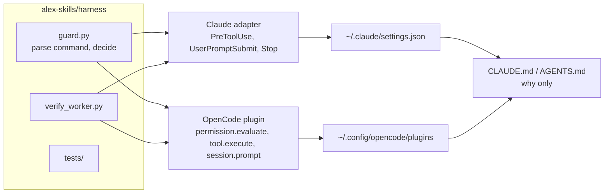
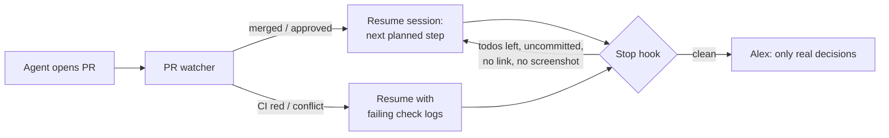

# Harness evolution: rules in code, not prose

Status: plan only. Nothing is built. Written 2026-11-25. Decisions D1 to D3 were taken by Alex on 2026-11-25 (see the table). D4 to D7 are open.

Evidence (scratch, not durable):
- Archeologist briefing, session `ses_dec5cba8bffeG7XseU2P5tAuyM`. It covers 2026-11-19 to 2026-11-25 only: this Linux box has 6 days of history and no Mac stores.
- OpenCode features: `ses_dec5c94cdffe1v7zVO7K45B0Q3`. Checked on OpenCode v2.4.1.
- Claude Code features: `ses_dec5c74ffffeXTLt2kV33YEDxE`. Checked on Claude Code 2.1.332.
- Practice: `ses_dec5c5a5affeXDt64DMht0sGg7`, plus Anthropic's [3 patterns for harnessing Claude's intelligence](https://claude.com/resources/articles/harnessing-claudes-intelligence) (April 2026), added after Alex asked.

## Why

Every rule in `~/.config/opencode/AGENTS.md` and `~/.claude/CLAUDE.md` is prose. The model can decide a prose rule does not apply, and it did:

- On 2026-11-21 a worker ran `rm -r ~/Developer/ChamberlainGroup-myQ-Shared`, and about 54 repos had to be cloned again. The fix was another prose rule.
- "Load `coding`" and "no git writes" were pasted by hand into 69 of 158 worker prompts in 6 days.
- The post-worker check (restore the tests from base, hash them, re-run) was done by hand in 74 sessions.
- The acastro2 push trick was typed 250 times in 48 sessions.

Two facts make prose rules weaker than they look:

- OpenCode `cli.json` sets `session.permissions: "autoaccept"`. Every `ask` rule is approved automatically, so only `deny` is a fence.
- In both tools, a deny rule matches the command text only. `git -C . push`, `/usr/bin/git push` and `bash -c '...'` get past a `git push` rule. The Claude Code docs say deny rules are not a security boundary. A hook that parses the full command is the real fence.

Alex also spends his time steering, not building. In the same 6 days, 334 of his 1,202 top-level prompts (28%) only told the agent to take an obvious next step, and 584 (49%) were 6 words or fewer. The top kinds, from keyword matches on the OpenCode store and Claude Code `history.jsonl` (approximate counts):

| Prompt | Count | What it means |
| --- | --- | --- |
| "merged", "both merged", "approved", "sent" | 82 short ones, 102 in all | Alex acts as the agent's GitHub webhook |
| `/mcp`, `/model`, `/resume`, `/reload-skills` | 55 | Harness upkeep |
| A screenshot pasted as feedback | 41 | Alex does the UI check by hand |
| "link?", "links" | 36 | The links rule leaks |
| "commit and push" | 32 | The agent stops before the obvious step |
| "continue", "do it", "yes", "ok" | 31, plus 35 automatic "Continue." | The agent stops with todos open |
| "so what now?", "did it return?" | 17 | No view of the state |
| "CI failing", "merge conflict", "same error" | 17 | Alex relays CI to the agent |
| "nudge it, faster" | 12 | Alex watches the workers |
| "it's already merged", "already sent" | 9 | The agent reports old state as current |
| "you can, use browser control" | 1 here, likely more on the Mac | The agent gives up a task it can do in the browser |

"Use the question tool" appears once in these 6 days. Either it happens on the Mac, or that rule already mostly works.

The practice behind this is harness engineering: when an agent makes a mistake, add a fix in code so it cannot happen again ([Hashimoto](https://mitchellh.com/writing/my-ai-adoption-journey), [Böckeler](https://martinfowler.com/articles/exploring-gen-ai/harness-engineering.html), [OpenAI](https://openai.com/index/harness-engineering/)). A rule with no exceptions goes in a hook. A preference stays in prose.

## Shape

One guard script holds the logic. Each tool gets a thin adapter that calls it. The prose files keep only the why.



Why one script: two copies drift. Why thin adapters: each tool's hook API changes between versions (OpenCode V2 renamed every hook), and only the adapter has to follow.

## Decisions

| # | Decision | Answer | Why |
| --- | --- | --- | --- |
| D1 | Scope of this change | Plan doc only | Alex picked it, 2026-11-25 |
| D2 | `gh pr merge` | Deny, unless Alex's prompt has a one-time token | Alex picked it over a hard deny. He keeps the merge in chat. The token is checked by a typed `merge_pr` tool, not by shell parsing (see Phase 1). |
| D3 | Where the code lives | `alex-skills/harness/` | Alex picked it over a new repo. One fewer repo. |
| D4 | Token word and lifetime | Open. Proposal: `MERGE-OK`, one merge, then gone | |
| D5 | Recursive `rm` allowlist | Open. Proposal: the scratchpad, `~/.agents/skill-workspace`, and paths inside the current git repo that git tracks or ignores | |
| D6 | Stop hook: warn or block on a stale `HANDOFF.md` | Open. Proposal: warn | A block can loop on a session that has nothing to record |
| D7 | Repo lock for parallel sessions: warn or block | Open. Proposal: warn, and show the other session's ID | |
| D8 | Where the steering fixes go | In this spec, as Phase 2 | Alex picked it, 2026-11-25 |
| D9 | What the agent does when a watched PR merges | Resume the session and run the next planned step | Alex picked it, 2026-11-25. It is what he does by hand today when he types "merged". |
| D10 | Stop hook cap | Open. Proposal: send the agent back at most 3 times per turn, then let it stop and say why | Stops a loop when a check is wrong |

## Phase 0. Prove the unverified facts

Do this first. The design depends on these facts, and the docs do not answer them.

| Fact | Test | Done when |
| --- | --- | --- |
| OpenCode `permission.hook("evaluate")` with `effect = "deny"` stops a `shell` call, under `autoaccept` | A scratch plugin denies `echo HARNESS-PROBE`, and a session runs it | The command does not run, and the agent sees the reason |
| A per-call subagent `model` overrides the agent's frontmatter `model` | Call `general` with a `model` that differs from its frontmatter, then read `session_v2.model` | The row shows the per-call model |
| An automation or a background wait can wake an idle session (OpenCode `automation` `send`, Claude Code `Monitor` or a background shell) | Start a 1-minute watch that sends `HARNESS-WAKE`, then let the session go idle | The session resumes and answers with no prompt from Alex |
| The OpenCode V2 event for a session that goes idle, for the Stop hook | Log every `session.hook` event name in a scratch plugin for one turn | The name is recorded in this spec |

If the first fails, the OpenCode adapter uses `tool.hook("execute.before")` to replace the command with one that fails with the reason. Test that the same way. If both fail, stop and bring it to Alex.

## Phase 1. Guard (closes the worst risks)

`harness/guard.py` reads one tool call as JSON on stdin and prints a decision: `allow`, or `deny` plus a reason the agent can act on. It parses the command with `shlex` and walks `bash -c`, `sh -c`, `env`, `xargs`, `git -C` and absolute paths before it matches.

Rules:

| Rule | Denies | Reason the agent sees |
| --- | --- | --- |
| Recursive delete | `rm -r`, `rm -rf`, `find -delete`, `rsync --delete` outside the D5 allowlist | "Recursive delete outside the allowlist. Name the exact files, or ask Alex." |
| Merge in shell | Every `gh pr merge`, `gh api .../merge`, `git merge` into `main` or `master`, `git push` of a merge to `main` that has no PR | "Use the `merge_pr` tool." |
| Destructive git | `git reset --hard`, `git clean`, `git push --force` and `-f`, `git checkout -- .` | Same rules as today's `opencode.jsonc` deny list, now in both tools |
| Token tamper | Any write to the token folder | "Only Alex's prompt can create a merge token." |

Merges go through one typed `merge_pr` tool (an MCP tool or an OpenCode custom tool), with `repo` and `pr` as fields. Why: Anthropic recommends a dedicated tool for hard-to-reverse actions, because the harness then sees typed arguments it can gate, log and replay, not a command string it must parse ([article](https://claude.com/resources/articles/harnessing-claudes-intelligence)). The shell guard then only has to deny every merge form, which is simpler than allowing one.

The merge token, per tool:

- **Claude Code:** a `UserPromptSubmit` hook sees `MERGE-OK` in Alex's prompt and writes `~/.local/state/harness/tokens/<session_id>`. The `merge_pr` tool allows one merge and deletes the file.
- **OpenCode:** `session.hook("prompt")` sees the word and sets a flag in plugin memory for that session. `merge_pr` reads the flag, allows one merge and clears it.

Why a hook writes the token: the agent can write files, so a token the agent can create proves nothing. The guard denies writes to the token folder, and the OpenCode flag lives in memory the agent cannot reach.

Done when:
- `pytest harness/tests` passes. It has one case per rule, plus the bypass forms (`git -C . push --force`, `bash -c "rm -rf ~/x"`, `/usr/bin/gh pr merge 1`).
- A live probe in each tool shows a denied `rm -rf <scratch outside allowlist>` with the reason, and an allowed merge on a test repo after `MERGE-OK`. The test repo is a throwaway under `~/.agents/skill-workspace/`.

## Phase 2. Steering: PR watcher and Stop hook

This phase gives Alex his time back. The PR watcher and the Stop hook remove about 230 of the 334 steering prompts.



**PR watcher.** It also keeps state fresh: the agent reads PR state from the watcher's last poll, not from its memory of the conversation. When an agent runs `gh pr create` or pushes to a PR branch, a `PostToolUse` / `execute.after` hook registers the PR with the session ID. A watcher polls `gh pr view <n> --json state,reviewDecision,mergeable,statusCheckRollup` every 2 minutes and wakes the session on a change:

| Change | What the session gets |
| --- | --- |
| Merged (D9) | "PR #n merged. Run the next planned step." The next step comes from the todo list or `HANDOFF.md`. |
| Approved | "PR #n approved. Merge needs Alex's token." The agent never merges by itself. |
| A check failed | The failed job name and the last 80 log lines (`gh run view --log-failed`) |
| Conflict | "PR #n has a conflict with its base. Rebase and re-run the acceptance commands." |

- OpenCode: one `automation` with an `every` trigger and a `code` action. It returns `send: { prompt }` to the session that opened the PR, and `done: true` once the PR is closed or merged and the next step has started.
- Claude Code: a background `Monitor` or a `gh pr checks --watch` background shell that ends the wait. Check in Phase 0 which one wakes an idle session. If neither can, use a Rex or Herdr notification, and Alex types one word.

**Stop hook.** When the agent tries to end its turn, `stop_check.py` reads the turn and sends it back (Claude Code: `Stop` exit 2 with the reason; OpenCode: the session idle event, then a prompt into the session). It sends the agent back for these reasons:

| Check | Sends back when | Prompts it removes |
| --- | --- | --- |
| Commit | The repo has verified changes that this session made, and they are not committed and pushed. Never other sessions' files. | 32 "commit and push" |
| Links | The turn ran `git push`, `gh pr create`, a ticket or comment create, or a page publish, and the reply has no URL for it | 36 "link?" |
| Continue | The todo list has a pending item and the reply does not ask Alex anything | 31 "continue", 35 automatic "Continue." |
| UI proof | The turn changed UI files and has no `browse` screenshot after the last change | most of the 41 screenshots |
| State | The reply does not end with what is done, what is running, and the next step | 17 "what now?" |
| Handoff | The repo has a `HANDOFF.md` that is older than this session's last commit (D6) | the handoff reminders |
| Processes | A process this session started is still running and is not named in the reply | the server scavenger hunt |
| Stale state | The reply says a PR is open, a review is waiting, or something waits for Alex, and the turn did not check it live (`gh pr view`, the ticket, the inbox) after the last time Alex spoke | 9 "it's already merged", "already sent" |
| False "can't" | The reply says the agent cannot do something, or asks Alex to do it by hand, and the task is in a browser while `browse` is connected. Only login, 2FA, a passkey, a captcha or a payment confirmation go to Alex, through `handoff`. | "you can, use browser control" |

The cap (D10) stops a loop: after 3 send-backs in one turn, the hook lets the agent stop and say which check failed.

**Upkeep.** Pin model and effort in each agent's frontmatter and in `settings.json`, so `/model` and `/effort` stop being needed at session start. Reload skills when a file in `~/.agents/skills` changes. Claude Code has a `FileChanged` hook event, and the existing `sync-agents-skills.sh` is the start.

Done when:
- A test PR on a throwaway repo goes from opened to merged, and the session resumes with no prompt from Alex.
- A failed check comes back as logs in the session.
- `pytest harness/tests` has one case per Stop check, plus the cap.
- After one week of use, a re-run of the prompt count shows the steering share down from 28%.

## Phase 3. Worker spawn hook

On every `subagent` call (OpenCode) and `Agent`/`Task` call (Claude Code):

- Deny the call when `model` is missing. Reason: "Set `model`, see AGENTS.md Execution."
- Add the worker contract to the prompt: load `coding` first, no git writes, flag a wrong test and do not edit it, and return the proof bundle. Skip it for `archeologist` and other read-only agents.

Claude Code allows the prompt change through `updatedInput`. For OpenCode, test in Phase 0 that `tool.hook("execute.before")` can replace the input. If it cannot, deny with the contract text so the parent re-sends.

Done when: a subagent call with no `model` is denied in both tools, and a worker's first message shows the contract.

## Phase 4. `verify_worker.py`

One command replaces the manual loop that ran in 74 sessions:

```
harness/verify_worker.py --base <ref> --tests '<globs>' -- <acceptance commands>
```

It does the following:
1. Hash the test files.
2. Restore them from `<base>`.
3. Run each acceptance command, and print its exit code and the last 40 lines.
4. Print `git diff --stat` and the files outside an optional `--allow` list.
5. Exit non-zero on any failure.

Add a `tool.hook("execute.after")` / `PostToolUse` on the subagent tool that prints `git status --short`. Then the parent sees the worker's changes without asking.

Done when: run on a seeded repo, it catches a worker that edited a test (red), and passes a clean worker (green).

## Phase 5. Small fixes, no hook needed

- **acastro2 pushes:** set `credential.https://github.com/acastro2.helper` in the global git config, so pushes to acastro2 repos use that account's token. This removes the 250 hand-typed helpers. The command goes in mac-bootstrap, not in a skill.
- **Broken symlinks:** `~/.claude/commands/ub-mode.md` and `~/.config/opencode/commands/ub-mode.md` point at `/Users/acastro/...`. Make them relative, or create them from mac-bootstrap per host.

Done when: `git push` in `alex-skills` works with no `-c credential.helper`, and both `ub-mode` links resolve on Linux and on the Mac.

## Phase 6. Parallel sessions and workers

- **Lock:** on session start, write `.git/harness-lock/<session_id>` with the PID and the start time. Warn when another live session holds a lock in the same repo, and name it.
- **Done signal:** when a background worker finishes, send one Rex or Herdr notification. This answers "did the task return?" without polling.

- **Watchdog:** when a background worker runs 10 minutes with no new tool call, send it the nudge Alex types today ("stop exploring, run the acceptance commands once, return"). This removes the 12 "nudge it, faster" prompts.

Done when: two sessions in one repo see each other's ID, a finished worker shows a notification, and a stalled worker gets one nudge without Alex.

## Phase 7. Cut the prose

For each rule now enforced in code, cut the "what" from `AGENTS.md` and `CLAUDE.md`, and keep one line of why plus a pointer to the guard. Target: both files under 70 lines. Why: OpenAI keeps its AGENTS.md at about 100 lines, and every enforced rule left in prose is context the model reads for nothing.

Done when: the line counts drop, and a short eval shows no rule loss. Run the `coding` worker eval and one merge-attempt eval before and after the cut.

## Phase 8. Prune by eval

Anthropic's point: every harness part encodes a limit of the model, and a newer model can make it dead weight ([article](https://claude.com/resources/articles/harnessing-claudes-intelligence)). So the harness gets the same test as a skill.

- For each prose rule left after Phase 7, run one eval with the rule and one without it, on the current model.
- Remove each rule that changes nothing. Keep the eval, so the next model change re-runs it.
- Count the MCP tools loaded in a session. Tools sit in the cached prefix, so a long or changing list costs cache hits and attention. Move rarely used servers behind Code Mode search.
- Test Claude Code auto mode (a second model judges each shell command) as a backstop behind `guard.py`. It does not replace the guard: it is a judgment, and the guard rules have no exceptions.

Done when: every remaining prose rule has an eval that shows it changes the output.

## Later, end to end

Not in this plan. Each needs its own spec.

- Automations: `gather` and `bard` sweeps, the morning brief, and a weekly `upstream_audit.py` run that opens a PR.
- `anthropics/claude-code-action` for PR review on `alex-skills`.
- A doc-gardening job that checks `HANDOFF.md` and the README tables against the repo.
- Package the adapters as a Claude Code plugin (`.claude-plugin/plugin.json`), so the Mac and this box install the same thing.

## Risks

- **skillcheck may flag `harness/`.** It has no `SKILL.md`. Check `skillcheck/policy.py` for a non-skill folder rule before Phase 1. Add the folder to the exclusions if needed.
- **A hook timeout lets the call through.** In Claude Code, a timed-out `PreToolUse` hook does not block. Keep `guard.py` pure Python with no network, and set a 5-second timeout.
- **`--bare` skips hooks.** `claude -p --bare` runs with no hooks, so the eval harnesses run without the guard. That is fine for evals, but never use `--bare` for real work.
- **Plugin subagents ignore `hooks`.** Put the hooks in `settings.json`, not in a plugin's agent frontmatter.
- **Another session edits the same files.** Commit each phase with a pathspec.
