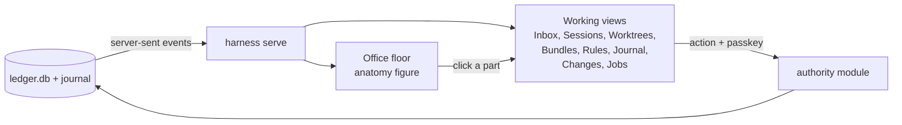

# Harness office: the UI

Status: plan only. Written with Alex on 2026-11-25. It replaces the monitor page in `harness-evolution.md` (D58 to D61) with a fuller design, and builds in Phase 9 of that spec. Product record: `harness/PRODUCT.md`.

**Ask:** approve this brief. The build then follows the `impeccable` and `anatomy` workflows below.

## What it is

One local page per host, served by `harness serve`. The first view is an isometric office floor where every moving part is a true signal from the ledger. A click on any part opens the matching working view, a plain dense tool screen for real work.

Why two kinds of surface: the office answers "is anything wrong?" in one glance. Dense data (a journal search, a bundle's re-runs) does not fit in a drawing, so it gets a tool screen. Each office signal also exists as text in a working view, so the figure is never the only way to read it.

## Decisions

| # | Decision | Answer | Why |
| --- | --- | --- | --- |
| O1 | Product record | `harness/PRODUCT.md`, scoped to the harness | The repo root is the skills collection |
| O2 | Stack | Plain TypeScript and HTML, no framework. Bun serves it; server-sent events push ledger changes; `bun build` bundles it | Nothing to upgrade, and the anatomy kit runs as is |
| O3 | Shape | Office overview, plus 8 plain working views | Fun where it carries data; familiar tools where the work is |
| O4 | Office mapping | The table in "The office" below. No human figures | Every moving part is a true signal |
| O5 | Desk count | Up to 8 desks; more sessions on a "+N" rack. A worker sits at a small desk beside its parent | Reads at 1440 and 390 px, and the worker-to-parent link is visible by position |
| O6 | Figure size | anatomy Hero: 80 to 150 parts, about 2 to 4 hours of build time | One dense live floor; an Epic (people, rooms, shaders) is out of scope |
| O7 | Views | Inbox, Sessions and workers, Worktrees and conflicts, Proof bundles, Rules, Journal and replay, Harness changes, Jobs | Alex picked all 8 |
| O8 | Build path | Code-first, recorded in `harness/.impeccable/config.json` | App screens and anatomy figures are built in code either way |
| O9 | Reach | Local only, on `localhost`. The VM page reaches the Mac browser through port forwarding. No phone access | Passkeys work on `localhost` with no certificates, and nothing is exposed past the machine |
| O10 | Desk assignment | Sessions that need Alex first (a waiting question, stuck), then running turns, then idle. A desk stays with its session until it ends; an ended desk dims for 10 minutes, then frees. A racked session that needs Alex takes the longest-idle desk, and that is the only reshuffle | What needs Alex is always on the floor, and nothing moves under his eyes |
| O11 | Alerts | A silent browser notification when a question arrives or a session goes stuck. Permission is asked from a top-bar button, never on page load. The bell is drawn, not heard | Alex notices from another app, with no noise |
| O12 | One world | The working views share the office's look: the anatomy paper and ink palette, one lit accent, the same type. `impeccable` new-work sets the details | Clicking into a view feels like zooming into the same room |
| O13 | Inbox answers | The question's own options as buttons, plus a free-text box. An answer from the page is never a grant, even with `MERGE-OK` in it (D35) | Grants come only from a typed prompt or a passkey tap |
| O14 | Ticker and theme | The ticker's speed follows the journal rate on a log scale, not one notch per row. The theme follows the system, with a switch | One notch per row blurs at a few hundred rows a minute |

## The office (anatomy figure)

**Concept.** A small, real office floor seen from 45° and 30° up. Each live session is a desk with a terminal. The office machines around the room are the shared parts of the harness. What moves is always a ledger fact changing; nothing moves for decoration.

| Part | Harness fact (ledger source) | What moves, and what it means |
| --- | --- | --- |
| Desk with a terminal | one live session (`sessions`) | The screen shows the session's goal in one line, drawn in the plane of the screen and clipped to it. The desk lamp is lit while a turn runs. |
| Small side desk | a worker (`sessions.parent_session_id`) | It sits beside its parent's desk, and its lamp follows the worker's turn. |
| In-tray | a question waiting for Alex (journal `question` events with no answer) | A card drops into the tray, and the lamp turns amber. |
| Red flag on the desk | `stuck` (D78) | The flag rises after the 5th nudge. |
| Filing cabinet, one drawer per worktree | `worktrees` | A drawer slides open while `active`. Its tab turns red on `conflict` (D79), and an empty drawer slides shut on `removed`. |
| Pneumatic tube to each desk | the waker (`watches`) | A capsule runs the tube on each wake: a PR merged, CI red, a stall nudge. |
| Ticker-tape machine | the journal | The tape speed follows the journal rate on a log scale (O14). A deny prints with a darker mark. |
| Rubber stamp and ink pad | grants (`tokens`) | The stamp presses down once per grant, and lifts when the token is used. |
| Dial gauge on the wall | steering share (journal, last 7 days) | The needle reads the share of steering prompts; 28% at baseline. |
| Wall clock | jobs (`jobs`, `Bun.cron`) | The hands show the time; a small second hand points at the next job. |
| Fuse box by the door | the kill switch and rule modes (`rules`, `harness off`) | The main lever is down when the harness is off. One small breaker per rule shows its mode: enforce, advise, inject or off. |
| Bell | a session newly `stuck`, or a conflict with no owner | It rings once, then stays still until the next event. |
| "+N" rack | sessions beyond 8 (O10) | One slot per extra session, each with a small lit or dark lamp. |

**Truth module.** A pure `office-model.ts` turns ledger rows into the figure's state: desks, lamps, drawers, capsules in flight, the tape position, the needle angle. The build and the page both import it, the same pattern as the arcade's coins. Every readout on the card comes from this module.

**Parts list (Hero, 80 to 150 parts).** Each part sits on another part.

- **Floor and room (about 20):** floor slab with board seams, skirting, two wall slabs with a seam at the corner, a door frame and door, a window with mullions, ceiling-light rails, cable trays, wall sockets with screws, a rug.
- **Desk unit, repeated up to 8 times (about 10 each, built in the page):** top with a bevel, two leg frames, a modesty panel, a drawer with a pull, the terminal (case, screen bezel, screen face, stand, cable to a socket), a desk lamp (base, arm, head), the in-tray, the flag on a pin, a name plate with an engraved session slug.
- **Side desk (about 6 each):** a smaller top, legs, a terminal and a lamp.
- **Filing cabinet (about 14):** carcass, plinth, drawers with pulls and label holders, rails, a lock barrel.
- **Pneumatic system (about 12):** a main tube along the ceiling, drops to each desk, receivers with flaps, the capsule, brackets with screws.
- **Ticker machine (about 10):** base, glass dome, spool, tape path, print wheel, tape tray.
- **Stamp station (about 6):** pad, stamp handle, rubber face, holder.
- **Wall instruments (about 14):** dial gauge (bezel, dial, ticks, needle, crown), clock (case, face, hands), fuse box (door, main lever, breakers, label rail), bell (dome, striker, bracket).
- **"+N" rack (about 8):** frame, slots and lamps.

**Craft rules that bind here** (from `anatomy`):
- Solids, not wireframes. The base and room are `lo`, the furniture `mid`, and the machines `hi`. Exactly one `lit` accent at a time: the most urgent thing on the floor (a waiting question, then `stuck`, then a conflict).
- Screen text fits its window at the widest goal string and is clipped to it.
- Every cable and tube ends on a real socket, receiver or flange. Run `node build.mjs --audit` and the `lines.mjs` check to zero.
- Calm, time-based motion: exponential follow, with an idle tour when nothing changes. Still under reduced motion. Stops when the tab is hidden.
- A WebGL layer only if it earns its place: the screen and lamp glow. The SVG must read without it.
- Verify at 1440 and 390 px, in light and dark, with 4× close-ups of every junction.

## Working views (impeccable shape brief)

**Job and audience.** Alex, mid-flow in other sessions, opens the page to see what needs him and act in seconds. Mode: **Operate**. Familiar patterns beat novelty, density is fine, and one well-tuned sans carries every label.

**Outcome.** Every action Alex takes today by typing a steering prompt has a place here: answer, mark wrong, grant, apply, switch off. Success: he never visits a terminal tab just to find out its state.

**Layout.** A top bar holds the host name, the harness on/off state, and the passkey session timer. A left rail lists the office and the 8 views, each with a count badge. The office sits in the main area; a view replaces it, and a click on an office part deep-links to the right view with the item selected. Back returns to the office.

| View | Shows (ledger source) | Actions (D60, D61) |
| --- | --- | --- |
| Inbox | waiting questions, oldest first, with session, goal and age | answer (sent as the session's next prompt) |
| Sessions and workers | each session: tool, model, goal, turn, nudges, stuck, parent | open its journal |
| Worktrees and conflicts | each worktree: branch, owner, state, sync state, conflict files | none in v1 (the waker fixes; the view explains) |
| Proof bundles | verdicts by head SHA, re-runs with exit codes, known gaps, push-gate result | none |
| Rules | each rule: mode, ships in, send-backs today, wrong count | `harness wrong` on a send-back; `harness on <rule>` |
| Journal and replay | search by session, rule, event and time; replay one session step by step | none |
| Harness changes | requests with the rendered review and digest, applies, rollbacks | approve (fresh passkey), rollback (fresh passkey) |
| Jobs | each job: schedule, last run, result, next run | run now |

**States.** Each view has loading (a skeleton, never a spinner over content), empty (it says what will appear and why, for example "No questions waiting. A question shows here when a session asks you something."), error (the ledger cannot be read: say so, and keep the last good data greyed), and stale (the event stream dropped: show the time of the last update, and reconnect). The office has an empty floor (no live sessions: one dark desk with "No sessions on this host") and an overflow (more than 8: the "+N" rack).

**Ranges.** 0 to about 20 live sessions, 0 to 10 waiting questions, 0 to 30 worktrees, journal rows in the hundreds of thousands (paged, never loaded whole).

**Actions and safety.** Merge, harness apply, `harness off` and `on`, and rollback each ask for a fresh passkey tap. Answers, `harness wrong` and read views use the 30-minute session. Each action calls the authority module; the page holds no logic of its own that grants anything.

**Constraints.** Keyboard reachable everywhere, visible focus, light and dark themes following the system (O14), reduced motion respected. It must work in a 390 px-wide Mac window, though 1440 is the main screen. Local only (O9).

**Anti-goals.** No decorative motion in the working views. No modal as a first choice: details open inline. No data the ledger did not record. No human figures in the office.

## Build steps

1. **Model:** `harness/ui/office-model.ts`, pure, with tests: ledger rows in, figure state out.
2. **Working views:** build with `impeccable` (new-work for the visual world, then each view), check every component state, then run `impeccable detect` on the changed files.
3. **Office:** follow `anatomy` steps 5 to 10: world plan, geometry once, painter's order with `A.settle`, the card, the live layer, and the audit and line check to zero.
4. **Wire:** the server-sent events endpoint in `harness serve`, deep links from office parts to views, and passkey prompts for actions.
5. **Verify:** screenshots at 1440 and 390 px in both themes, 4× close-ups of the office, and the Phase 9 Done-when checks in `harness-evolution.md`.

## Open

None. The design was grilled with Alex on 2026-11-25 (O9 to O14).
