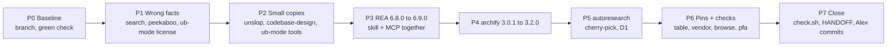

# Upstream refresh, end to end

Status: executed 2026-11-13 on branch `chore/upstream-refresh`; decisions D1 to D5 taken by Alex (see the table). Written 2026-11-13 against `origin/main` `21863a3`.
Audit evidence: `~/.agents/skill-workspace/alex-skills/upstreams/` (`audit.py`, `audit2.py`, `audit.json`, `audit2.json`).

## Why

Ten skills are behind their upstream. Two of them, `peekaboo` and `search`, give the agent wrong facts today. Most rows have no pin, so the next drift is invisible again. The goal is every row current or deliberately held back, with a pin recorded, in one reviewable change set.

## Order

Why this order: wrong facts first, because they mislead every session now. Then cheap, low-risk copies. Then the two large refreshes, one at a time, so a break points at one skill. Pins last, because each phase changes them.

## Rules for every phase

- Copy from the exact upstream commit or release named below, never from `main` at an unknown point.
- Before you copy, diff our file against the upstream file at our old version. Every difference is a local edit. Re-apply it after the copy.
- Put upstream copies in a new temp folder outside every skill root. OpenCode loads any nested `SKILL.md`.
- After each phase: `./scripts/check.sh` and `pre-commit run --all-files` pass. Record the pin.
- Implementation goes to `general` under a contract (see `AGENTS.md` in `~/.config/opencode`). P1 and P2 lanes do not share files and can run in parallel. `README.md` and `docs/HANDOFF.md` are edited only in the main thread.

## P0. Baseline

| Step | Command or action | Done when |
| --- | --- | --- |
| Branch | `git switch -c chore/upstream-refresh` from `origin/main` (needs Alex's approval) | `git status -sb` shows the branch |
| Carry the open edits | `AGENTS.md` `## Upstreams`, the README search/rex/opencode-charts lines, HANDOFF entries | In the branch, uncommitted |
| Green start | `./scripts/check.sh`, `pre-commit run --all-files` | Both pass (they pass on 2026-11-13) |

## P1. Fix wrong facts

### P1a. `search` Exa reference

Upstream: exa-labs/agent-skills `skills/exa-search/SKILL.md` (tag `v2026.11.06-a0c2df8`).

- `search/references/exa-search.md` lines 17, 105, 176-177, 182, 189: replace `fast` and `instant` with `lite`. Add the `lite` limits: cached content only; it rejects `outputSchema`, `systemPrompt`, `stream` and `contents.maxAgeHours`.
- `search/SKILL.md:101`: the row claims the MCP "offers only `auto`, `fast`, and `instant`". The live `web_search_exa` takes only `query`, `numResults` and `objective`. This MCP exposes no `web_search_advanced_exa`; it exposes `web_search_exa`, `web_fetch_exa` and `agent_run`. Rewrite the row to match.
- Done when: `grep -nE '\b(fast|instant)\b' search/` returns no Exa type, and one live `web_search_exa` call works as the row describes.

### P1b. `peekaboo` to v4.9.8

Upstream: openclaw/Peekaboo `skills/peekaboo/SKILL.md` at tag `v4.9.8`. The installed CLI is already `Peekaboo 4.9.8`.

- Local edits to re-apply (found by diffing against pin `4d3c92e`): the description suffix "Not for reading page content, DOM, forms, or tabs; use a browser skill for those." and the `## Asking` block.
- `peekaboo/PROVENANCE.md`: new release, commit, copy date and CLI version. Replace "byte-identical to upstream" with the list of the two local edits.
- Done when: `diff` against upstream v4.9.8 shows only the two local edits, and `peekaboo --version` matches the pinned release.

### P1c. README license fact

- The `ub-mode` row says license "None". unclebob/ub-mode added an MIT license in `3da62bf`. Change the row and remove the "not formally licensed" sentence.

## P2. Small copies

### P2a. `unslop`

Upstream: heydamir/unslop `skills/unslop` at `97daa3e` (19 commits after pin `1d13095`; 3 files change on our path).

- Copy `SKILL.md`, `scripts/snapshot.mjs` and `scripts/story.mjs`.
- Keep `references/visuals.md` as ours. It holds the local isoscene routing edit from `62e9438`.
- Keep `LICENSE`. Leave out `agents/openai.yaml`, because it is for Codex hosts only.
- Done when: `node unslop/scripts/snapshot.mjs --help` prints the new usage, and `skillcheck` passes with the `unslop` policy entry.

### P2b. `codebase-design`

Upstream: mattpocock/skills `7739eae`. Apply the one line in `DESIGN-IT-TWICE.md` ("each with a fresh context window"). Keep the `## Asking` block.

### P2c. `ub-mode` tools

`crapper` (`6fd92c4`) and `mutator` (`a5a0cb8`) are 1 commit behind each. `dryer` is current.

- Read both commits first. Bump only if they are fixes, not breaking changes.
- Update the pins in `ub-mode/tools/README.md` and re-run `ub-mode/tools/setup.sh`.
- Done when: `./scripts/check.sh --tools` passes.

## P3. `reverse-engineer-anything` and the REA MCP, 6.8.0 to 6.9.0

Our skill is byte-identical to the skill inside the npm package `rea-agents@6.8.0` (`diff -r` is empty). The package pins its own version into the commands (`npx -y rea-agents@6.8.0 ...`). The OpenCode MCP is pinned to the same version at `~/.config/opencode/opencode.jsonc:157`. `rea-agents@6.9.0` ships skill version 62, `tool_count` 255 (was 229), and a new `references/desktop-build.md`.

- The source is the npm package, not the GitHub repo. Run `npm pack rea-agents@6.9.0` into a temp folder and copy `package/skills/reverse-engineer-anything`.
- D5: skill only. Leave `opencode.jsonc:157` on `6.8.0`. Known gap: the skill names `npx -y rea-agents@6.9.0` (npx fetches that version on its own) and 255 tools, while the MCP serves 229. Record the gap in the README row and in HANDOFF, so the MCP bump is a known follow-up.
- README row: source becomes "npm `rea-agents` (repo morluto/rea)"; pin `6.9.0`.
- Done when: `diff -r` against the 6.9.0 package is empty and the README row states the MCP gap.

## P4. `archify`, 3.0.1 to 3.2.0

Upstream: the tt-a1i/archify release `v3.2.0` asset `archify.zip`, `sha256:70e210265c59f24dcbdf2a502ff671104b5454e7ee7d3554aecd86bad32384f5`. Use the zip, not the repo tree, because the repo also holds dev-only skills under `.agents/skills/`.

- Verify the SHA-256 before you unpack.
- Local edits to re-apply: the description exclusion "Not for isometric illustrations ... that is isoscene." (`62e9438`), the `## Asking` block, and the example title "Incident Handling Runbook" (`d06d250`).
- Upstream removed 3 files that we still have: `examples/locales/es.json`, `examples/locales/ko.json`, `renderers/lifecycle/grid-routing.mjs`. Delete them, unless 3.2.0 still references them.
- License: the v3.2.0 release zip still ships MIT (`archify/LICENSE`, `package.json`). Only the repo's `main` branch is Apache-2.0 (checked 2026-11-13), so the next release may change it. The README row says both.
- `skill-release.json` must read `3.2.0`, so archify's own update check stops reporting drift.
- Done when: `find archify -name SKILL.md` returns one file; `node archify/bin/archify.mjs` renders one example of each of the 10 diagram types; `check.sh` passes.

## P5. `autoresearch` (needs D1)

Ours is a deliberate trim: 2 commands, loop and goal wizard, our v3.0.0. Upstream v2.3.0 (`7bddd05`) adds 7 commits. Candidates:

- `66b3d57` fix: close orchestrator classify and command-screen bypasses. It touches `scripts/orchestrate.sh`, which we ship. Likely take it.
- `c14f376` fork-and-flush rounds and `3c80011` behavior-preserving performance reference. These are features in commands we cut. Likely skip.
- `af1afe5` Pi extension: skip, because Pi is gone from this setup.

Done when the picked commits are applied by hand, `scripts/orchestrate.sh` passes `bash -n`, and the README row records "trimmed fork of v2.3.0, cherry-picked: ...".

## P6. Pins and checks

- **Pin column (D4).** Add `Pin` to the README "Upstream provenance" table: commit or release plus copy date for every row. Fill it from P1 to P5. For untouched rows, use the upstream commit that matches our copy (`audit.py` finds it).
- **`skill-creator/vendor/claude` (D3).** `a98faf2` changed whitespace in 3 vendored files, but `PROVENANCE.md` says the vendored files are never edited. Either restore the files to upstream `34040c9`, or record the whitespace fix in `PROVENANCE.md`. Upstream has 7 new commits, none of them on our path, so no refresh is needed.
- **`browser-control`.** It is a short pointer to the browse MCP. Read the 16 new anomalyco/browse commits for any rule change: execute helpers exist only inside the code string; tabs stay visible between calls. Change the skill only if one of its rules is now wrong.
- **`personal-finance-advisor`.** InvestSkill moved 30 commits, 41 of them in the `plugins/us-stock-analysis` path we cite. some_claude_skills moved 6, none on our path. Follow the refresh protocol in its `references/UPSTREAM.md`, or record that we hold the old pin on purpose.

## P7. Close

- `./scripts/check.sh` and `pre-commit run --all-files` pass. `scripts/link_claude_skills.sh` reports nothing new.
- Re-run `audit.py`. Every row must be "same" or a listed local edit.
- Update `docs/HANDOFF.md`. Alex commits and opens the PR. Pushing uses `git-push-acastro2`.

## Decisions for Alex

| ID | Question | Decision (Alex, 2026-11-13) and why |
| --- | --- | --- |
| D1 | autoresearch: which upstream commits? | Taken: only the orchestrator bypass fix (`66b3d57`). It is a security fix in a script we ship; the rest adds back what we cut on purpose. |
| D2 | archify 3.2.0 now, or hold? | Taken: now, in its own phase. The update notice will keep firing until we move, and the zip comes with a SHA-256 to check. |
| D3 | vendor/claude whitespace: restore or document? | Taken: restore. "Never edited" is easy to check only while it is true. |
| D4 | Pins: README column, or a PROVENANCE file per skill? | Taken: README column. One table is checkable in one read. Keep the existing PROVENANCE and UPSTREAM files and point to them. |
| D5 | REA: upgrade the MCP with the skill? | Skill only (Alex overrode the recommendation to do both together). The MCP stays on 6.8.0, and P3 records the gap. |

## Out of scope

- Upstream changes to skills we hold as first-party.
- The local `main` branch (`ec9a208`), which split from `origin/main`.
- `neon/` and `neon-postgres/` links without a `SKILL.md`. That is a separate cleanup.
