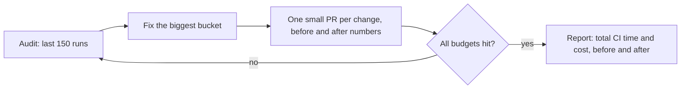

# Improve CI

## Asking

When you need a decision from Alex, ask through the `question` tool, not prose. One call
carries the whole round. The recommended option goes first, and its description carries the
why. Do not add a "type your own answer" option: the tool adds it. A decision with one
plausible answer is not a question, so decide it and say why. Where this skill defines its
own review or answer format, that format wins. If the host has no question tool, use
`❓ **Q1 - <title>**: ...` and `➡️ <answer and why>` in the same place.

Make the CI fast without letting it lie. **Target: a PR gets its result in under 1 minute at the median and under 2 minutes at p95.** GitHub Actions only.

## Three rules outrank speed

1. **The full suite runs before anything reaches main, in a merge queue.** Test selection only narrows PR feedback. It never replaces the full run.
2. **Never hide failures.** No retries, no wider timeouts, no skipped tests. A check that needs a retry has a bug: find it. This bans `gotestsum --rerun-fails`, `pytest-rerunfailures`, and any other retry flag or plugin in a required check.
3. **Never check less.** Lint rules and required checks only stay or grow.

If a speed-up breaks one of these, drop the speed-up.

## 1. Audit first

Run `python3 -I scripts/ci_audit.py OWNER/REPO --runs 150` (paths are relative to this skill). It splits every job into waiting, setup, and running, at p50 and p95, and names the biggest bucket. Fix that bucket first. How the buckets are measured, and their limits, are in [audit](references/audit.md).

## 2. Hit these budgets

| Bucket | Budget | How |
| --- | --- | --- |
| Waiting | under 5 s | Move every job off GitHub-hosted runners to Blacksmith and keep machines warm. Cancel a branch's in-progress run when a new commit lands. |
| Setup | under 15 s | Bake the toolchain into the runner image. Get PR cache hits above 95% by seeding caches from main, and cache the installed dependencies themselves. Use a blobless clone (`filter: blob:none`). |
| Slowest job | under 35 s | No required job waits on another. |
| Lint and format | under 1 s each | The language's fastest linter and formatter. Turn on every rule you can. |
| Typecheck | under 5 s | The language's fastest checker. |
| Tests | under 30 s per shard | Isolate modules, not processes. Reset state after every file. Run in random order to flush out leaks. |
| Local hooks | under 9 s | hk: pre-commit formats and lints staged files; pre-push runs the same check as CI. |

The runner, cache, merge queue, and hook details are in [GitHub Actions](references/github-actions.md). The tool for each row, per language, is in [JavaScript and TypeScript](references/js-ts.md), [Python](references/python.md), and [Go](references/go.md).

**Keep it fast: fail any job that exceeds its budget.** A slow green job fails. Keep `timeout-minutes` for hangs only.

## 3. Shape the pipeline

- **Run lint, typecheck, build, and tests in parallel.** Fold the small checks into one job that lists every failure, not only the first.
- **Shards:** buy cores before shards, and match workers to cores. Give each shard its own throwaway database. Split any test file over 20 seconds. Balance shards from the file times that main records on every full run, and prove that the shards together ran every file.
- **Selection:** on PRs, run only the tests the diff can reach, and list the inputs that rerun everything (lockfiles, CI config, shared fixtures, build config). Then hide a real change from the selection on purpose and confirm CI goes red. If it stays green, the selection lies: fix it before you ship it.
- **Hooks, not instructions:** put the local checks in an hk hook, not a line in `AGENTS.md`, because agents skip steps.

## 4. Fewer tests, on evidence only

- **For two weeks, log every test failure you fix as a caught regression or a change detector.** A change detector is a test that failed because the code changed, not because behaviour broke.
- **Then delete the files that only detect change, and ban their patterns in `AGENTS.md`.**
- **Never delete tests for authorization, privacy, migrations, or concurrency.**

This matches `coding` part 2 and its [real-work tracking](../coding/references/real-work-tracking.md).

## 5. Switch tools on evidence

- **The tools in the references are defaults.** You need a measured reason to keep an old one.
- **Before each switch, run old and new side by side, and list everything the new one misses.** A rule the old linter had and the new one lacks is "checking less": keep the old rule or find its equal.
- **If a tool only exists in a canary, pin that exact canary.** `bun lint` is canary-only as of Bun 1.4.5.
- **Check each command and flag against the installed version before you use it.** The references were checked on 2026-11-24 and tools move fast.

## 6. Ship and report

- **One small PR per change, with before and after numbers from real runs.** Re-run the audit on the PR's runs. Write the PR body with `coding`'s [PR description standards](../coding/references/pr-description.md).
- **Do everything you can without Alex first.** Then bring anything that needs an account, a secret, or a bigger bill as one list, with the expected monthly cost of each item. Use the prices in [GitHub Actions](references/github-actions.md), and say which are vendor claims.
- **End with total CI time and cost, before and after:** PR wall time p50 and p95, billed minutes per week, and USD per month.
