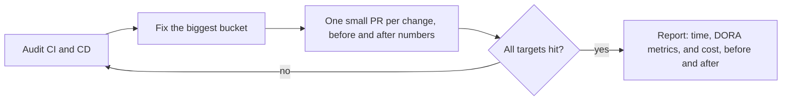

# Improve CI and CD

## Asking

When you need a decision from Alex, ask through the `question` tool, not prose. One call
carries the whole round. The recommended option goes first, and its description carries the
why. Do not add a "type your own answer" option: the tool adds it. A decision with one
plausible answer is not a question, so decide it and say why. Where this skill defines its
own review or answer format, that format wins. If the host has no question tool, use
`❓ **Q1 - <title>**: ...` and `➡️ <answer and why>` in the same place.

Make CI and CD fast without letting them lie. GitHub Actions only.

| Side | Target |
| --- | --- |
| CI | A PR gets its result in under 1 minute at the median and under 2 minutes at p95 |
| CD | A merged change serves all production traffic, verified, in under 30 minutes at the median and under 60 at p95. Change failure rate under 5%. A bad deploy rolls back by itself in under 5 minutes |

The CD targets are Alex's defaults, set well inside DORA's 2024 elite band (lead time under a day, change failure rate 5%, recovery under an hour). Ask before you loosen one.

## Part A: CI

### A1. Three rules outrank speed

1. **The full suite runs before anything reaches main, in a merge queue.** Test selection only narrows PR feedback. It never replaces the full run.
2. **Never hide failures.** No retries, no wider timeouts, no skipped tests. A check that needs a retry has a bug: find it. This bans `gotestsum --rerun-fails`, `pytest-rerunfailures`, and any other retry flag or plugin in a required check.
3. **Never check less.** Lint rules and required checks only stay or grow.

If a speed-up breaks one of these, drop the speed-up.

### A2. Audit first

Run `python3 -I scripts/ci_audit.py OWNER/REPO --runs 150` (paths are relative to this skill). It splits every job into waiting, setup, and running, at p50 and p95, and names the biggest bucket. Fix that bucket first. How the buckets are measured, and their limits, are in [audit](references/audit.md).

### A3. Hit these budgets

| Bucket | Budget | How |
| --- | --- | --- |
| Waiting | under 5 s | Move every job off GitHub-hosted runners to Blacksmith and keep machines warm. Cancel a PR branch's in-progress run when a new commit lands; never on main, `merge_group`, or a deploy. |
| Setup | under 15 s | Bake the toolchain into the runner image. Get PR cache hits above 95% by seeding caches from main, and cache the installed dependencies themselves. Use a blobless clone (`filter: blob:none`). |
| Slowest job | under 35 s | No required job waits on another. |
| Lint and format | under 1 s each | The language's fastest linter and formatter. Turn on every rule you can. |
| Typecheck | under 5 s | The language's fastest checker. |
| Tests | under 30 s per shard | Isolate modules, not processes: one runner process with a fresh module graph per file. Reset state after every file. Run in random order to flush out leaks. |
| Local hooks | under 9 s | hk: pre-commit formats and lints staged files; pre-push runs the same check as CI. |

The runner, cache, merge queue, and hook details are in [GitHub Actions](references/github-actions.md). The tool for each row, per language, is in [JavaScript and TypeScript](references/js-ts.md), [Python](references/python.md), and [Go](references/go.md).

**Keep it fast: fail any job that exceeds its budget.** A slow green job fails. Keep `timeout-minutes` for hangs only.

### A4. Shape the pipeline

- **Run lint, typecheck, build, and tests in parallel.** Fold the small checks into one job that lists every failure, not only the first.
- **Shards:** buy cores before shards, and match workers to cores. Give each shard its own throwaway database. Split any test file over 20 seconds. Balance shards from the file times that main records on every full run, and prove that the shards together ran every file.
- **Selection:** on PRs, run only the tests the diff can reach, and list the inputs that rerun everything (lockfiles, CI config, shared fixtures, build config). Then hide a real change from the selection on purpose and confirm CI goes red. If it stays green, the selection lies: fix it before you ship it.
- **Hooks, not instructions:** put the local checks in an hk hook, not a line in `AGENTS.md`, because agents skip steps.

### A5. Fewer tests, on evidence only

- **For two weeks, log every test failure you fix as a caught regression or a change detector**, in the [real-work tracking](../coding/references/real-work-tracking.md) table. A change detector is a test that failed because the code changed, not because behaviour broke.
- **Then delete the files that only detect change, and ban their patterns in `AGENTS.md`.**
- **Never delete tests for authorization, privacy, migrations, or concurrency.**

This matches `coding` part 2.

## Part B: CD, everything after merge

### B1. Five rules outrank speed

1. **Build once, promote the same artifact.** Every environment gets the same image digest or package file. Never rebuild for production. For OpenTofu, every environment uses the same commit and module pins, and each environment makes and applies its own saved plan.
2. **Every production deploy can roll back by itself.** A health signal (an alarm, a monitor, a metric query) aborts the rollout and restores the last good version with no human step. Prove the rollback works once per target with a drill: deploy a known-bad version to staging and watch it roll back. A drill is a one-time run, not a committed test.
3. **Done means verified.** Mark a deployment `success` only after the bake and the smoke checks pass. A deploy that cannot be verified is a failed deploy.
4. **Never deploy less safely to go faster.** No skipped bake, no `-refresh=false` or routine `-target` in production applies, no `cdk deploy --hotswap`, no `cancel-in-progress: true` on a deploy job, a `push` to main, or a `merge_group` run, no shorter health checks than the signal needs.
5. **Short-lived credentials only.** GitHub OIDC to AWS and registries. No long-lived keys or publish tokens in secrets.

A company change process (for example a change record that must be approved) is a rule, not a speed-up target. Never remove or bypass it. Measure its wait and bring the number to Alex, with the evidence in [delivery](references/delivery.md#manual-approvals).

### B2. Audit first

Run `python3 -I scripts/cd_audit.py OWNER/REPO --environment production --days 90`. It reads GitHub deployments and their statuses, and reports merge-to-production lead time, deploy duration, and recovery time at p50 and p95, plus deploys per week and change failure rate, each against the DORA 2024 bands. It names the worst metric: fix that first.

- **If the repo records no GitHub deployments, that is the first fix.** Use `environment:` on every deploy job, so GitHub records each deploy and its status. Until then, take the baseline from `scripts/ci_audit.py --workflow <deploy workflow>`, and say in the report that lead time and change failure rate are not measured yet.
- **In a monorepo, use one environment per service** (`production-api`, `production-web`), so lead time is per service, not a mix of all of them.
- **Report p95 only from 20 or more deploys.** With fewer, report the median and say the sample is small.
- **For the time inside a deploy workflow**, run `scripts/ci_audit.py` with `--workflow <deploy workflow>`. Its waiting and setup buckets apply to deploy jobs too.
- How lead time and change failure rate are counted, and where GitHub's data stops, is in [delivery](references/delivery.md#measure).

### B3. Hit these budgets

| Stage | Budget | How |
| --- | --- | --- |
| Merge to artifact ready | under 3 min | Build once, with a warm layer or package cache, on the push to main. Capture the digest. The merge queue's build can be reused only when the push run's `head_sha` equals the tested `merge_group` SHA: GitHub does not promise that, so check it. |
| Staging deploy and verify | under 5 min | Deploy the same digest. Smoke-test the real endpoints. Block on failure. |
| Production rollout and bake | under 20 min | Progressive: canary, linear steps, or blue/green, with an automatic abort on a health signal. Default bake is 5 minutes. Raise it to the measured time for the signal to fire on a known-bad version, plus two evaluation periods, and write that number in the PR. A Watchdog gate needs at least 15 minutes on its own, so it fits this budget only as the whole bake. |
| Automatic rollback | under 5 min | The rollout tool restores the last good version when the signal fails. Never a manual runbook first. |
| Waiting for people | 0 min | No approval gate without a rule that requires it. A required gate is measured, not removed. |

The tool for each row, per target, is in [OpenTofu on AWS](references/opentofu.md), [Kubernetes](references/kubernetes.md), [AWS Lambda and ECS](references/aws.md), and [releases](references/releases.md). Environments, OIDC, deploy concurrency, verification, feature flags, and database migrations are in [delivery](references/delivery.md).

### B4. Shape the delivery

- **Deploy every merge.** Small, frequent deploys keep each change easy to verify and to roll back. Batching merges into a release train makes lead time worse and failures harder to trace.
- **One deploy at a time per environment.** A job-level `concurrency` group per environment, `cancel-in-progress: false`. A deploy that is running is never cancelled.
- **Promote in order:** staging, then production, each job `needs:` the one before, each in its own GitHub environment.
- **Separate deploy from release.** Ship risky behaviour dark, behind a feature flag, and turn it on later. A flag flip is the fastest rollback there is.
- **Expand, then contract, for every schema change.** The database change ships in its own deploy before the code that needs it, and nothing is dropped while any running version still reads it.
- **Watch the deploy, not only the pipeline.** Tag every deploy with its version, so the monitoring tool can compare the new version with the old.

## Part C: switch tools on evidence

- **The tools in the references are defaults.** You need a measured reason to keep an old one.
- **Before each switch, run old and new side by side, and list everything the new one misses.** A rule, check, or safety gate the old tool had and the new one lacks is "checking less": keep it or find its equal.
- **If a tool only exists in a canary, pin that exact canary.** `bun lint` is canary-only as of Bun 1.4.5.
- **Check each command and flag against the installed version before you use it.** The references were checked on 2026-11-24 and 2026-11-25, and tools move fast.
- **In a work repo, a shared platform workflow owns plan, apply, and deploy.** Improve it there, with the team that owns it. Do not fork it into the repo.

## Part D: ship and report

- **One small PR per change, with before and after numbers from real runs.** Re-run the audit on the PR's own runs, or on the deploys after the change merged. Write the PR body with `coding`'s [PR description standards](../coding/references/pr-description.md).
- **Do everything you can without Alex first.** Then bring anything that needs an account, a secret, a new AWS role, a bigger bill, or a change to a production safety setting as one list, with the expected monthly cost of each item. Use the prices in [GitHub Actions](references/github-actions.md), and say which are vendor claims.
- **End with time, DORA metrics, and cost, before and after:** PR wall time p50 and p95, merge-to-production lead time p50 and p95, deploys per week, change failure rate, recovery time, billed minutes per week, and USD per month.
