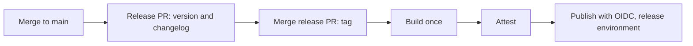

# Releases: packages and images

Publish with OIDC, sign what you publish, and make releases immutable. Checked 2026-11-25.

## The shape



- **Pick one versioning tool:** release-please for Conventional Commits with a release PR a human merges ([release-please](https://github.com/googleapis/release-please-action/blob/main/README.md)); Changesets when maintainers write the release notes per change, best for many packages ([Changesets](https://github.com/changesets/action/blob/main/README.md)); semantic-release for no release PR at all ([semantic-release](https://github.com/semantic-release/semantic-release/releases/tag/v26.0.0)).
- **Keep build and publish in one workflow.** A tag or release made with `GITHUB_TOKEN` does not start another workflow.
- **Give only the publish job `id-token: write`**, in a `release` environment. Build in a job without publish rights.

## npm

```yaml
permissions: { contents: read, id-token: write }
environment: release
steps:
  - uses: actions/setup-node@v6
    with: { node-version: 24, registry-url: https://registry.npmjs.org }
  - run: npm ci && npm test
  - run: npm publish
```

- **Trusted publishing needs npm 11.5.1 or later** and Node 22.14.0 or later, a GitHub-hosted runner, and a trusted publisher set on the package (owner, repo, workflow file, environment). No `NPM_TOKEN` ([trusted publishers](https://docs.npmjs.com/trusted-publishers/)).
- Provenance is added by itself for public packages from public repos. Once it works, set the package to require 2FA and refuse tokens.

## PyPI

```yaml
publish:
  needs: build
  environment: release
  permissions: { id-token: write }
  steps:
    - uses: actions/download-artifact@v5
      with: { name: dist, path: dist/ }
    - uses: pypa/gh-action-pypi-publish@release/v1
```

- Register the trusted publisher on PyPI first. The action uploads `dist/`; it does not build. It makes PEP 740 attestations by default ([trusted publishers](https://docs.pypi.org/trusted-publishers/using-a-publisher/), [attestations](https://docs.pypi.org/attestations/producing-attestations/)).
- **With uv:** `uv build` in the build job, `uv publish` in the publish job. `uv publish` uploads attestations but does not make them: run `astral-sh/attest-action` first ([uv in GitHub Actions](https://docs.astral.sh/uv/guides/integration/github/)).
- Rehearse on TestPyPI with its own trusted publisher.

## Go modules

- **A release is a tag:** `go mod tidy && go test ./... && git tag v0.1.0 && git push origin v0.1.0`. Never move a published tag: the checksum database has recorded it ([publishing](https://go.dev/doc/modules/publishing)).
- **Warm the proxy:** `GOPROXY=proxy.golang.org go list -m example.com/mod@v0.1.0`.
- **v2 and later change the module path** to `.../v2` before tagging ([major versions](https://go.dev/doc/modules/major-version)).
- **Binaries:** GoReleaser on the tag, with `fetch-depth: 0` and `contents: write` ([GoReleaser](https://goreleaser.com/customization/ci/actions/)).

## Container images

- Push to GHCR with `GITHUB_TOKEN` and `packages: write` on the publish job only ([publish images](https://docs.github.com/en/actions/tutorials/publish-packages/publish-docker-images)).
- `docker/build-push-action` adds provenance by default; add `sbom: true`. Never pass a secret as a build arg, because provenance can show it: use a secret mount ([attestations](https://docs.docker.com/build/ci/github-actions/attestations/)).
- Attest the digest with `actions/attest@v4`, and verify with `gh attestation verify oci://ghcr.io/OWNER/IMAGE:v1.2.3 -R OWNER/REPO`.

## GitHub releases

- **Turn on immutable releases** (Settings, Releases). Create the release as a draft, upload every asset, then publish: after that, assets and the tag cannot change, and GitHub attests the release ([immutable releases](https://docs.github.com/en/code-security/concepts/supply-chain-security/immutable-releases)).
- **Protect `v*` tags with a ruleset:** restrict update and delete, and restrict creation to the release identity ([rulesets](https://docs.github.com/en/repositories/configuring-branches-and-merges-in-your-repository/managing-rulesets/available-rules-for-rulesets)).
- **Attest binaries** with `actions/attest@v4` (`subject-path: dist/*`), and verify with `gh attestation verify <file> -R OWNER/REPO` ([attestations](https://docs.github.com/en/actions/how-tos/secure-your-work/use-artifact-attestations/use-artifact-attestations)).
