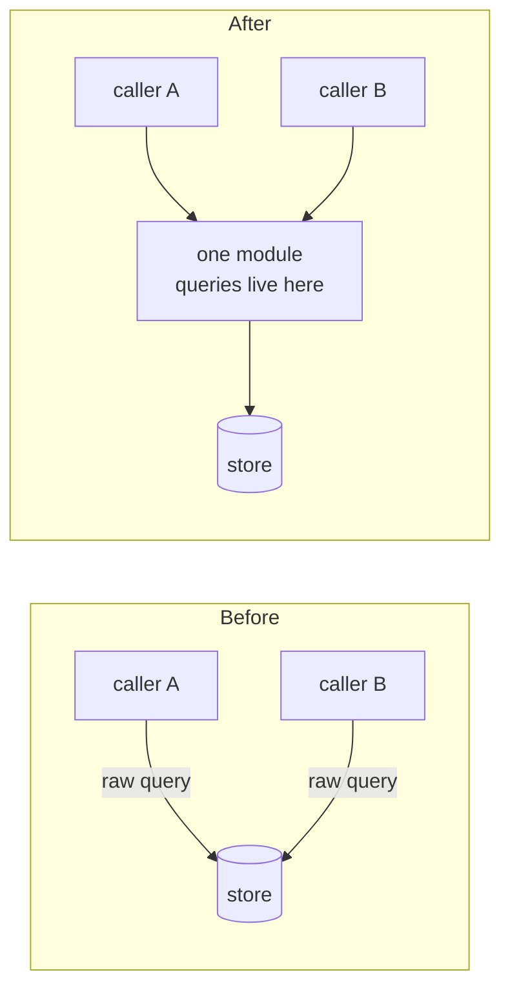
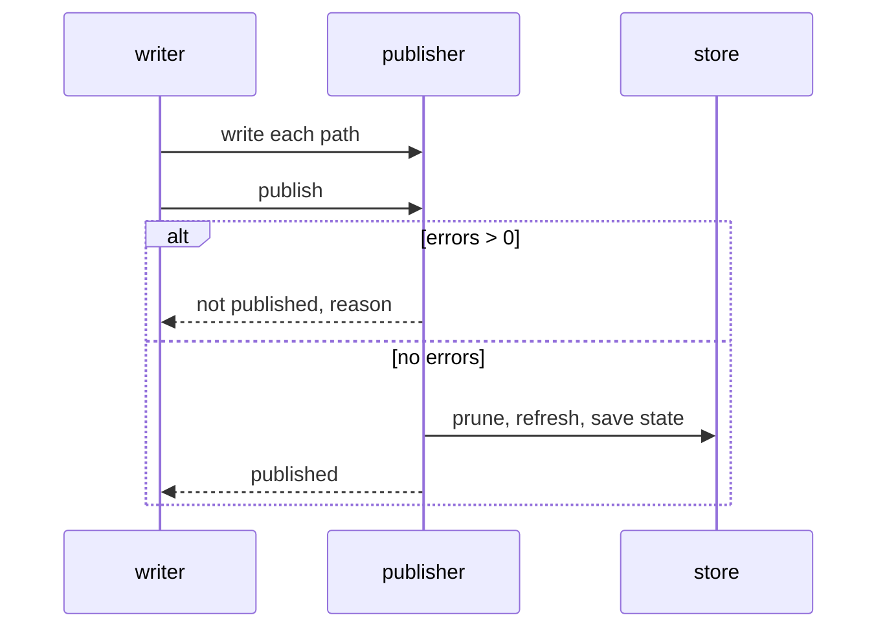
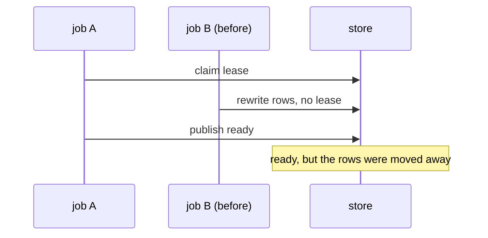

# Diagrams for a PR change description

GitHub renders a fenced `mermaid` block on the PR page. These rules keep the blocks rendering, and the patterns below show which diagram fits which kind of change.

## Syntax that renders on GitHub

- Quote any label that has punctuation, a slash, a colon, or parentheses: `A["mcp_server.py<br/>807 lines"]`.
- Break a label with `<br/>` inside the quotes.
- Never use `end` as a node id; it closes a `subgraph`.
- Give a subgraph an id and a quoted title: `subgraph IDX["indexer"]`.
- Put edge labels in quotes when they hold punctuation: `A -->|"raw queries, no retry"| B`.
- In a sequence diagram, a message may contain a colon after the first one: `H->>OS: get with seq_no, if owner is ours: write back`.
- Use `direction TB` inside a subgraph only when the layout needs it.
- Keep a diagram under about 25 nodes. Split a bigger one by area.

## Pick the diagram by the change

| Change | Diagram | What it shows |
| --- | --- | --- |
| Duplicated logic folded into one module | Two flowcharts: before with the copies, after with one subgraph | The copies and their drift on the before edges |
| A new seam or adapter | Flowchart, the seam as a subgraph, the adapters outside | The one interface callers cross |
| Call order that must not change | `sequenceDiagram` | The ordered calls, and an `alt` / `else` for the failure branch |
| A race or a concurrency bug that was fixed | `sequenceDiagram` with two actors | The interleaving that went wrong, with a `Note over` the bad end state |
| A lifecycle (lease, job, status) | `stateDiagram-v2` | Every transition, including the failure ones |
| A test or ratchet rule | Flowchart of decisions (`{"question?"}` nodes) | Which input passes, which fails, and the message |
| How the safety was proven | Left-to-right flowchart | Base, characterization, decisions, refactor, the diff check |

## Patterns

### Before and after, side by side in one block



### A failure branch



### A race that the change closes



## Check the render in the browser

Post the body first. Then, with the `browser-control` skill, open the PR page, scroll to the bottom so every block loads, and read each Mermaid frame:

```js
await page.goto(PR_URL, { waitUntil: "domcontentloaded" });
await page.waitForTimeout(6000);
for (let i = 0; i < 25; i++) { await page.mouse.wheel(0, 1500); await page.waitForTimeout(350); }
await page.waitForTimeout(4000);
const frames = page.frames().filter((f) => f.url().includes("viewscreen"));
const out = [];
for (const f of frames) {
  try {
    out.push(await f.evaluate(() => ({
      err: /syntax error|parse error/i.test(document.body.innerText),
      svgs: document.querySelectorAll("svg").length,
    })));
  } catch (e) { out.push({ fail: String(e).slice(0, 80) }); }
}
return { frames: frames.length, bad: out.filter((o) => o.err || o.fail || !o.svgs).length };
```

Pass: `frames` equals the number of Mermaid blocks in the body, and `bad` is 0. Count the blocks with:

```bash
grep -c '^.\{3\}mermaid' body.md
```

 If a frame fails, its index matches the block's order in the body: fix that block, post again, and rerun the check. Reset the browser session when done.
