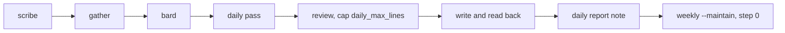

# The daily pass: `--daily`, a small truth-up that feeds the weekly run

Read this on every `--daily` run (Team mode). It runs part of the project pass and the wiki pass
on what changed since the last daily run. It writes one daily report note for the weekly run to
read. Hard rules, the invariants and the exclusion screen stay in `SKILL.md` and hold here.
Why: a daily run keeps the tracker close to true. The weekly run still owns stage moves, new
rows, row comments and the roll-up, so the daily run must hand it everything it saw.

## 1. Purpose and chain

Alex runs `scribe → gather → bard → projects-curator --daily` every working day. The weekly run
(`--maintain`, the default) runs `weekly-report`, then the full pass.



The daily run never runs `weekly-report`. It never drafts or sends the roll-up or any email. It
never posts an epic weekly comment.

## 2. Inputs and window

- **The gather store** (`~/.gather/raw/*`). Use its ledger lines. GitHub, GitHub activity, Jira,
  Slack, team Slack, Teams and mail are read-only evidence.
- **The Bard notes** bard wrote since the last daily run.
- **Live Jira.** Read each key with `getJiraIssue`, `view: full`.
- **The live wiki pages** in `config.wiki.pages`.

**Window:** from `daily.last_run` to now. First run: since `weekly.last_run`, or the start of the current week in `config.week`
if there is none. A store that is unreachable or has a gap is reported as such, never as no
results (see [retrieval.md](retrieval.md)).

## 3. Checks

Numbers are the section 1 numbers in [project-pass.md](project-pass.md).

| Check | Daily scope |
|---|---|
| 1. Keyed PRs → state | Run |
| 2. Unkeyed PRs → a home | Run |
| 3. In Progress done-check | Only items touched in the window |
| 4. Done items with live work | Only keys on a PR opened or updated in the window |
| 6. Standing-decision conflicts | Only decisions recorded in the window |
| 7. Owners | Only items created in the window |
| 8. Parents | Only items created in the window |
| 11. Anchor links | Run, on every row: a board is small, and drift fixes are the daily job |

Skipped daily, weekly only: 5 (bulk-closed audit), 9 (epic weekly comment), 10 (epic gap check).

## 4. Board drift

Field drift fixes only. Propose a fix where a row and its anchor epic disagree on a fact one
side owns. The Milestone date follows the anchor's due date from `2. Committed`. The epic's
theme label echoes the row's Theme. Fix the side that does not own the fact.

Not daily, all weekly: stage moves, new rows, row comments, merges. A stage-move signal seen
daily goes into the note under For weekly (section 7). Stage stays Alex's column.

## 5. Wiki

Run [wiki-pass.md](wiki-pass.md) on only the pages in `config.wiki.pages` whose facts touch an
item, PR or decision that changed in the window. Same buckets, same evidence order, same write
path.

## 6. Review

The same gate and groups as `SKILL.md`: R F W B P order, Needs you, Check the words, Routine.
In Team mode Alex answers through the `question` tool, one question per group. The cap is
`review.daily_max_lines`, default 8. Routine stays exempt: one answer.

Overflow rolls to `open_items`, as today. Each entry records `rolled` (never shown to Alex) or
`asked: <date>` (shown, and he skipped it). Why: a skipped line asked again the same week is noise,
and a rolled line never asked must not be lost.

- **Rolled:** the next daily proposes it first. The weekly run proposes it if it is still open.
- **Asked and skipped:** no daily asks it again. The weekly run asks it once more, only if it is
  still true and was not asked in the 2 days before. After that it waits for the next week, as
  [project-pass.md](project-pass.md) section 2 says.
- A line is never asked twice in one review, and the weekly review marks a line first asked by a
  daily run with `asked <date>` in its Why line.

## 7. The daily report note

The daily log is a note in the Obsidian vault, not a ledger list. Why: one source of truth, so
two copies cannot drift apart.

**Path:** `reports.daily`, default `$OBSIDIAN_VAULT/Reports/Daily/<YYYY-MM-DD>.md`. Resolve the
vault from `$OBSIDIAN_VAULT` as bard does. Never write a literal path.

**Write it on every run, even when the review writes nothing.** A rerun on the same day updates
that day's note in place: append a `Rerun HH:MM` block. Never create a second file.

The note is plain text, with no secrets and no @-mentions. It is Alex's private vault, but run
the exclusion screen on any quoted text anyway.

```markdown
---
type: report
date: YYYY-MM-DD
window_from: <daily.last_run>
window_to: <now>
mode: daily
---

## Sources read
- <store> · <gather ledger line> · read | gap | unreachable

## Written
- <line id> · <item> · <change> · read-back: <result>

## Declined
- <line id> · <item> · <change>

## Rolled
- <line id> · <item> · rolled to open_items

## For weekly
Seen daily, not acted on. Weekly checks each source live before it writes a line.
- Stage-move evidence: <row> · <evidence>
- Comment-worthy signals: <row> · <signal>
- Epic progress (done, by name): <epic> · <item>
- New-initiative candidates: <candidate> · <evidence>
- Forum signals: <signal>
- Connections leads: <lead>
```

## 8. Ledger and the weekly run

The ledger keeps cursors and the note list only:

```json
"daily": {"last_run": "<ISO 8601 time with offset>", "notes": ["<path of each daily note written>"]},
"weekly": {"last_run": "<ISO 8601 time with offset>"}
```

- Both cursors are full ISO 8601 times with an offset, never a bare date. Why: a date cursor makes a second run on the same day re-read the whole day, and a run near midnight skips hours.
- Set `daily.last_run` only after the writes are verified by read-back, and set it to the run's
  `window_to` (the time its evidence reads started), never the time the run ends. Why: a change
  that lands between the read and the end of the run would then fall in no window. Add the note path to
  `daily.notes`.
- The weekly run reads every daily note whose `window_to` is later than `weekly.last_run`, by
  listing the folder, as its step 0 in `SKILL.md`. Compare full times, never the file date: a
  daily run after a weekly run on the same day has the same date, and a date test skips it. A working day with no note is a gap: `UNVERIFIED`.
- Weekly's own evidence window is always since `weekly.last_run`, never since `daily.last_run`.
  So a daily cursor never hides a source from weekly.
