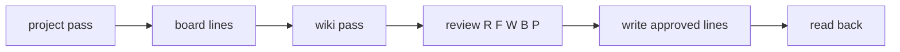

# The wiki pass: keep chosen pages true, every week

Read this on every Team-mode run, after the project pass. It keeps the Confluence pages in
`config.wiki.pages` true against live evidence. The board database stays in
[team-board.md](team-board.md). Hard rules stay in `SKILL.md`; this file adds the page checks and
the page write path. Why: a page that states a stale fact does more harm than no page, because
readers trust it.

The skill holds no page ids, titles, site names or keys. They live in `config.wiki.pages`
(`{id, title, bucket, scope?}`) in the ledger.

## 1. Purpose and order

The wiki pass runs in the same weekly session, after the project pass and the board lines. Why:
pages truth-check against tracker and board state, and the earlier lines fix that state first.



Its lines are `P#`, numbered after `B#`. They use the same review gate and the same three groups
(Needs you, Check the words, Routine). In Team mode Alex answers through the `question` tool, as
[project-pass.md](project-pass.md) section 2 says. Nothing lands without his yes on its line.

## 2. Buckets and their checks

Read the live page first. Sort each page by its `bucket`.

- **`portfolio`**: roadmap pages. The curator owns them (Alex lifted their read-only status on
  2026-11-13). Check each item against the board row and its anchor epic: name, stage, date,
  status. Propose the fix on the page.
- **`status`**: pages, or one section named in `scope`, that hold status: environments, versions,
  health, ORR state, MOP index. Check each fact against live evidence (section 3). Edit only the
  `scope` section when one is named.
- **`mirror`**: pages that summarise a GitHub doc they name as canonical. Status facts follow live
  evidence. Any other text that conflicts with the canonical doc is proposed to match GitHub.
  GitHub wins. Never edit GitHub.
- **`check`**: links and contradictions only. The one allowed edit is a broken-link fix, as a
  Routine line. Report any other problem under Also found.
- **`retire`**: list once under Also found in the first wiki-pass review. Alex archives by hand.
  The curator never archives, moves or deletes a page.

Every page edit passes the full exclusion screen: pages are org-visible. Text is plain, with no
@-mentions and vendor-neutral names.

## 3. Evidence order

For one page fact, use evidence in this order:

1. **Live Jira.** Read each key with `getJiraIssue`, `view: full`. Never use a search for this:
   a search result can hide the field you need.
2. **The canonical GitHub doc**, at its default branch.
3. **The weekly-report facts file** (`evidence.team_facts`).

A fact with no live evidence is left alone and reported as `UNVERIFIED`. Never guess. Why: an
invented status is worse than a stale one, because it looks checked.

## 4. Cross-page contradictions

When two pages state one fact differently, the live evidence decides. Propose a fix for every
stale page, and quote both lines in the Why. A page's "Last reviewed" line changes only when an
approved edit lands on that page, and only when the line is inside the page's `scope`. Why: a bumped date on an unchecked page tells readers it is true.

## 5. Write path

Never send a whole page body. Why: a whole-body write races other editors and can drop their text.

1. **Read the rules.** Re-read the space instructions each run.
   Call `getContentFormatGuide` with `toolName: updateConfluencePage` once per run, before the
   first write.
2. **Read the page** with `getConfluenceContent`, `detail: full`, `content_format: html`. Keep its
   `snapshotToken`.
3. **Build the edit** for `updateConfluenceContent` as `edits` (`replaceNode` or
   `insertNodeAfter`). Target the node's FULL live `data-local-id`. A 12-character tail failed as
   unresolved (seen live, 2026-11-13).
4. **Dry run first** (`dryRun`). The ids a dry run generates are not the saved ones: do not reuse
   them.
5. **Write** with the latest `snapshotToken`. On `snapshot_stale`, re-read the page and rebuild the
   edit. Never resend the old one.
6. **Read back** and check that only the target nodes changed. Any other difference is a failed
   write: report it.

Space facts change per org and over time, so they live in the ledger (`config.wiki.space_notes`),
never in this file. Each run, read the space with `getConfluenceSpace`: if
`enabledContentTypes.isDatabasesEnabled` is false, the board database waits for a space admin and
the first write goes to `board.scratch_database_id`.

## 6. Ledger

Record each page write under `wiki.<pageId>.updates`: date, node, old text, new text. Read it at
the start of the run. A line whose new text is already there is not proposed again, so a rerun
posts nothing twice.

```json
"wiki": {"<pageId>": {"updates": [
  {"date": "YYYY-MM-DD", "node": "<data-local-id>", "old": "...", "new": "..."}
]}}
```
