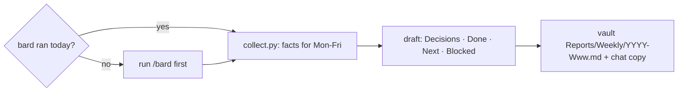

# weekly-report

## Asking

When you need a decision from Alex, ask through the `question` tool, not prose. One call
carries the whole round. The recommended option goes first, and its description carries the
why. Do not add a "type your own answer" option: the tool adds it. A decision with one
plausible answer is not a question, so decide it and say why. Where this skill defines its
own review or answer format, that format wins. If the host has no question tool, use
`❓ **Q1 - <title>**: ...` and `➡️ <answer and why>` in the same place.

## Why this shape

The manager keeps a 1:1 doc as a running agenda, and Alex agreed to "add anything that needs
a decision from you and updates on what I'm currently working on" (Slack, 2026-11-09). So the
report leads with the decisions the manager owes, then the updates. A status list that buries
an ask is the report failing at its one job.



## Steps

1. **Config.** Read `~/.config/weekly-report.json` (`manager`, `exclude_headings`,
   `github_orgs`). It lives outside this public repo on purpose: names and orgs never land
   here. No `manager` → ask Alex for the first name and write the file (mode 600).
2. **Fresh data.** Run the collector first:

   ```bash
   python3 ~/.agents/skills/weekly-report/scripts/collect.py --vault <vault> > /tmp/weekly-facts.json
   ```

   The vault is `$OBSIDIAN_VAULT`, or the vault the `obsidian` CLI reports. If `bard_fresh` is
   false, run the `bard` skill's normal sweep now (Alex's rule: a report from a stale sweep
   silently misses the latest Slack asks and PRs), then run the collector again. If bard
   cannot run, write the report anyway and put the gap at the top in one line.
3. **Read the facts.** `window` is Mon-Fri in America/Chicago; a weekend run covers the week
   that just ended. `board.done` is what closed this week, `board.open` is what is open with its
   horizon, `notes` are this week's Bard notes (decisions, lessons, artifacts), and `github`
   holds authored and reviewed PRs: `state` is `open`, `merged`, or `closed` (closed without
   merge, never "shipped"), and a closed PR appears only when it closed inside the window. A
   `github_error`, or a search named in `github.truncated` (a full page, so PRs may be
   missing), is a gap to report, never an empty or complete week.
   Open the Bard note or PR behind any line before you claim more than its title says.
   **Mail.** Search the window's mail from the manager for asks he is waiting on: the
   Microsoft 365 connector where the host has one, else the `m365` skill
   (`m365 --json mail search "<query>" --sender <manager>`). A failed search is one gap line
   in the chat summary, not silence.
4. **Decisions needed.** Candidates: open board lines, this week's notes, and the manager's mail where the next step
   is the manager's call: approval, budget, priority between two bets, a hire, a policy fight
   he must own. Ask Jev one `noul` per candidate: "Does `item` need a decision or approval that
   only the user's manager can give?" (`state` is a redacted line, roles not names, per
   `../jev/SKILL.md`). ≥ 0.80 goes in; ≤ 0.20 stays out; between, decide from the full evidence
   and say `Jev unsure (0.xx) → model: …` in the chat summary, never in the report. Each
   decision is one line: the ask, the options if there are two, and your recommendation.
   None is a valid answer; write "None this week."
5. **Draft** in Alex's comms register ([alex-voice](../alex-voice/SKILL.md)): short, point
   first, plain words. One screen.

   ```markdown
   ---
   type: report
   week: 2026-W46
   window: 2026-11-09..2026-11-13
   ---
   # Week 2026-W46 (Nov 9–13)

   ## Decisions needed
   - <ask> — <options>; I recommend <x> because <why>.

   ## Done
   - <outcome first, then what> ([PR](url))

   ## Next
   - <the next step, from This week / This month>

   ## Blocked
   - <what, and who it waits on>
   ```

   - **Done** is outcomes, grouped by theme, at most 7 bullets. Merged PRs and `board.done`
     lines are proof; an open PR is "in review", never "shipped". A Bard `decision` note can
     be a Done line ("agreed X with Y").
   - **Next** comes from the `🔥 This week` and `📅 This month` lines, at most 5.
   - **Blocked** is only real blockers: `⏳ Waiting on others` lines and 🔺 risks. Omit the
     section when empty.
6. **Screen before you write.** Never a credential, token, or password value (say "a token
   that needs rotating", not the token). Nothing from an excluded heading (Alex's personal
   items). No customer data. People by first name only, and only when the line needs them.
   A line you cannot back with a board line, note, or PR does not go in: empty beats soft.
7. **Write** `report_path` from the facts (`<vault>/Reports/Weekly/<week>.md`). If the file
   exists, show what changed and ask before you overwrite it. Then print the report body in
   chat for Alex to paste. Never post it anywhere: sending it is Alex's click.

## Limits

- Meetings show up only through bard's notes; the calendar is not read. Mail is read only
  for asks from the manager (step 3).
- The report only knows what bard and GitHub know. Work done off the record (a hallway call,
  a whiteboard) is missing unless Alex adds it; ask once in the chat summary whether anything
  is missing.
