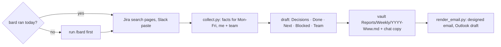

# weekly-report

## Asking

When you need a decision from Alex, ask through the `question` tool, not prose. One call
carries the whole round. The recommended option goes first, and its description carries the
why. Do not add a "type your own answer" option: the tool adds it. A decision with one
plausible answer is not a question, so decide it and say why. Where this skill defines its
own review or answer format, that format wins. If the host has no question tool, use
`❓ **Q1 - <title>**: ...` and `➡️ <answer and why>` in the same place.

## Why this shape

The manager keeps a 1:1 doc as a running agenda, and Alex agreed to "add anything that needs
a decision from you and updates on what I'm currently working on" (Slack, 2026-11-09). So the
report leads with the decisions the manager owes, then the updates. A status list that buries
an ask is the report failing at its one job.

The team section comes after Alex's own work, never mixed into it. The manager reads Alex's
report to judge Alex; the team's progress is context. Alex's own PRs and tickets are flagged
`mine` in the team facts, so they are not counted twice.



## Steps

1. **Config.** Read `~/.config/weekly-report.json` (`manager`, `exclude_headings`,
   `github_orgs`, `team`). It lives outside this public repo on purpose: names and orgs never land
   here. No `manager` → ask Alex for the first name and write the file (mode 600).
   `team` is `{name, org, repos, jira_project, slack_channels}`. No `team` → skip every team
   step; the facts carry `team: null`. `team.org` must also be in `github_orgs`: Alex's own
   PRs are flagged `mine` from that search, and without it they are counted twice.
2. **Team inputs** (only with `team`). These come before the collector because the script
   cannot call MCP tools.
   - **Jira.** Follow [references/team-jira.md](references/team-jira.md): count first, then
     even pages, so each page is saved to a file the script can read. A short page comes
     back inline, and a skipped page silently skews the bulk flags.
   - **Slack.** Only by hand. Give Alex the prompt in
     [references/team-slack-prompt.md](references/team-slack-prompt.md), filled in. If he
     has a file, pass it to `--slack`. If not, go on; the gap is named in the facts. No
     `slack_channels` in config → ask Alex for the channel names first.
3. **Fresh data.** Run the collector:

   ```bash
   mkdir -m 700 -p ~/.weekly-report
   python3 ~/.agents/skills/weekly-report/scripts/collect.py --vault <vault> \
     [--jira <page-file> ...] [--slack <file>] > ~/.weekly-report/facts-<week>.json
   ```

   The facts go to a private folder, not `/tmp`: they now hold private-channel Slack text,
   and a file in `/tmp` is readable by every user on the machine.

   The vault is `$OBSIDIAN_VAULT`, or the vault the `obsidian` CLI reports. If `bard_fresh` is
   false, run the `bard` skill's normal sweep now (Alex's rule: a report from a stale sweep
   silently misses the latest Slack asks and PRs), then run the collector again. If bard
   cannot run, write the report anyway and put the gap at the top in one line.
4. **Read the facts.** `window` is Mon-Fri in America/Chicago; a weekend run covers the week
   that just ended. `board.done` is what closed this week, `board.open` is what is open with its
   horizon, `notes` are this week's Bard notes (decisions, lessons, artifacts), and `github`
   holds authored and reviewed PRs: `state` is `open`, `merged`, or `closed` (closed without
   merge, never "shipped"), and a closed PR appears only when it closed inside the window. A
   `github_error`, or a search named in `github.truncated` (a full page, so PRs may be
   missing), is a gap to report, never an empty or complete week.
   Open the Bard note or PR behind any line before you claim more than its title says.
   **Mail.** Search the window's mail from the manager for asks he is waiting on: the
   Microsoft 365 connector where the host has one, else the `m365` skill
   (`m365 --json mail search "<query>" --sender <manager>`). A failed search is one gap line
   in the chat summary, not silence.
5. **Team facts** (`team`, only when config has `team`). Read them after Alex's own facts.
   - `prs.merged` and `prs.open` cover every author in `team.repos`; `mine: true` is Alex's
     own PR, which already sits in `github`, so do not list it twice. A draft is not "in review".
   - `jira.resolved` and `jira.created` are tickets done and opened in the window (created
     ones are new requests); `jira.bugs` are bugs opened or closed in it. `mine` is Alex as
     assignee. Open the ticket before you claim more than its summary says.
   - `bulk: true` marks a ticket closed in a bulk run (`jira.bulk_runs`: 10 or more closes,
     each within a minute of the last). It says how a ticket closed, not whether the work is
     real. Seen live on 2026-11-12: one run closed 188 tickets. Most were created in June to
     October, but 3 were created that week and 12 were Alex's. So judge each bulk ticket on
     its own. Created in or near the window, or its summary names work you can see in a
     merged PR → real, and it can count. Otherwise it is stale, and the stale ones together
     are one line at most: "N stale tickets closed in a cleanup". Never count the whole run as
     shipped.
   - `slack.items` are raw channel reads. Pull from them, each with its link, or channel and
     time when the read carries no link: decisions,
     new ideas, new requests, problems solved, and bugs raised. Ask Jev one `noul` per
     candidate when the type is unclear: "Is `item` a decision the team made?" (or idea,
     request, problem solved).
   - `gaps` names every source not fetched or not complete. Each one is one line in the
     chat summary; a gap is never an empty week. `datadog: not fetched` stays until the
     Datadog connector is logged in and proven.
6. **Decisions needed.** Candidates: open board lines, this week's notes, and the manager's mail where the next step
   is the manager's call: approval, budget, priority between two bets, a hire, a policy fight
   he must own. Ask Jev one `noul` per candidate: "Does `item` need a decision or approval that
   only the user's manager can give?" (`state` is a redacted line, roles not names, per
   `../jev/SKILL.md`). ≥ 0.80 goes in; ≤ 0.20 stays out; between, decide from the full evidence
   and say `Jev unsure (0.xx) → model: …` in the chat summary, never in the report. Each
   decision is one line: the ask, the options if there are two, and your recommendation.
   None is a valid answer; write "None this week."
7. **Draft** in Alex's comms register ([alex-voice](../alex-voice/SKILL.md)): short, point
   first, plain words. One screen.

   ```markdown
   ---
   type: report
   week: 2026-W46
   window: 2026-11-09..2026-11-13
   ---
   # Week 2026-W46 (Nov 9–13)

   ## Decisions needed
   - <ask> — <options>; I recommend <x> because <why>.

   ## Done
   - <outcome first, then what> ([PR](url))

   ## Next
   - <the next step, from This week / This month>

   ## Blocked
   - <what, and who it waits on>

   ## <team.name> this week
   - <what moved, outcome first> ([PR](url) / [ticket](url) / [thread](url))
   ```

   - **Done** is outcomes, grouped by theme, at most 7 bullets. Merged PRs and `board.done`
     lines are proof; an open PR is "in review", never "shipped". A Bard `decision` note can
     be a Done line ("agreed X with Y").
   - **Next** comes from the `🔥 This week` and `📅 This month` lines, at most 5.
   - **Blocked** is only real blockers: `⏳ Waiting on others` lines and 🔺 risks. Omit the
     section when empty.
   - **Team** comes last, from step 5, without Alex's own lines. Its format is a draft:
     Alex shapes it later.
8. **Screen before you write.** Never a credential, token, or password value (say "a token
   that needs rotating", not the token). Nothing from an excluded heading (Alex's personal
   items). No customer data. People by first name only, and only when the line needs them.
   A line you cannot back with a board line, note, ticket, thread, or PR does not go in:
   empty beats soft.
9. **Write** `report_path` from the facts (`<vault>/Reports/Weekly/<week>.md`). If the file
   exists, show what changed and ask before you overwrite it. Then print the report body in
   chat for Alex to paste. Never post it anywhere: sending it is Alex's click.
10. **Email draft.** Write the same words as `~/.weekly-report/report-<week>.json` (schema in
    [references/email.md](references/email.md)), then run
    `python3 ~/.agents/skills/weekly-report/scripts/render_email.py --report <that file> --facts <facts file> --out <vault>/Reports/Weekly/<week>.email.html --draft`.
    It computes every number and chart from the facts, so never put a count in the report
    file. `--draft` opens an Outlook draft on the Mac as the end of the run; Alex sends it.
    Exit 2 names what is wrong: a `report:` or field error means fix the report file, a
    `facts:` error means run the collector again, never edit the script. Not at the Mac
    (no Outlook to drive): drop `--draft` and say the HTML file is waiting.

## Limits

- Meetings show up only through bard's notes; the calendar is not read. Mail is read only
  for asks from the manager (step 4).
- Team Slack is by hand only (admin block on headless Slack). Datadog is not read yet.
- The report only knows what bard, GitHub, Jira, and the Slack paste know. Work done off the record (a hallway call,
  a whiteboard) is missing unless Alex adds it; ask once in the chat summary whether anything
  is missing.
